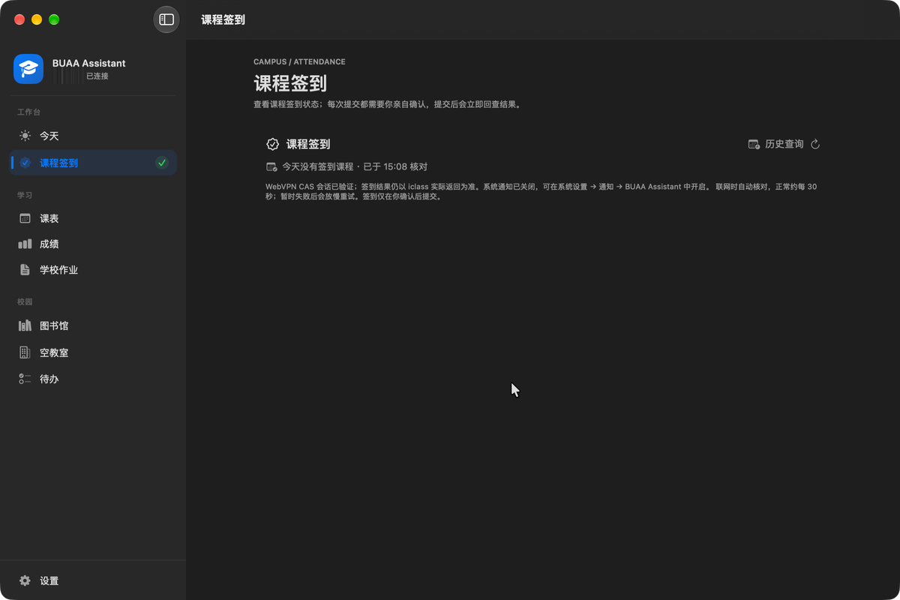
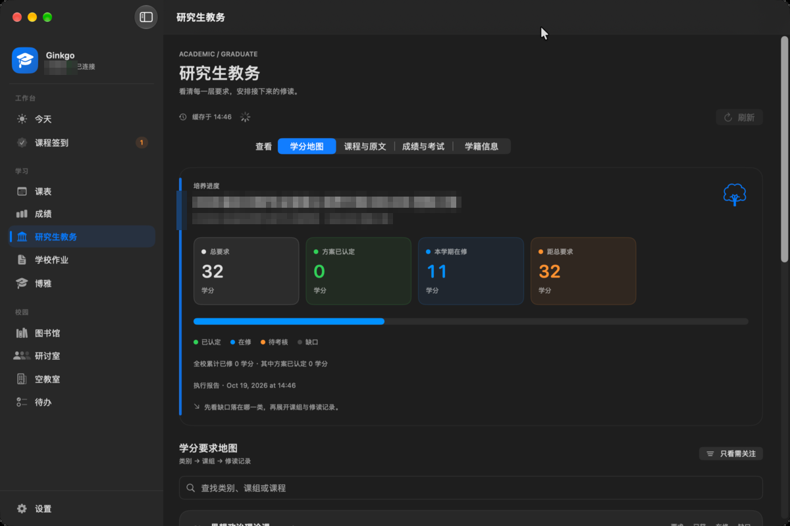
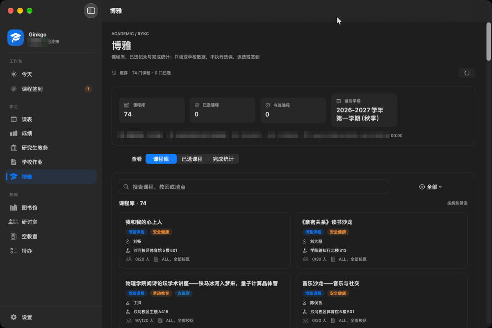
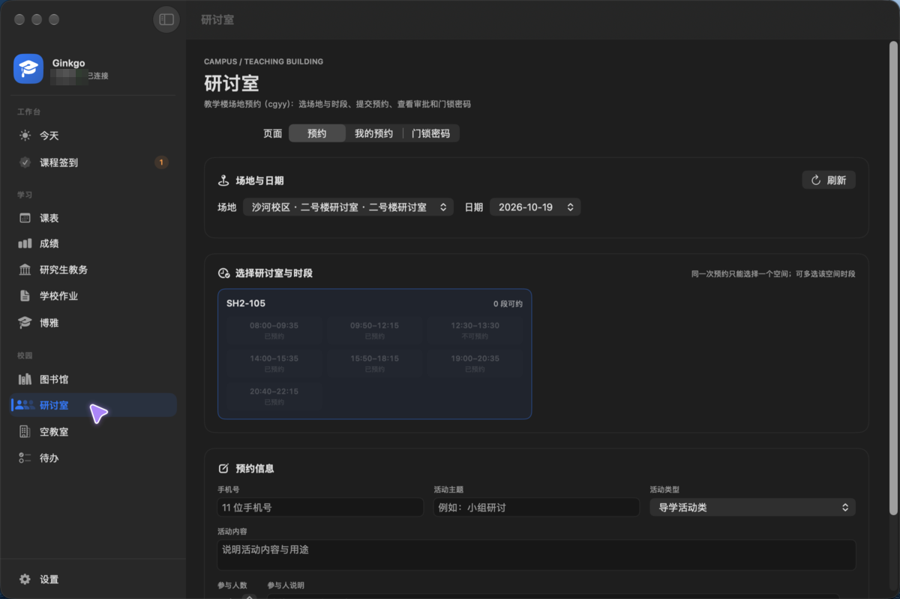

# Ginkgo · 北航校园工作台

北航校园服务聚合的原生客户端（Swift/SwiftUI）。macOS 版提供侧栏工作台与菜单栏常驻；iOS 子项目提供 iPhone/iPad 自适应工作台。个人项目，不经过自建中转服务器；可选直连或北航 WebVPN 网关。

> **为什么叫 Ginkgo**：银杏是北航最有辨识度的符号——学院路与沙河的银杏大道。它简短、好念、一眼能画成图标；也希望这个工作台像秋天那条路一样，成为你每天都会经过的地方。

## 快速开始

1. 用 Xcode 16+（工程为文件系统同步格式；本机已用 Xcode 27.1 验证可编译、测试全绿）打开 `BUAA-Assistant.xcodeproj`；
2. ⌘R 运行，⌘U 跑测试（最近运行结果与验证范围见 [docs/TESTING.md](docs/TESTING.md)）；
3. 按顺序阅读 [docs/ROADMAP.md](docs/ROADMAP.md) 开始开发——它回答"先写什么、后写什么、每步怎么验收"；
4. iOS 版打开 `BUAA-Assistant-iOS/Ginkgo-iOS.xcodeproj`（iOS 17+）；工程由 [XcodeGen](https://github.com/yonaskolb/XcodeGen) 根据 `project.yml` 生成，详见 [iOS 子项目说明](docs/IOS.md)。

> 命令行构建（`CODE_SIGNING_ALLOWED=NO`）的产物资源未封签，Dock 会显示白色占位图标；本地运行请用 Xcode ⌘R，或构建后先执行 `codesign --force --sign - <App>` 再启动。

> 首次运行或更新后，macOS 可能询问一次钥匙串访问权限：选择“**始终允许**”即可。发布包与本地构建都使用同一张稳定自签名证书（`Ginkgo Local Signing`），授权一次后后续构建/更新不再询问；即使弹窗未处理，应用也会在 5 秒后回到登录页并提示。详见 [docs/SIGNING.md](docs/SIGNING.md)。

## 当前版本：0.1.0-alpha.7（2026-10-19）

本版完成一次工程瘦身：抽取共享存储、时间、解析、加密与刷新节流基础设施，macOS 与 iOS 共用工作区编排；删除未挂载的图书馆研讨间代码。功能面覆盖课表与考试、成绩、研究生教务（学分地图）、博雅、学校作业、图书馆座位、教学楼研讨室（CGYY）、空教室、iclass 签到、待办与校园通知。自动化验证见 [docs/TESTING.md](docs/TESTING.md)；内置更新会从 GitHub Releases 检查新版本，下载安装后**保留课表、成绩缓存与本机待办**。已知限制与风险见 [docs/RELEASE-NOTES.md](docs/RELEASE-NOTES.md)。

项目主页（GitHub Pages）：<https://juanwang-buaa.github.io/ginkgo/>

> 验证范围：macOS 与 iOS 模拟器单元测试结果按日期记入 TESTING；正式签名包的真实账号全链路与 CGYY 写入仍待人工验收。

## iOS 子项目

仓库新增 `BUAA-Assistant-iOS/`，复用 macOS 主项目的 CAS、客户端、模型、缓存和 ViewModel，并使用独立的原生 iOS 界面层：

| 能力 | iPhone | iPad |
|------|--------|------|
| 主导航 | 原生底部 TabView：今天 / 课表 / 作业 / 图书馆 / 更多 | 原生 `NavigationSplitView` + 侧栏 |
| 页面结构 | `List` / `Form` / `Section` / `NavigationStack` | 同左，详情区自适应 |
| 登录 | 原生 Form、系统键盘与密码自动填充提示 | 同左 |
| 交互 | `.searchable`、`.refreshable`、toolbar Menu、swipeActions、confirmationDialog | 同左 |
| 网络路线 | 自动 / 直连 / WebVPN，登录页与设置均可切换 | 同左 |
| 校园服务 | 共享 CAS、网络、缓存与 ViewModel | 共享 |

当前状态：已在标准 **iOS 27.0 Runtime** 的 iPhone 17 Pro、iPhone SE (3rd generation) 和 iPad Pro 11 上运行原生 UI 冒烟测试；iPhone/iPad UI 测试通过。单元测试与 UI 冒烟的日期和范围见 [测试记录](docs/TESTING.md)；真实账号 UI 测试在未注入凭据时按设计跳过。产物已包含 AppIcon、LaunchBackground、PrivacyInfo，Application Support 被排除出系统备份。

真实账号会话测试于 2026-10-18 在 iPhone 17 Pro 模拟器通过：直连 UC 被学校访问策略以 HTTP 483 拦截后，客户端自动切换到北航 WebVPN（`d.buaa.edu.cn`），重新完成 CAS 登录，并以 `uc/status` 的 `code == 0 + data` 确认会话有效。iOS 提供博雅课程库（74 门课程、已选与完成统计）与研究生教务（学籍摘要、10 章培养方案、59 门计划课程、学分地图）两个原生只读页面，以及教学楼研讨室（CGYY）预约、订单与门锁密码页面；图书馆仅提供座位预约（研讨间只读代码已删除）。真实账号 live UI 已进入博雅与研究生教务并读回数据；CGYY 与座位写操作仍待真实往返验收，希冀课程列表结构仍需适配。

```sh
xcodebuild test \
  -project BUAA-Assistant-iOS/Ginkgo-iOS.xcodeproj \
  -scheme Ginkgo-iOS \
  -destination 'platform=iOS Simulator,name=iPhone 17 Pro,OS=27.0'
```

平台边界、复用矩阵、真机验收清单见 [docs/IOS.md](docs/IOS.md)；项目改进优先级见 [docs/IMPROVEMENTS.md](docs/IMPROVEMENTS.md)。

## Android / Windows 镜像

Android / Windows 使用 Rust + Flutter，Apple 继续 SwiftUI。Android 与 Windows Alpha.4 均已发布；课表、成绩、SPOC、图书馆、签到、博雅、研究生教务等主要只读链路已接入，也有真实账号只读记录。Alpha.4 增加手机端设置、返回手势保护、课程范围与助教作业分类、iClass 首次加载进度反馈，以及带暂停续传和安装包校验的应用内更新。签到和图书馆写路径已有确认、单次提交与回查，但真实写入尚未验收；最近实网登录失败仍需复验。Windows 首个公开包为 Windows 10 / 11 x64 ZIP，在 Parallels Windows 11 完成 Release 构建、合成保险库、宽窄布局与桌面集成验证；包未签名，物理 x64、干净系统运行依赖和真实学校业务仍待验收。源码、公开版本与验收边界见 [镜像现状](docs/MIRROR-IMPLEMENTATION.md)、[Windows Alpha.4](docs/archive/mirror/MIRROR-WINDOWS-ALPHA4.md)、[模块对照](docs/MIRROR-PARITY.md) 和 [待办](docs/MIRROR-TODO.md)；架构边界见 [Rust + Flutter 计划](docs/RUST-FLUTTER-PORT.md)。

## 界面预览

> 截图来自开发机（macOS 深色模式，1200 × 800 pt 窗口），姓名、学号、课程、作业与培养方案信息均已打码；页面内容为当时状态。


| 今天 | 课表 |
|------|------|
|  |  |

| 学期总览 |
|----------|
|  |

| 学校作业 | 图书馆 |
|----------|--------|
|  |  |

| 空教室 | 课程签到 |
|--------|----------|
|  |  |

| 研究生教务 | 博雅 |
|------------|------|
|  |  |

| 教学楼研讨室（CGYY） |
|----------------------|
|  |

| 成绩 | 设置 |
|------|------|
|  |  |

## 当前功能与验证范围（2026-10-19）

| 模块 | 已实现 | 验证范围与限制 |
|------|--------|----------------|
| 登录与会话 | CAS、验证码分支、钥匙串可选保存、启动会话验证、自动登录、登出提示 | 已观察真实账号登录与恢复；验证码触发和无障碍仍待人工验收 |
| 今天与课表 | 今日课程、星期 × 节次网格、课程详情、学期总览、缓存 | 已观察研究生课程返回；本科真机待验收；本科总览只覆盖已查询周次 |
| 成绩 | 学期选择、成绩列表、参考绩点和加权均分 | 已观察当前学期成功返回空列表；非空成绩与 GPA 尚未真实对照 |
| 研究生教务 | 学籍白名单摘要、培养方案章节与课程池、总要求 → 类别 → 课组 → 修读记录的学分地图、各层独立缺口、成绩、考试数量、可访问应用目录；macOS/iOS 原生页面 | 真实账号已读回 10 章方案、59 门计划课程、46 个应用；2026-10-19 读回执行报告 9 个类别及课组最低分（思想政治 3、基础理论 9、综合素养 5、培养环节 1 等），旧版窗口曾显示“还差 21”；本轮已更正为要求减已认定，待考核和在修不抵扣缺口 |
| 博雅 | 课程库、类别/搜索筛选、课程详情、已选课程、完成统计；macOS/iOS 原生页面 | 真实账号已读回 74 门课程；macOS 页面待真实窗口验收；选课/退选/签到不开放 |
| 图书馆 | 楼馆/分区/当前时段座位查询、进行中/历史预约、签到入座、临时离开、完全离开、取消预约、官网公开在馆人数与本机趋势 | 座位预约/取消已可用；暂离/完全离开写路径已接入但**未真实往返验收**，需人工确认且结果不明不自动重发 |
| 研讨室（教学楼 CGYY） | 校区/楼栋/日期/时段选择、活动类型与参与人、自动滑块识别、预约、我的预约、取消、门锁密码；macOS/iOS 原生页面 | 协议移植自 UBAA；**真实预约/取消/门锁密码往返未验收**；自动验证码识别按用户明确要求启用，需自行承担上游条款与风控风险。图书馆仅提供座位预约，历史 `v4/seminar` 提交已停用 |
| 空教室 | 校区与日期查询、楼栋概览/房间列表/节次对照、搜索与筛选排序、缓存 | 已按源码协议接入；真实查询已用无障碍树观察，视觉与完整交互待验收 |
| 待办 | 添加、截止时间、完成/恢复、确认删除、本机保存 | 按账号摘要隔离；未同步学校作业/签到 |
| 学校作业 | SPOC 只读列表与详情、账号缓存、今天页摘要、状态筛选 | 希冀来源暂时下线（真实课程列表结构未过验收，见 RELEASE-NOTES）；SPOC 真实账号待完整核对 |
| 课程签到 | iclass 只读状态、按日历史、逐课程人工确认的手动签到与回查 | 打卡签到已可用；按日历史已查到真实已签到记录，写入需逐项确认且不自动重发 |

学校作业当前只同步 SPOC 只读列表与详情；希冀来源因真实课程列表结构未完成验收已暂时下线（代码与测试保留，见 [RELEASE-NOTES](docs/RELEASE-NOTES.md)）。课程签到已接入只读状态、按日历史与逐课程确认的手动提交，写入尚未做真实往返验收。座位暂离/完全离开与教学楼研讨室预约已接入但尚未完成真实写操作验收；作业提交、一键签到、阳光打卡提交仍不在本版本范围。模块实现与真机验收分别跟踪，详见 [实施进度](docs/IMPLEMENTATION.md) 和 [验收记录](docs/ACCEPTANCE.md)。

## 文档地图

| 文档 | 用途 |
|------|------|
| [docs/ROADMAP.md](docs/ROADMAP.md) | **开发说明书（详细版）**：从零到成品——Xcode 入门、每步任务分解/验收动作/常见坑/给 AI 的提示词要点 |
| [docs/API.md](docs/API.md) | 上游协议（✅已验证/⚠️待验证分级，含修订对照表） |
| [docs/EDUCATION-DATA-MAP.md](docs/EDUCATION-DATA-MAP.md) | 博雅、教学楼研讨室（CGYY）、研究生教务、SPOC 的可读取数据与 API 地图 |
| [docs/ARCHITECTURE.md](docs/ARCHITECTURE.md) | 架构与技术决策 |
| [docs/IOS.md](docs/IOS.md) | iOS 子项目：平台边界、信息架构、构建、验证与真机验收清单 |
| [docs/IMPROVEMENTS.md](docs/IMPROVEMENTS.md) | 项目改进点分析与 P0/P1/P2 执行路线 |
| [docs/UI-DESIGN.md](docs/UI-DESIGN.md) | macOS 原生 UI 设计准则：信息架构、页面状态、通知、无障碍与验收 |
| [docs/TESTING.md](docs/TESTING.md) | 测试策略 |
| [docs/MIRROR-IMPLEMENTATION.md](docs/MIRROR-IMPLEMENTATION.md) | Rust + Flutter 现状、待办与功能对照入口 |
| [Opus 5.5 评审落实](docs/_audit/2026-10-21-opus-review-followup.md) | 原评审来源、本次核实、修复定位与验证边界 |
| [docs/COLLABORATION.md](docs/COLLABORATION.md) | 人 + AI 协作规则（分工/红线/审查清单/提示词模板） |
| [docs/BACKLOG.md](docs/BACKLOG.md) | 候选功能储备（A-D 级分级；接入前须先取证转正） |
| [docs/ACCEPTANCE.md](docs/ACCEPTANCE.md) | 验收记录（每 Step 验收后追加，规则见 ROADMAP 附录 A） |
| [docs/IMPLEMENTATION.md](docs/IMPLEMENTATION.md) | 当前模块的实现范围、测试结果与待验收项 |
| [docs/RELEASE-NOTES.md](docs/RELEASE-NOTES.md) | 版本发布说明：0.1.0-alpha 范围、验证证据与已知限制 |
| [docs/PROMOTION.md](docs/PROMOTION.md) | 宣传文案与关键词：仓库描述、topics、社区发帖模板 |
| [docs/PRIVACY.md](docs/PRIVACY.md) | 隐私与数据管理：本机数据位置、仓库红线、清理方式与反馈要求 |
| [docs/SIGNING.md](docs/SIGNING.md) | 代码签名与更新体验：本地稳定证书、CI 签名与将来公证路径 |
| [docs/LEARNING.md](docs/LEARNING.md) | 实施中用到的 Swift 概念速记 |
| [docs/DEEP-ARCHITECTURE-REVIEW.md](docs/DEEP-ARCHITECTURE-REVIEW.md) | UBAA 参考实现透视（只读参考） |

## 工程结构

```
BUAA-Assistant/
├── BUAA-Assistant.xcodeproj       # macOS Xcode 16+ 工程（objectVersion 70 文件系统同步）
├── BUAA-Assistant-iOS/            # iOS 17+ 子项目（XcodeGen project.yml + 自适应 SwiftUI 应用壳）
├── BUAA-Assistant.entitlements    # macOS App Sandbox + 网络客户端权限
├── BUAA-Assistant/                # macOS/iOS 共用的 Swift 源码（新增 .swift 文件自动纳入 macOS 编译）
│   ├── Features/                  # Auth / Today / Schedule / Grade / Library / Classroom / Homework / CheckIn / Campus / Tasks / Settings
│   └── Core/                      # Network / Storage / Logging / UI（共享提示、跨平台语义色与空态组件）
├── BUAA-AssistantTests/           # 共享 XCTest 与跨语言契约测试（iOS target 复用）
├── LICENSE                        # MIT License（含 UBAA 参考实现版权声明）
└── docs/                          # 全部文档与界面截图（单一事实源）
```

## 许可证与致敬

本项目以 [MIT License](LICENSE) 发布（版权标识为 Ginkgo contributors）。

**特别致敬 [UBAA（BUAASubnet/UBAA）](https://github.com/BUAASubnet/UBAA)**—同样以 MIT 许可发布的 Kotlin Multiplatform 校园客户端。感谢 UBAA 的作者与贡献者把北航各系统的直连协议、校园网边界情况和加密方案整理成可读、可验证的实现：本项目的 CAS 登录链路、研究生课表推算、图书馆预约加密、SPOC 作业分页与 iclass 签到写协议等，都是逐行对照 UBAA 源码与测试后完成的 Swift 复刻。没有这份开源工作，这个项目不会存在。也感谢它让“直连、不中转、隐私留在本机”的路线有了可信的先例。

派生部分的版权与许可声明见 [LICENSE](LICENSE) 末尾；协议对照与出处记录见 [docs/API.md](docs/API.md) 与 [docs/DEEP-ARCHITECTURE-REVIEW.md](docs/DEEP-ARCHITECTURE-REVIEW.md)。

## 隐私

- 应用不经过第三方服务器：账号密码只在你主动勾选后写入本机钥匙串，Cookie、会话与查询缓存均留在本机。
- 仓库不提交真实学号、姓名、Cookie、票据、HAR 原件或个人数据；界面截图中的身份字段已打码。
- 数据存放位置、清理方式与反馈时的脱敏要求见 [docs/PRIVACY.md](docs/PRIVACY.md)。

## 持续集成与发布

- [`.github/workflows/ci.yml`](.github/workflows/ci.yml)：push/PR 到 `main` 时在 macOS runner 上执行构建、全量测试与测试结果归档。
- [`.github/workflows/ios.yml`](.github/workflows/ios.yml)：XcodeGen 生成 iOS 工程、generic device build，并在可用 iPhone Simulator 上执行全量测试与结果归档（待首次远端跑通）。
- [`.github/workflows/release.yml`](.github/workflows/release.yml)：推送 `v*` tag 时构建 Release、ad-hoc 签名、打包 zip 并创建草稿 Release（未配置 Developer ID 与公证，仅源码自用级别）。
