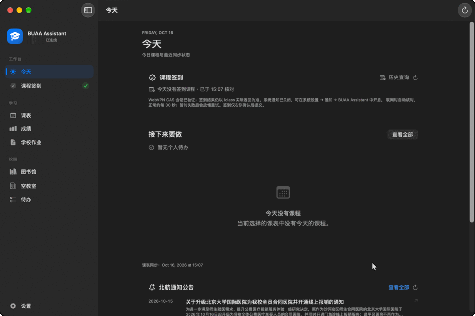
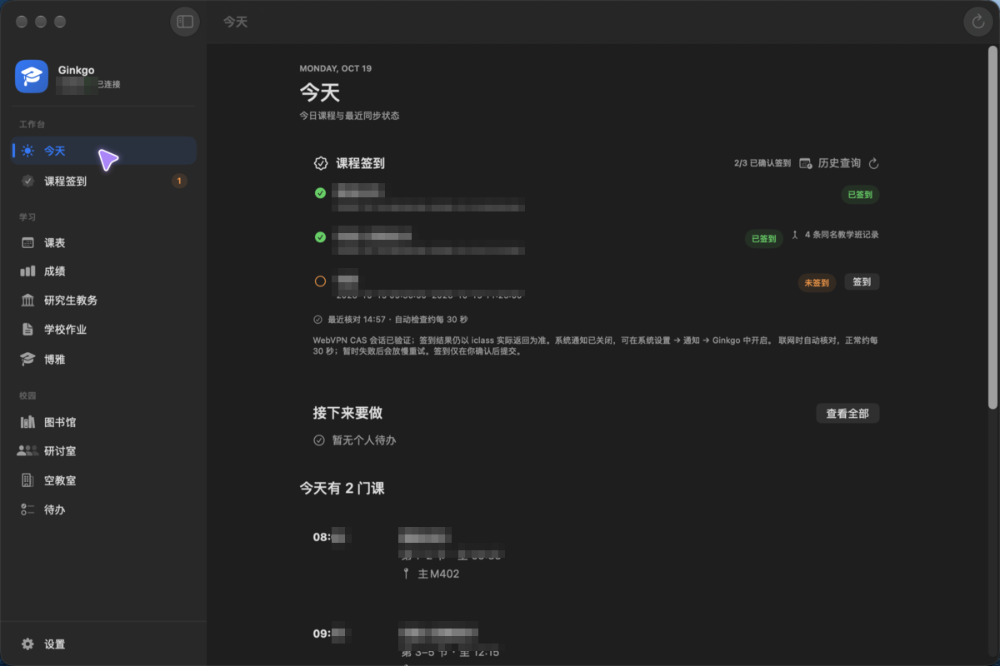
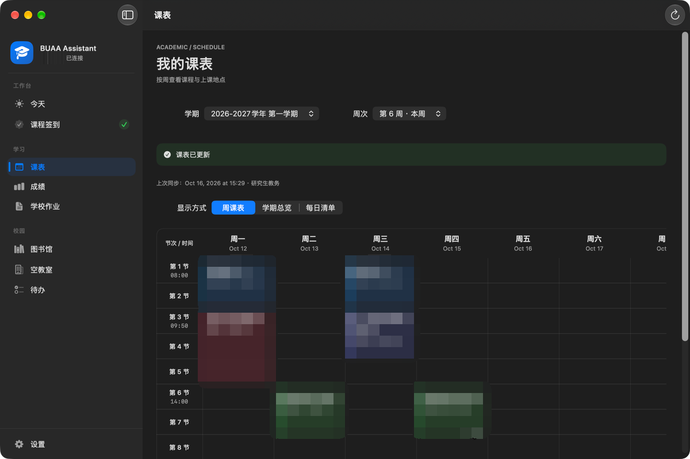
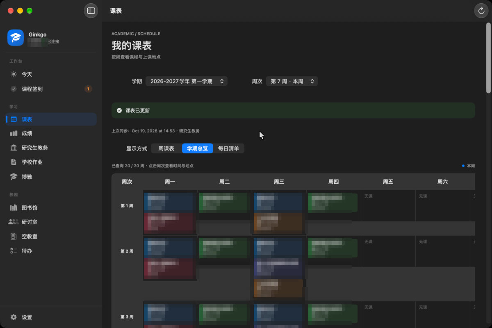
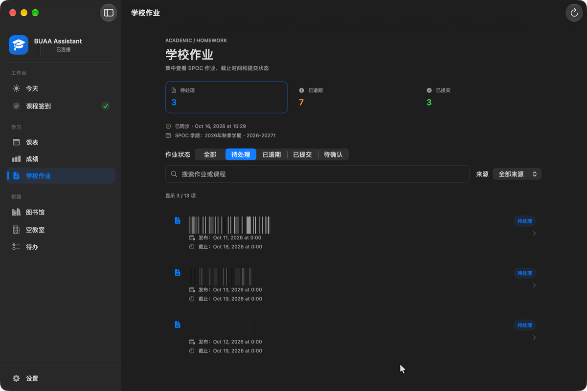
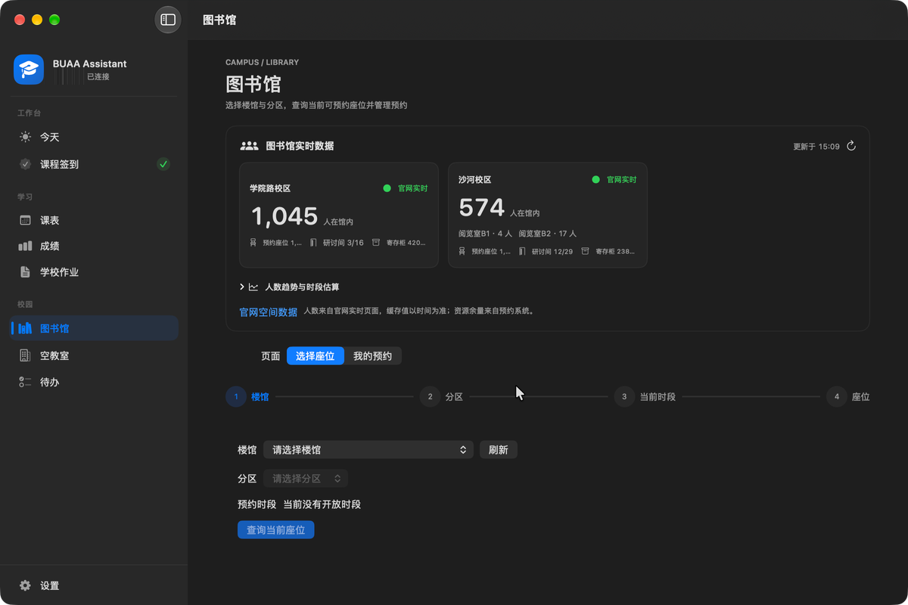
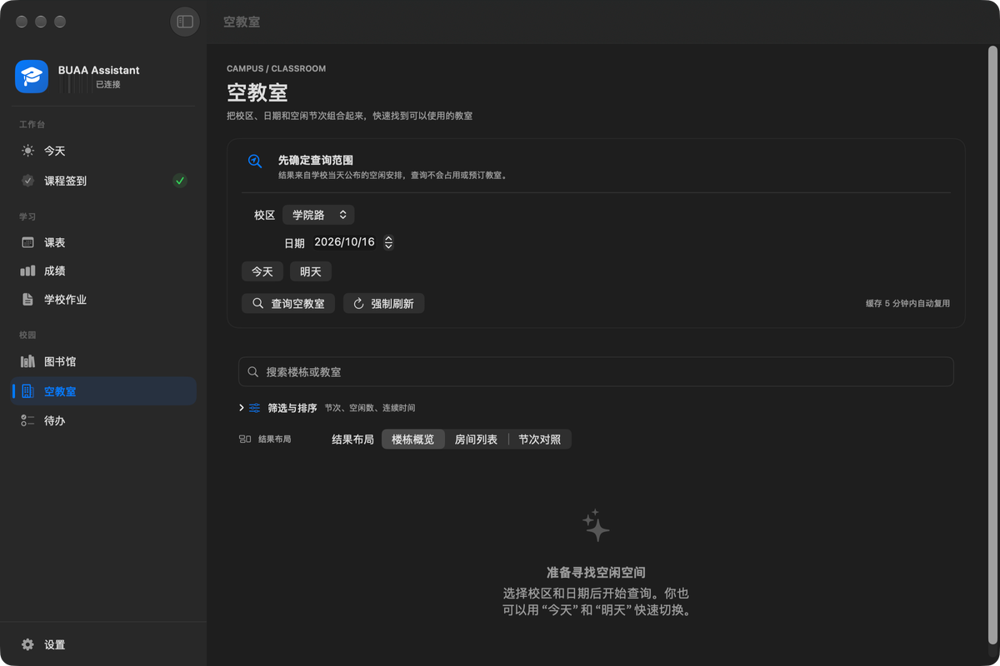
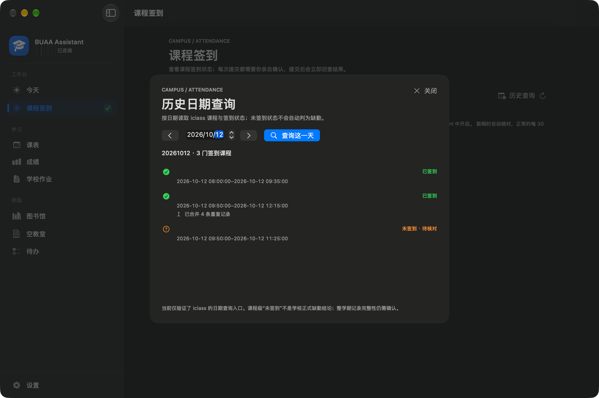
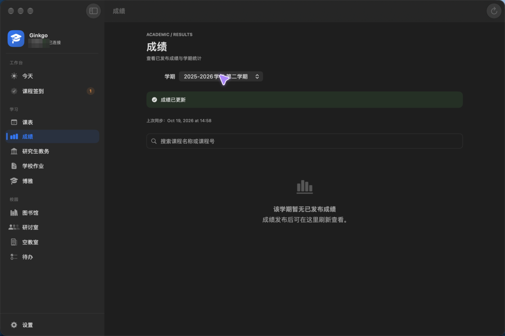
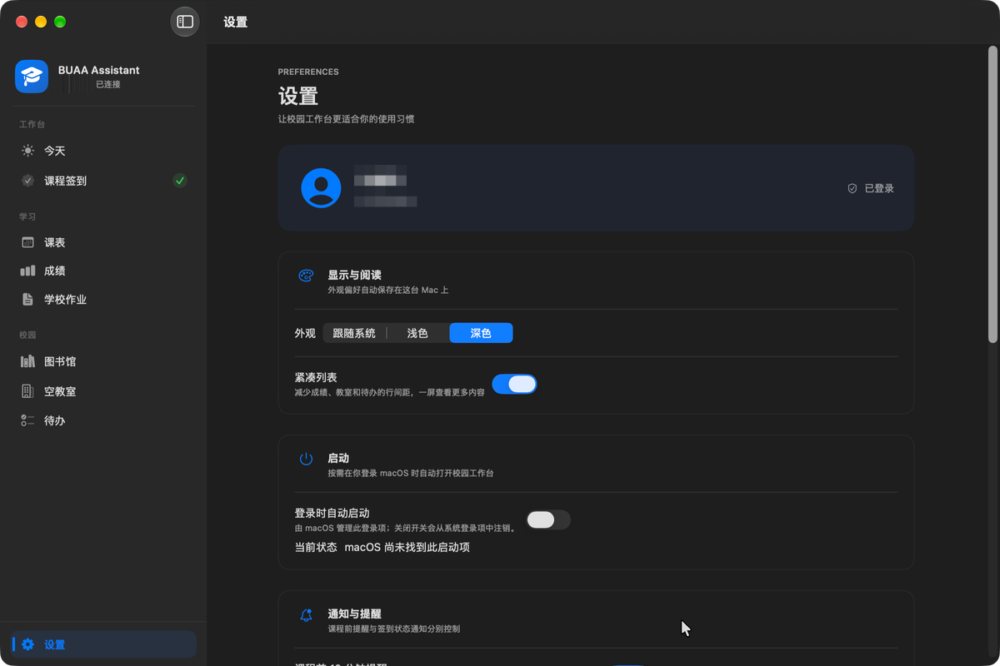

# Ginkgo · 北航校园工作台

北航校园服务聚合的 macOS 原生客户端（Swift/SwiftUI，菜单栏常驻），即此前的 BUAA Assistant。个人项目，仅直连校内系统。

> **为什么叫 Ginkgo**：银杏是北航最有辨识度的符号——学院路与沙河的银杏大道。它简短、好念、一眼能画成图标；也希望这个工作台像秋天那条路一样，成为你每天都会经过的地方。

## 快速开始

1. 用 Xcode 16+（工程为文件系统同步格式；本机已用 27.0 验证可编译、测试全绿）打开 `BUAA-Assistant.xcodeproj`；
2. ⌘R 运行，⌘U 跑测试（源码现有 141 个测试方法；0.1.0-alpha 全量通过）；
3. 按顺序阅读 [docs/ROADMAP.md](docs/ROADMAP.md) 开始开发——它回答"先写什么、后写什么、每步怎么验收"。

> 命令行构建（`CODE_SIGNING_ALLOWED=NO`）的产物资源未封签，Dock 会显示白色占位图标；本地运行请用 Xcode ⌘R，或构建后先执行 `codesign --force --sign - <App>` 再启动。

> 首次运行或更新后，macOS 可能询问一次钥匙串访问权限（ad-hoc 签名每次构建的指纹不同）：选择“**始终允许**”即可继续自动登录；弹窗未处理时应用也会在 5 秒后回到登录页并提示。

## 当前版本：0.1.0-alpha（2026-10-16）

首个 alpha 基线：141 项测试全绿（见 [docs/TESTING.md](docs/TESTING.md)）。课表、打卡签到与图书馆预约均已可用；内置更新会从 GitHub Releases 检查新版本，下载安装后**保留课表、成绩缓存与本机待办**。本版还修好了研究生周次误标、希冀作业的 ATS 阻断、图书馆聚焦刷新与总览配色；希冀来源按取舍暂时下线，已知限制与风险见 [docs/RELEASE-NOTES.md](docs/RELEASE-NOTES.md)。

项目主页（GitHub Pages）：<https://juanwang-buaa.github.io/ginkgo/>

## 界面预览

> 截图来自开发机（macOS 深色模式，1200 × 800 pt 窗口），姓名与学号已打码；课程、作业等内容为当时状态。



| 今天 | 课表 |
|------|------|
|  |  |

| 学期总览 |
|----------|
|  |

| 学校作业 | 图书馆 |
|----------|--------|
|  |  |

| 空教室 | 课程签到（历史查询） |
|--------|----------|
|  |  |

| 成绩 | 设置 |
|------|------|
|  |  |

## 当前功能与验证范围（2026-10-16）

| 模块 | 已实现 | 验证范围与限制 |
|------|--------|----------------|
| 登录与会话 | CAS、验证码分支、钥匙串可选保存、启动会话验证、自动登录、登出提示 | 已观察真实账号登录与恢复；验证码触发和无障碍仍待人工验收 |
| 今天与课表 | 今日课程、星期 × 节次网格、课程详情、学期总览、缓存 | 已观察研究生课程返回；本科真机待验收；本科总览只覆盖已查询周次 |
| 成绩 | 学期选择、成绩列表、参考绩点和加权均分 | 已观察当前学期成功返回空列表；非空成绩与 GPA 尚未真实对照 |
| 图书馆 | 楼馆/分区/当前时段座位查询、预约记录、确认预约/取消、官网公开在馆人数与本机趋势 | 预约/取消已可用（需人工确认，结果不明不自动重发）；研讨室专用分类未完成 |
| 空教室 | 校区与日期查询、楼栋概览/房间列表/节次对照、搜索与筛选排序、缓存 | 已按源码协议接入；真实查询已用无障碍树观察，视觉与完整交互待验收 |
| 待办 | 添加、截止时间、完成/恢复、确认删除、本机保存 | 按账号摘要隔离；未同步学校作业/签到 |
| 学校作业 | SPOC 只读列表与详情、账号缓存、今天页摘要、状态筛选 | 希冀来源暂时下线（真实课程列表结构未过验收，见 RELEASE-NOTES）；SPOC 真实账号待完整核对 |
| 课程签到 | iclass 只读状态、按日历史、逐课程人工确认的手动签到与回查 | 打卡签到已可用；按日历史已查到真实已签到记录，写入需逐项确认且不自动重发 |

学校作业当前只同步 SPOC 只读列表与详情；希冀来源因真实课程列表结构未完成验收已暂时下线（代码与测试保留，见 [RELEASE-NOTES](docs/RELEASE-NOTES.md)）。课程签到已接入只读状态、按日历史与逐课程确认的手动提交，写入尚未做真实往返验收。作业提交、一键签到、阳光打卡提交和研讨室专用预约仍不在本版本范围；模块实现与真机验收分别跟踪，详见 [实施进度](docs/IMPLEMENTATION.md) 和 [验收记录](docs/ACCEPTANCE.md)。

## 文档地图

| 文档 | 用途 |
|------|------|
| [docs/ROADMAP.md](docs/ROADMAP.md) | **开发说明书（详细版）**：从零到成品——Xcode 入门、每步任务分解/验收动作/常见坑/给 AI 的提示词要点 |
| [docs/API.md](docs/API.md) | 上游协议（✅已验证/⚠️待验证分级，含修订对照表） |
| [docs/ARCHITECTURE.md](docs/ARCHITECTURE.md) | 架构与技术决策 |
| [docs/UI-DESIGN.md](docs/UI-DESIGN.md) | macOS 原生 UI 设计准则：信息架构、页面状态、通知、无障碍与验收 |
| [docs/TESTING.md](docs/TESTING.md) | 测试策略 |
| [docs/COLLABORATION.md](docs/COLLABORATION.md) | 人 + AI 协作规则（分工/红线/审查清单/提示词模板） |
| [docs/BACKLOG.md](docs/BACKLOG.md) | 候选功能储备（A-D 级分级；接入前须先取证转正） |
| [docs/ACCEPTANCE.md](docs/ACCEPTANCE.md) | 验收记录（每 Step 验收后追加，规则见 ROADMAP 附录 A） |
| [docs/IMPLEMENTATION.md](docs/IMPLEMENTATION.md) | 当前模块的实现范围、测试结果与待验收项 |
| [docs/RELEASE-NOTES.md](docs/RELEASE-NOTES.md) | 版本发布说明：0.1.0-alpha 范围、验证证据与已知限制 |
| [docs/PROMOTION.md](docs/PROMOTION.md) | 宣传文案与关键词：仓库描述、topics、社区发帖模板 |
| [docs/PRIVACY.md](docs/PRIVACY.md) | 隐私与数据管理：本机数据位置、仓库红线、清理方式与反馈要求 |
| [docs/LEARNING.md](docs/LEARNING.md) | 实施中用到的 Swift 概念速记 |
| [docs/DEEP-ARCHITECTURE-REVIEW.md](docs/DEEP-ARCHITECTURE-REVIEW.md) | UBAA 参考实现透视（只读参考） |

## 工程结构

```
BUAA-Assistant/
├── BUAA-Assistant.xcodeproj       # Xcode 16+ 工程（objectVersion 70 文件系统同步；本机以 27.0 打开验证；AI 不手改此目录）
├── BUAA-Assistant.entitlements    # App Sandbox + 网络客户端权限
├── BUAA-Assistant/                # 应用源码（新增 .swift 文件自动纳入编译）
│   ├── Features/                  # Auth / Today / Schedule / Grade / Library / Classroom / Homework / CheckIn / Campus / Tasks / Settings
│   └── Core/                      # Network / Storage / Logging / UI（共享提示与空态组件）
├── BUAA-AssistantTests/           # 单元测试（源码现有 141 个测试方法）
├── LICENSE                        # MIT License（含 UBAA 参考实现版权声明）
└── docs/                          # 全部文档与界面截图（单一事实源）
```

## 许可证与致敬

本项目以 [MIT License](LICENSE) 发布（版权标识为 Ginkgo contributors）。

**特别致敬 [UBAA（BUAASubnet/UBAA）](https://github.com/BUAASubnet/UBAA)**—同样以 MIT 许可发布的 Kotlin Multiplatform 校园客户端。感谢 UBAA 的作者与贡献者把北航各系统的直连协议、校园网边界情况和加密方案整理成可读、可验证的实现：本项目的 CAS 登录链路、研究生课表推算、图书馆预约加密、SPOC 作业分页与 iclass 签到写协议等，都是逐行对照 UBAA 源码与测试后完成的 Swift 复刻。没有这份开源工作，这个项目不会存在。也感谢它让“直连、不中转、隐私留在本机”的路线有了可信的先例。

派生部分的版权与许可声明见 [LICENSE](LICENSE) 末尾；协议对照与出处记录见 [docs/API.md](docs/API.md) 与 [docs/DEEP-ARCHITECTURE-REVIEW.md](docs/DEEP-ARCHITECTURE-REVIEW.md)。

## 隐私

- 应用不经过第三方服务器：账号密码只在你主动勾选后写入本机钥匙串，Cookie、会话与查询缓存均留在本机。
- 仓库不提交真实学号、姓名、Cookie、票据、HAR 原件或个人数据；界面截图中的身份字段已打码。
- 数据存放位置、清理方式与反馈时的脱敏要求见 [docs/PRIVACY.md](docs/PRIVACY.md)。

## 持续集成与发布

- [`.github/workflows/ci.yml`](.github/workflows/ci.yml)：push/PR 到 `main` 时在 macOS runner 上执行构建、全量测试与测试结果归档。
- [`.github/workflows/release.yml`](.github/workflows/release.yml)：推送 `v*` tag 时构建 Release、ad-hoc 签名、打包 zip 并创建草稿 Release（未配置 Developer ID 与公证，仅源码自用级别）。
