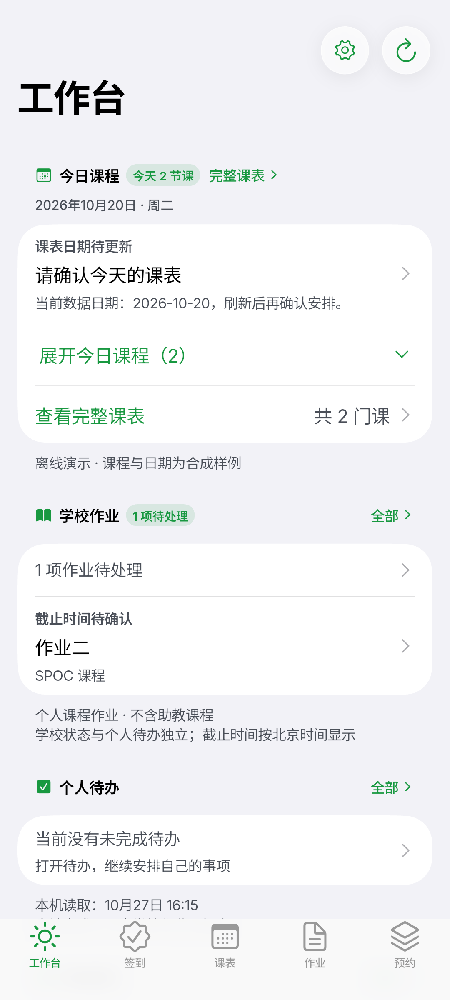
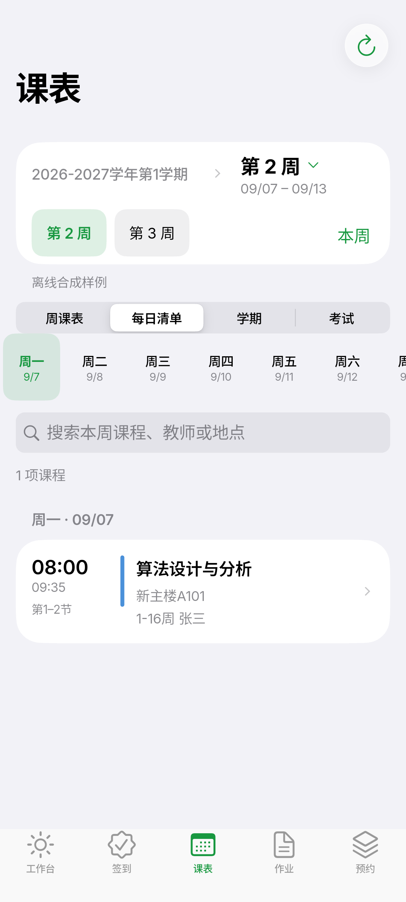
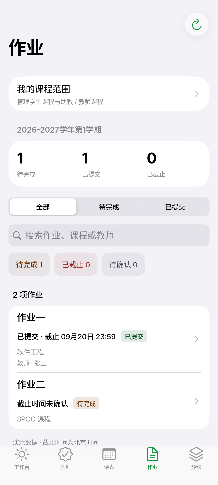
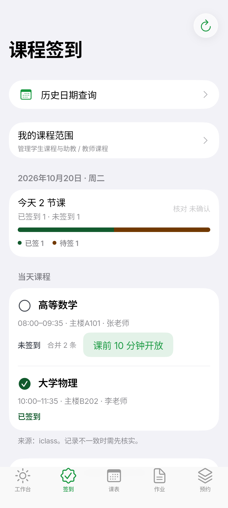
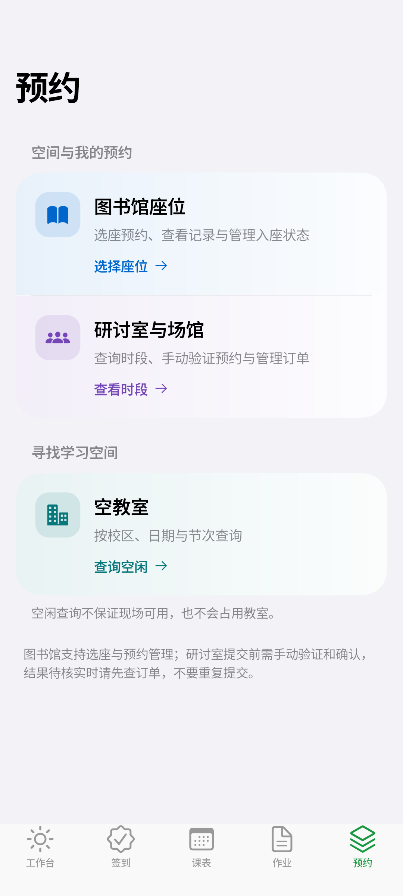
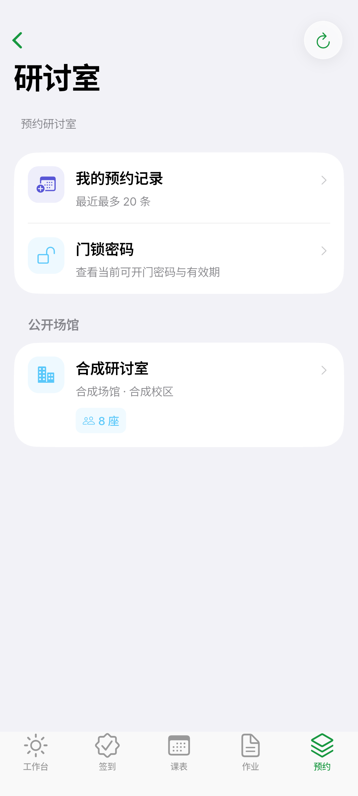

# Ginkgo · 北航校园工作台

> **手机上的北航校园工作台**：今天的课、待交的作业、能签到的课、能坐的图书馆座位。
> Flutter + Rust，学校请求在进程内直连学校系统或北航 WebVPN，不经过项目自建中转服务器；个人待办按账号保存在本机。

[](https://github.com/JUANWANG-BUAA/ginkgo/releases/tag/android-v0.1.0-beta.1)
[](https://juanwang-buaa.github.io/ginkgo/)
[](LICENSE)

**Android 是本项目当前唯一的主推平台**：Flutter + Rust 同一套工程，手机底部标签导航、平板与宽屏自动展开为侧栏。Windows 与它共用这份工程，只保证可编译；macOS / iOS 的原生应用已冻结，保留源码与归档文档。

- 最新公开版本：**Android 0.1.0-beta.1**（`0.1.0-beta.1+11`）· [下载 ARM64 APK](https://github.com/JUANWANG-BUAA/ginkgo/releases/download/android-v0.1.0-beta.1/Ginkgo-0.1.0-beta.1-android-arm64.apk) · [发布与验收记录](docs/_audit/2026-10-27-android-beta1-preparation.md)
- 当前源码版本：`0.1.0-beta.1+11`（GitHub Beta prerelease 已公开）
- Beta 试用反馈：[提交 Android 问题](https://github.com/JUANWANG-BUAA/ginkgo/issues/new?template=android-beta.md)（请勿附密码、Cookie、真实学号或未打码截图）
- 长期维护入口：[功能与接口协议总览](docs/FEATURES-AND-PROTOCOLS.md) · [接口索引](docs/INTERFACE-INDEX.md) · [学校协议事实](docs/API.md)

> **为什么叫 Ginkgo**：银杏是北航最有辨识度的符号——学院路与沙河的银杏大道。它简短、好念、一眼能画成图标；也希望这个工作台像秋天那条路一样，成为你每天都会经过的地方。

## 界面预览

> 以下全部为 **Android 真机尺寸的离线演示截图**（1080 × 2400），内容为合成样例，不含任何真实账号、学校数据或个人课程。

| 工作台 | 课表 | 作业 |
|--------|------|------|
|  |  |  |

| 课程签到 | 预约与空间 | 研讨室 |
|----------|------------|--------|
|  |  |  |

演示录屏（真实 Android 构建，冷启动 + 离线演示模式）：

| 冷启动 | 离线演示 |
|--------|----------|
| <video src="docs/media/ginkgo-cold-start.mp4" poster="docs/images/android-today.png" width="260" controls muted loop playsinline></video> | <video src="docs/media/ginkgo-android-demo.mp4" poster="docs/images/android-today.png" width="260" controls muted loop playsinline></video> |

冷启动录屏展示银杏叶展开的品牌动画；离线演示依次切换工作台、课表、作业、签到与预约。两段内容全部为合成样例，不含任何真实账号、学校数据或个人课程。

> 截图与录屏由 `flutter/integration_test/promo_capture_test.dart` 在隔离模拟器上生成，只使用离线演示数据；复现步骤见 [scripts/check-android-module-visual.sh](scripts/check-android-module-visual.sh)。

## Android 能做什么

| 能力 | 入口 | 读写边界 |
| --- | --- | --- |
| 登录与会话 | 启动页 / 设置 | 统一身份认证 + 验证码挑战；可选记住密码（Android Keystore） |
| 今天 | 工作台 | 读取当天课程、签到状态、作业摘要与个人待办 |
| 课表与考试 | 课表标签 | 周课表 / 每日清单 / 学期与周次 / 课程搜索 / 考试 |
| 作业 | 作业标签 | SPOC 列表与详情只读；个人文件提交需逐次确认，结果不明只回查 |
| 签到 | 签到标签 | 读取当天与历史状态；签到需逐课确认后单次提交 |
| 图书馆 | 预约 → 图书馆座位 | 馆 → 区 → 时段 → 座位；选座与入座状态需逐次确认 |
| 研讨室 | 预约 → 研讨室与场馆 | 时段查询、我的预约、门锁密码；预约需手动验证码并确认 |
| 空教室 | 预约 → 空教室 | 校区、日期、节次与楼栋查询 |
| 博雅 | 工作台 → 博雅 | 课程目录、已选与完成统计（只读） |
| 研究生教务 | 工作台 → 研究生教务 | 学籍、执行报告与学分地图（只读） |
| SPOC 学习 | 工作台 → SPOC 学习 | 课程、公告、资料与测验只读 |
| 公开查书 | 图书馆 → 查书目与馆藏 | 公开目录检索与馆藏（匿名只读） |
| 本人借阅 | 服务目录 → 本人借阅 | 独立只读入口，不复用选座会话，不落盘 |
| 校车时刻表 | 服务目录 → 校车时刻表 | 官方公开时刻表（不含实时余票与购票） |
| 校园通知 | 工作台 → 校园通知 | 新闻网列表（只读） |
| 个人待办 | 工作台 / 服务目录 | 纯本机数据，按账号隔离；不等同于学校作业提交 |

完整的读写边界、失败态与本机数据说明见 [功能与接口协议总览](docs/FEATURES-AND-PROTOCOLS.md)。

## 快速开始（开发）

```sh
# 1. 依赖与基线
bash scripts/check-mirror.sh        # 架构门禁 + Rust 格式/Clippy/测试 + Flutter 分析/测试 + FRB 再生成一致性

# 2. 运行（需要 Flutter 3.47.0、Rust 1.99.0、Android SDK 36 / NDK 28.2）
cd flutter
flutter pub get
flutter devices
flutter run -d emulator-5554

# 3. 构建正常入口 APK
flutter build apk --debug --target-platform android-arm64 --target lib/main.dart
```

工具链、签名、FRB 生成与 Windows 编译说明见 [flutter/README.md](flutter/README.md) 与 [Android 开发设定](docs/ANDROID-DEVELOPMENT.md)。

## 平台现状

| 平台 | 状态 | 说明 |
| --- | --- | --- |
| **Android** | **主推 · 持续开发** | 公开版本 0.1.0-beta.1（build 11，GitHub prerelease）。真实学校写入、物理设备与读屏验收仍在进行 |
| Windows | 共用工程 · 不再排期 | 与 Android 共用同一 Flutter 工程，只保证可编译；公开版本 0.1.0-alpha.6（安装器未签名） |
| macOS | 已冻结 | 独立 Swift/SwiftUI 应用，功能面最完整；保留源码与归档文档，见 [平台对照](docs/MIRROR-PARITY.md) |
| iOS | 已冻结 | 独立原生壳，复用 macOS 校园服务；保留源码与构建说明，见 [docs/IOS.md](docs/IOS.md) |

范围决策与冻结原因见 [多平台路线](docs/MULTI-PLATFORM-STRATEGY.md)；未完成事项只维护在 [MIRROR-TODO](docs/MIRROR-TODO.md)。

## 文档地图

**先读这两份**：想理解代码怎么组织、接口怎么定义、数据怎么流动，从这里开始。

| 文档 | 用途 |
|------|------|
| [docs/ARCHITECTURE-TOPOLOGY.md](docs/ARCHITECTURE-TOPOLOGY.md) | **架构拓扑与数据流（图）**：五层拓扑、读写时序、写入状态机、依赖图与循环检测、数据 IO 契约图、会话与缓存位置 |
| [docs/INTERFACE-INDEX.md](docs/INTERFACE-INDEX.md) | **接口索引（总览）**：接口设计模式、能力总表、四条完整链路、模块 IO 契约、跨层不变量。逐层全量清单在 [docs/interfaces/](docs/interfaces/README.md)（含[反向索引](docs/interfaces/REVERSE-INDEX.md)与[依赖图](docs/interfaces/DEPENDENCY-GRAPH.md)） |

**按任务查阅**：

| 文档 | 用途 |
|------|------|
| [docs/API.md](docs/API.md) | 上游协议（✅已验证/⚠️待验证分级，含修订对照表） |
| [docs/FEATURES-AND-PROTOCOLS.md](docs/FEATURES-AND-PROTOCOLS.md) | 功能入口、读写边界与本机数据 |
| [docs/MIRROR-ARCHITECTURE.md](docs/MIRROR-ARCHITECTURE.md) | Rust / Flutter 边界与隔离规则 |
| [docs/MIRROR-IMPLEMENTATION.md](docs/MIRROR-IMPLEMENTATION.md) | Android / Windows 实现现状与分层表 |
| [docs/ANDROID-DEVELOPMENT.md](docs/ANDROID-DEVELOPMENT.md) | Android 工具链、构建、签名与验收 |
| [docs/RELEASE-NOTES.md](docs/RELEASE-NOTES.md) | 版本发布说明与已知限制 |
| [docs/PROMOTION.md](docs/PROMOTION.md) | 宣传文案与关键词：仓库描述、topics、社区发帖模板 |
| [docs/PRIVACY.md](docs/PRIVACY.md) | 隐私与数据管理：本机数据位置、仓库红线、清理方式与反馈要求 |
| [docs/TESTING.md](docs/TESTING.md) | 测试策略与验收边界 |
| [docs/COLLABORATION.md](docs/COLLABORATION.md) | 人 + AI 协作规则（分工/红线/审查清单） |
| [docs/BACKLOG.md](docs/BACKLOG.md) | 候选功能储备（接入前须先取证转正） |
| [docs/IOS.md](docs/IOS.md) | 冻结平台说明：iOS 平台边界、构建与验收清单 |
| [docs/SIGNING.md](docs/SIGNING.md) | 代码签名与更新体验 |

## 隐私

- 学校请求不经过项目自建中转服务器：账号密码只在你主动勾选后写入系统保险库（Android Keystore / Windows Credential Manager / Apple 钥匙串），Cookie、会话与查询快照在本机处理；版本检查访问 GitHub，第三方下载代理需自行选择并核对摘要。
- 仓库不提交真实学号、姓名、Cookie、票据、HAR 原件或个人数据；界面截图与录屏全部来自离线演示模式。
- 数据存放位置、清理方式与反馈时的脱敏要求见 [docs/PRIVACY.md](docs/PRIVACY.md)。

## 持续集成与发布

- [`.github/workflows/mirror.yml`](.github/workflows/mirror.yml)：Rust 契约与门禁、FRB 生成差异、Flutter 分析与测试、Android ARM64 Debug 构建、Windows 路径检查与构建。
- [`.github/workflows/android-release.yml`](.github/workflows/android-release.yml)：`android-v*` tag 触发的签名 Release 构建与产物校验（发布与真实设备覆盖升级仍由维护者执行）。
- [`.github/workflows/ci.yml`](.github/workflows/ci.yml) 与 [`.github/workflows/ios.yml`](.github/workflows/ios.yml)：冻结平台的 Apple 构建与测试。

## 许可证与致敬

本项目以 [MIT License](LICENSE) 发布（版权标识为 Ginkgo contributors）。

**特别致敬 [UBAA（BUAASubnet/UBAA）](https://github.com/BUAASubnet/UBAA)**——同样以 MIT 许可发布的 Kotlin Multiplatform 校园客户端。感谢 UBAA 的作者与贡献者把北航各系统的直连协议、校园网边界情况和加密方案整理成可读、可验证的实现：本项目的 CAS 登录链路、研究生课表推算、图书馆预约加密、SPOC 作业分页与 iclass 签到写协议等，都是逐行对照 UBAA 源码与测试后完成的。没有这份开源工作，这个项目不会存在。也感谢它让“直连、不中转、隐私留在本机”的路线有了可信的先例。

派生部分的版权与许可声明见 [LICENSE](LICENSE) 末尾；协议对照与出处记录见 [docs/API.md](docs/API.md) 与 [docs/DEEP-ARCHITECTURE-REVIEW.md](docs/DEEP-ARCHITECTURE-REVIEW.md)。
