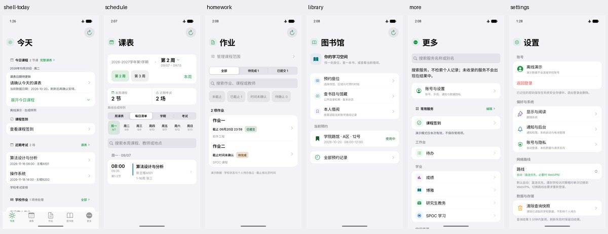
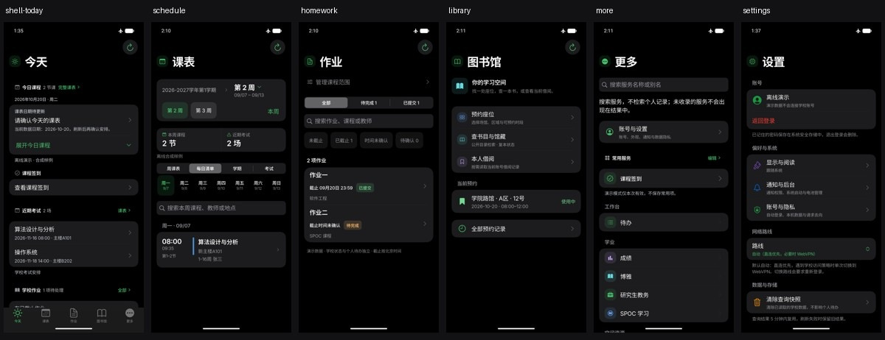
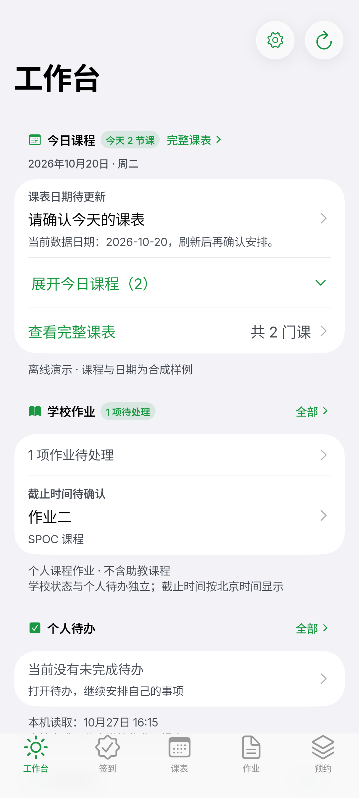
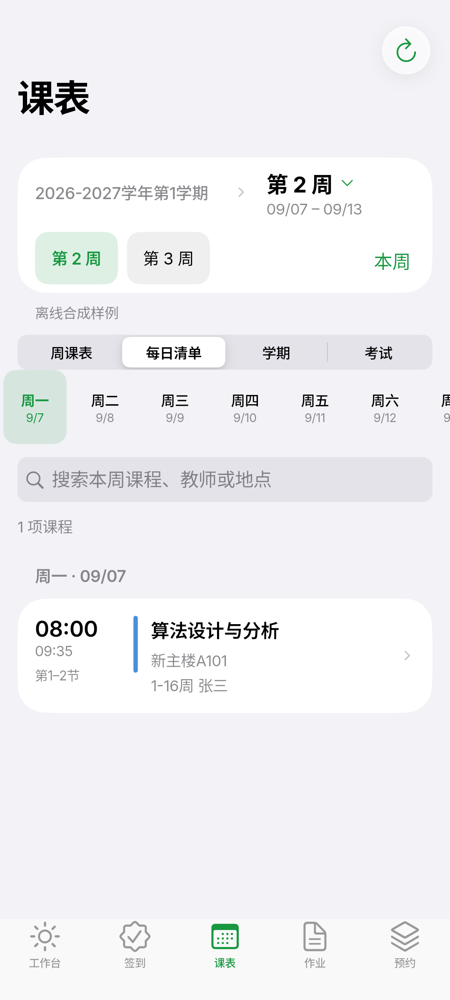
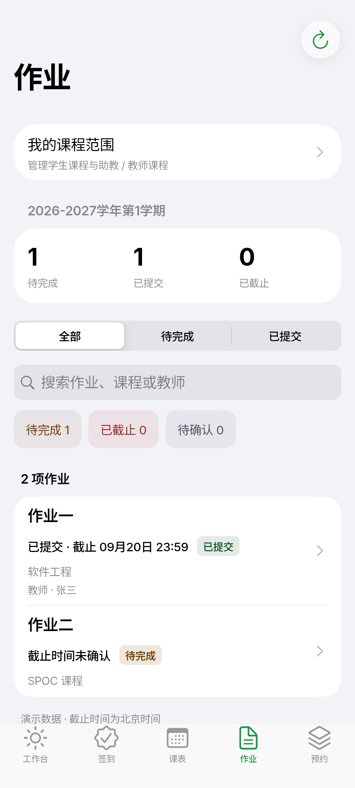
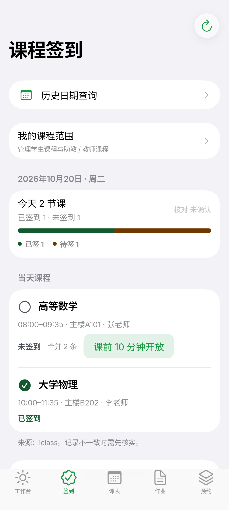
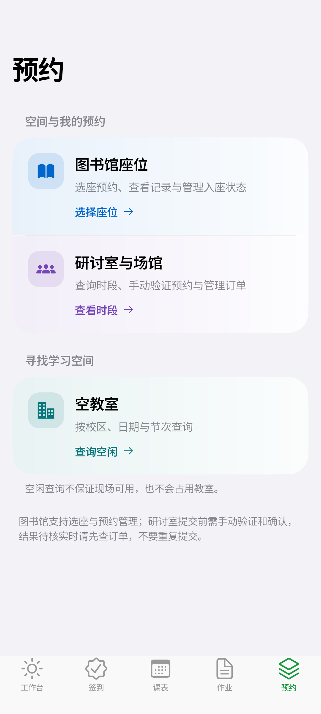
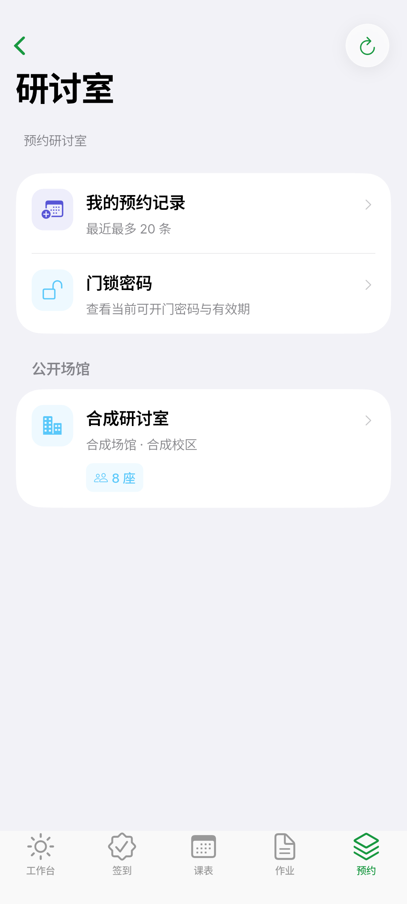

# Ginkgo · 北航校园工作台

> 课表、作业、签到码、图书馆座位、研讨室与校园账户查询，收进一个 Android 应用。
> Flutter + Rust 本地直连学校系统或北航官方 WebVPN，不经过自建中转服务器；余额与发放记录按需读取、默认遮挡、不落盘。

[](https://github.com/JUANWANG-BUAA/ginkgo/releases/tag/android-v0.1.0-beta.12)
[](https://juanwang-buaa.github.io/ginkgo/)
[](docs/ARCHITECTURE-TOPOLOGY.md)
[](LICENSE)

---

## 当前版本与平台范围

- **Android（唯一持续开发平台）**：基于 Flutter + Rust，手机端五栏底部导航，平板与宽屏切换侧栏。Windows 共用同一工程仅保编译；macOS / iOS 原生工程已归档冻结。
- **最新公开版本**：**Android 0.1.0-beta.12**（`0.1.0-beta.12+22`）· [下载 ARM64 APK](https://github.com/JUANWANG-BUAA/ginkgo/releases/download/android-v0.1.0-beta.12/Ginkgo-0.1.0-beta.12-android-arm64.apk) · [发布说明](docs/releases/android-beta12.md)
- **验收与冻结说明**：真机账号与写入验收进度见 [MIRROR-TODO](docs/MIRROR-TODO.md)；共享网络与认证链保持 [Beta.9 冻结基线](docs/NETWORK-FREEZE.md)。
- **问题反馈**：[提交 Android Beta 反馈](https://github.com/JUANWANG-BUAA/ginkgo/issues/new?template=android-beta.md)（请勿附密码、Cookie、真实学号或未打码截图）。

---

## 界面预览

浅色与深色主题概览（隔离 Android 模拟器离线演示合成数据）：




> 以下截图（1080 × 2400）与录屏均由 `flutter/integration_test/promo_capture_test.dart` 在隔离模拟器离线演示模式下生成，全部使用合成样例，不含任何真实账号或个人课程。

| 工作台 | 课表 | 学校作业 |
| :---: | :---: | :---: |
|  |  |  |

| 课程签到 | 空间预约 | 研讨室 |
| :---: | :---: | :---: |
|  |  |  |

| 冷启动品牌动画 | 20 秒离线交互演示 |
| :---: | :---: |
| <video src="docs/media/ginkgo-cold-start.mp4" poster="docs/images/android-today.png" width="260" controls muted loop playsinline></video> | <video src="docs/media/ginkgo-android-demo.mp4" poster="docs/images/android-today.png" width="260" controls muted loop playsinline></video> |

---

## 功能与读写边界

完整契约、缓存策略与未验收范围见 [功能与接口协议总览](docs/FEATURES-AND-PROTOCOLS.md)。

### 1. 工作台与日常
| 功能模块 | 入口 | 能力与边界 |
| --- | --- | --- |
| **登录与会话** | 启动页 / 设置 | 统一身份认证与验证码；支持自动 / 直连 / 官方 WebVPN 路线；勾选记住密码后写入 Android Keystore |
| **今天（工作台）** | 底部「今天」 | 汇总当日课程、近期截止作业、校园通知与个人待办 |
| **课程签到** | 工作台 / 更多 → 课程签到 | 查询当天与历史签到状态；课前窗口生成实时签到二维码，支持保存至相册并只读回查 |
| **个人待办** | 工作台 / 更多 → 待办 | 本机按账号隔离存储，不等同于学校作业提交；清除查询缓存不会删除个人待办 |

### 2. 学业与教务
| 功能模块 | 入口 | 能力与边界 |
| --- | --- | --- |
| **课表与考试** | 底部「课表」 | 周视图与每日清单切换、学期/周次选择、全周搜索、本科考试安排展示 |
| **学校作业** | 底部「作业」 | SPOC 作业列表、详情与附件下载；个人文件提交须本人确认、单次提交，结果不明时只允许回查 |
| **SPOC 学习** | 更多 → SPOC 学习 | 课程、公告详情、资料下载与测验列表只读；不触发网页已读状态或测验作答 |
| **成绩与绩点** | 更多 → 成绩 | 按学期查看原始成绩与本地汇总参考（不替代教务正式认定） |
| **研究生教务** | 更多 → 研究生教务 | 学籍信息、培养方案执行报告与分层学分地图（未知不补零、重叠课组不重复累加） |
| **课程评教状态** | 更多 → 课程评教 | 只读检查本学期评教任务、总课程数与已评/未评明细，提供官网入口完成评教，不接提交接口 |
| **博雅课程** | 更多 → 博雅 | 课程目录、已选记录与类别完成统计只读查询 |

### 3. 空间预约与图书
| 功能模块 | 入口 | 能力与边界 |
| --- | --- | --- |
| **图书馆座位** | 底部「图书馆」 | 实时在馆人数（匿名会话）、楼馆 → 分区 → 时段 → 座位查询；预约、签到、暂离、退座均须二次确认 |
| **公开书目与馆藏** | 图书馆 → 查书目与馆藏 | 匿名检索 OPAC 目录与馆藏状态，不携带个人登录 Cookie |
| **本人借阅** | 更多 → 本人借阅 | 按需读取个人当前借阅，离页、切后台或换账号时清空内存，不落盘、不接续借 |
| **教学楼研讨室** | 更多 → 研讨室 | 场地空档、我的订单、门锁密码查询，以及手动滑块预约/取消与本地待核实保护锁 |
| **空教室查询** | 更多 → 空教室 | 按校区、日期、节次与楼栋筛选空闲教室 |

### 4. 校园账户与公开信息
| 功能模块 | 入口 | 能力与边界 |
| --- | --- | --- |
| **校园卡余额** | 更多 → 校园卡 | 按需查询余额；默认 `¥ ••••` 遮挡，离页与退后台自动清除，不接入资金写操作 |
| **网费与流量** | 更多 → 网费与流量 | 按需读取网费余额、校园网流量明细（含套餐剩余流量汇总）与待还书/未读邮件/云盘指标，不接充值 |
| **财务收入查询** | 更多 → 财务收入 | 按需读取助研津贴、助学金与劳务费发放记录；默认遮挡金额，Rust 层剔除证件号与银行卡号，不落盘 |
| **就业 / 学术 / 校车 / 通知** | 更多 → 校园分组 | 就业宣讲月历、学术文化讲座列表、校车时刻表与北航新闻网通知（匿名只读） |

---

## 架构与分层边界

```text
Flutter Feature Page（消费单模块 Gateway 与纯值模型）
  ↓  ServiceCapabilities 按需注入
Flutter Infrastructure Mixins（Native* / Demo* 实现）
  ↓  Flutter Rust Bridge（类型化 DTO，学校原始 JSON 与 Token 不跨 FFI）
Rust ginkgo_core（Workspace<U> 账号绑定编排、本机待办与写保护状态机）
  ↓  ginkgo_domain 按域端口 Trait（不含 HTTP 与学校协议字段）
Rust ginkgo_upstream（CAS/WebVPN 路由、Cookie 隔离、协议解析与快照 TTL）
```

- **按功能拆分的窄接口**：每个模块有独立的 Domain Port、Upstream Adapter/Codec/Service、Bridge DTO 与 Dart `*Gateway`，单模块上游异常不会牵连全局登录态或其它页面。
- **最小数据留存**：无自建服务器；公开信息走无 Cookie 匿名会话；校园卡、网费、财务收入与本人借阅仅在当前页面内存中保留，切后台即清空。
- **写操作单次提交保护**：预约、取消与作业提交遵循「本人确认 → 单次发送 → 只读回查」，请求结果不明时不自动重发。
- **静态检查门禁**：仓库脚本检查网络冻结范围、跨层依赖、设计 Token 预算、UI 规范、调用图快照与接口文档同步。

---

## 快速开始（开发者）

```sh
# 1. 运行全量质量与架构门禁（含静态门禁、Rust Clippy/测试、Flutter 分析/测试与 FRB 零漂移检查）
bash scripts/check-mirror.sh

# 2. 本地运行调试（需 Flutter 3.47.0、Rust 1.99.0、Android SDK 36 / NDK 28.2、JDK 17）
cd flutter
flutter pub get
flutter devices
flutter run -d emulator-5554

# 3. 构建正常入口 Android ARM64 安装包
flutter build apk --debug --target-platform android-arm64 --target lib/main.dart
```

工具链配置、签名流程、FRB 代码生成与视觉回归脚本详见 [flutter/README.md](flutter/README.md) 与 [Android 开发指南](docs/ANDROID-DEVELOPMENT.md)。

---

## 平台状态矩阵

| 平台 | 当前状态 | 说明 |
| --- | --- | --- |
| **Android** | **主推 · 持续开发** | 当前公开版本 `0.1.0-beta.12`（ARM64 APK）；新模块与真实设备验收持续推进中 |
| Windows | 共用工程 · 仅保编译 | 与 Android 共用 Flutter + Rust 工作区（CI 持续验证编译），公开历史包 `0.1.0-alpha.6` |
| macOS | 已冻结归档 | 独立原生 Swift/SwiftUI 客户端，保留源码与文档，见 [平台对照](docs/MIRROR-PARITY.md) |
| iOS | 已冻结归档 | 独立原生 SwiftUI 壳，保留源码与构建说明，见 [docs/IOS.md](docs/IOS.md) |

平台演进策略见 [多平台路线](docs/MULTI-PLATFORM-STRATEGY.md)；待办事项唯一入口为 [docs/MIRROR-TODO.md](docs/MIRROR-TODO.md)。

---

## 文档导航

| 核心文档 | 说明 |
| --- | --- |
| [docs/ARCHITECTURE-TOPOLOGY.md](docs/ARCHITECTURE-TOPOLOGY.md) | **架构拓扑与数据流图**：分层拓扑、读写时序、写状态机与会话缓存边界 |
| [docs/INTERFACE-INDEX.md](docs/INTERFACE-INDEX.md) | **全链路接口索引**：接口模式、能力总表、模块 IO 契约与 [生成签名索引](docs/interfaces/README.md) |
| [docs/FEATURES-AND-PROTOCOLS.md](docs/FEATURES-AND-PROTOCOLS.md) | **功能与本地契约**：Android 功能覆盖、读写边界与本机持久化说明 |
| [docs/API.md](docs/API.md) | **学校上游协议事实源**：端点、参数、证据等级与修订记录 |
| [docs/PRIVACY.md](docs/PRIVACY.md) | **隐私与数据边界**：本机存储位置、敏感字段白名单、清理规则与反馈脱敏要求 |
| [docs/ANDROID-DEVELOPMENT.md](docs/ANDROID-DEVELOPMENT.md) | **Android 构建与验收**：工具链、模拟器视觉闭环与发包门禁 |
| [docs/INDEX.md](docs/INDEX.md) | **完整文档目录**：测试策略、协作规范、发布记录与审计归档 |

---

## 持续集成与发布流水线

- [`.github/workflows/mirror.yml`](.github/workflows/mirror.yml)：架构与网络冻结门禁、FRB 绑定零漂移、Rust 全工作区测试、Flutter 分析测试、Android ARM64 构建与 Windows 构建校验。
- [`.github/workflows/android-release.yml`](.github/workflows/android-release.yml)：`android-v*` 标签触发的签名 Release 构建、SHA-256 校验与门禁核验。
- [`.github/workflows/ci.yml`](.github/workflows/ci.yml) / [`.github/workflows/ios.yml`](.github/workflows/ios.yml)：Apple 冻结基线被动编译守护。

---

## 许可证与致谢

本项目基于 [MIT License](LICENSE) 开源发布（完整版权与许可声明见 [LICENSE](LICENSE)）。

感谢以下开源项目及其作者与贡献者：

- [BUAASubnet/UBAA](https://github.com/BUAASubnet/UBAA)
- [fontlos/buaa-api](https://github.com/fontlos/buaa-api)
- [CoolwindHF/Auto-BUAA-icw](https://github.com/CoolwindHF/Auto-BUAA-icw)
