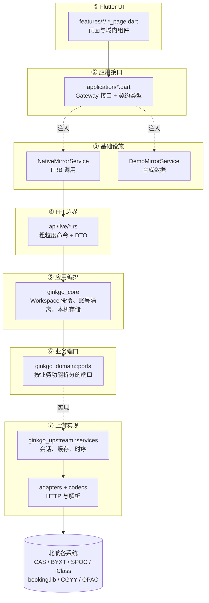
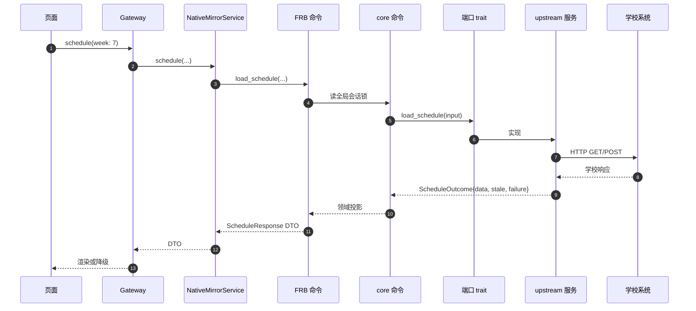
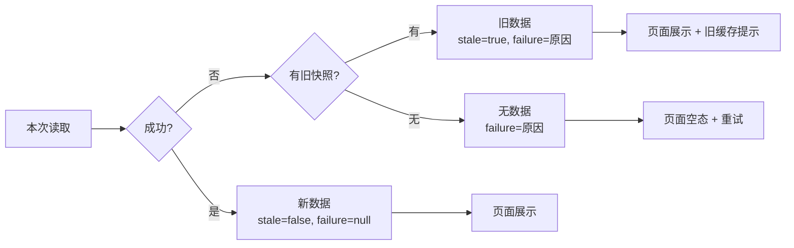
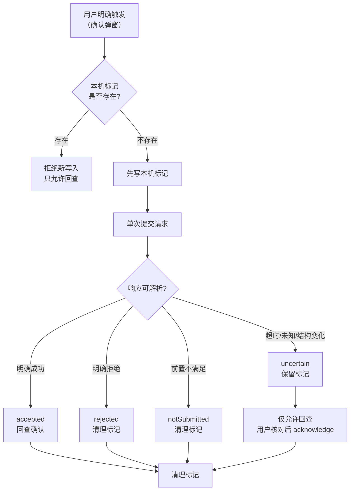
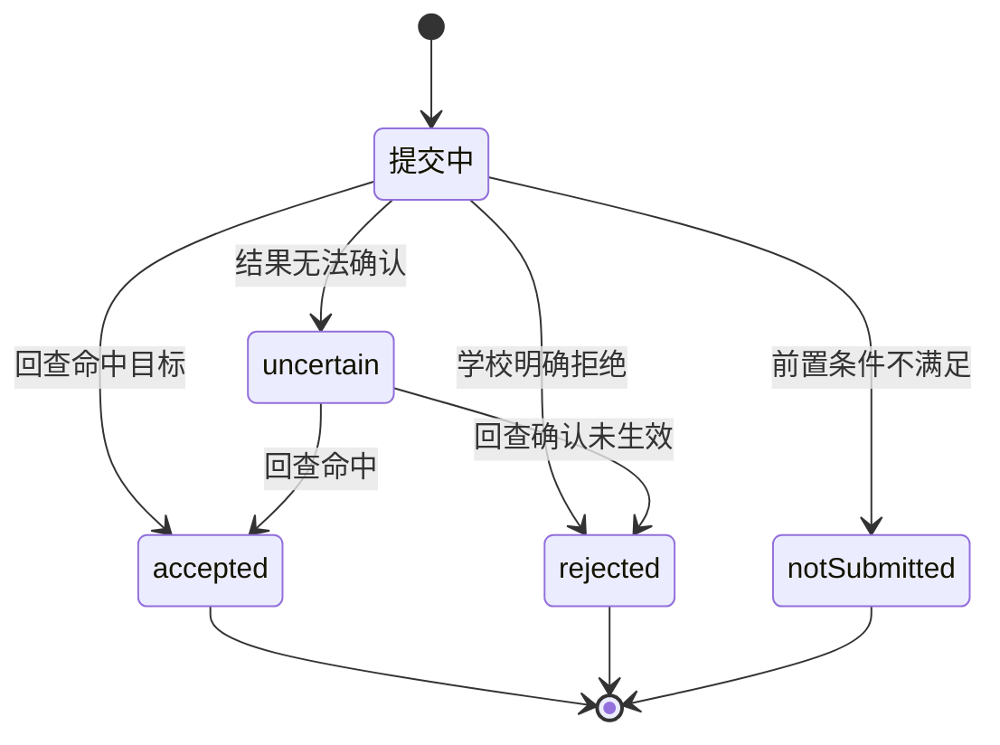
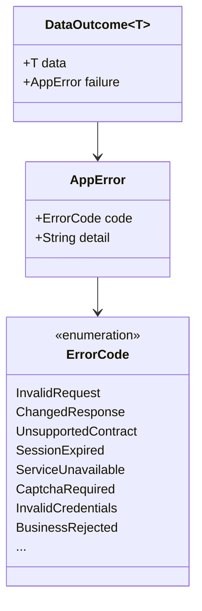
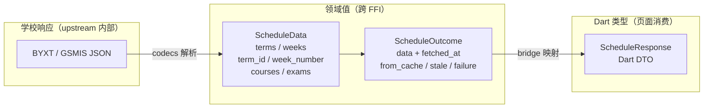
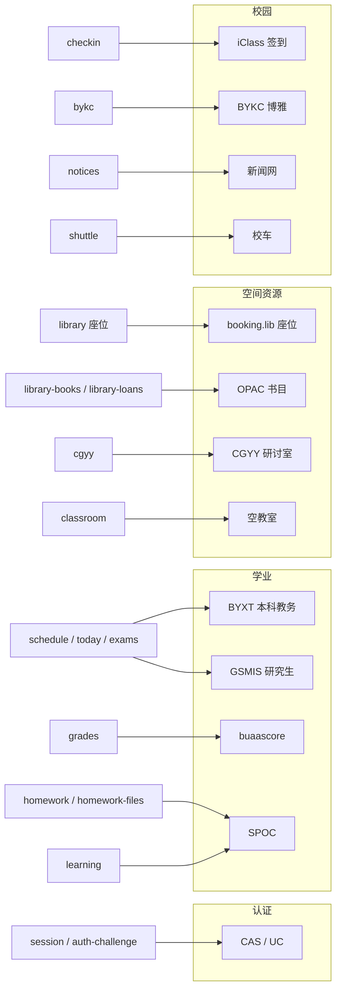
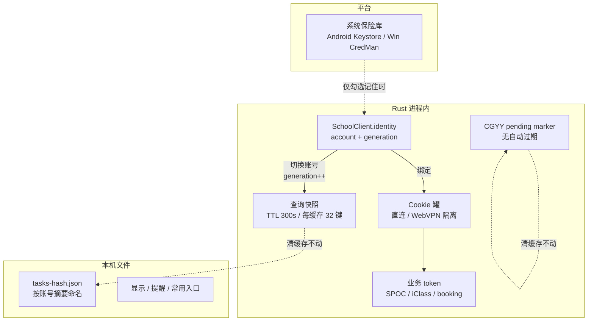

# Ginkgo 架构拓扑与数据流

更新：2026-11-05。**工程现状从 [工具生成的架构浏览器](architecture/index.html) 阅读**：函数调用、回调引用、实现候选、模块依赖、并发调用点与源码证据均可逐级展开。提取方式、覆盖缺口和重新生成命令见 [分析说明](architecture/README.md)。

本文保留分层约束、读写语义与状态机的设计说明。下方人工维护的 Mermaid 是概念示意，不是完整函数调用图，也不能替代解析结果。具体签名与源码位置见 [接口索引](INTERFACE-INDEX.md)。

## 1. 五个 Rust crate 与七段调用拓扑



三条硬规则在此图中固化：

1. **页面只碰 ②**：页面拿到的是 `application/` 的接口，不 import 生成绑定。
2. **端口是唯一收口**：`core` 依赖 `traits`，学校实现从外部注入，因此换实现不影响业务规则。
3. **协议只在 ⑦**：URL、Cookie、token、成功码不出 `ginkgo_upstream`。

### 1.1 Android 后台提醒旁路（已随 Beta.10 发布）

`JobScheduler → ReminderRefreshJob → headless Flutter runBackgroundReminders → read_background_reminders → runtime → upstream` 是只读提醒发现链，不经过页面或前台全局 Workspace。它只把已验证、未过期的加密会话快照复制到无密码的内存保险库，不读取保存密码，不更新前台持久会话。身份事务忙时跳过；账号/代次变化后丢弃结果；未成功读取的分组保留旧计划。计划提交、广播送达与重启重排共用原生 `ReminderQueue.worker`。详细状态与边界见[后台修复审计](_audit/2026-11-03-background-reminders-and-recovery.md)。

前台两分钟刷新和系统周期任务不是进程常驻或实时推送。当前周期最短 15 分钟，执行可能被系统推迟；快照固定 24 小时失效，后台不自动续期或重交密码。存储/恢复暂时错误显示重试页，不按退出处理。认证与 HTTP 仍受 [网络冻结](NETWORK-FREEZE.md) 约束。

## 2. 调用拓扑：读操作 vs 写操作

只读与写入走同一条链，差别在**返回值语义**与**是否可能已改学校状态**。



**失败时的数据流**（读）：



关键：**失败不清空旧数据，也不延长原成功时间**。所以页面的三态（新、旧、无）必须分开呈现。

## 3. 写入的数据流与状态机

写操作多一层本地保护，因为「网络失败」不等于「学校没生效」。



`MutationState` 只有四个终态，由 `ginkgo_domain::features::mutation` 定义：



**未在图上画出一条边**：`uncertain → 重新提交`。这条边在生产代码里不存在，也不应该存在。

## 4. 模块依赖图（生成）

完整图与循环检测结果见 [依赖图](interfaces/DEPENDENCY-GRAPH.md)。**本文不复制具体数字**：分组数、依赖条数与循环分量随代码变化，以该生成文件的首段为准（由 `scripts/generate-interface-index.py` 从源码算出）。

### 4.1 静态分析入口与证据

文件 / 目录依赖维护在 [生成报告](interfaces/DEPENDENCY-GRAPH.md)，函数级证据维护在 [架构浏览器](architecture/index.html)。报告包含 Dart 目录图、文件级强连通分量、跨目录导入的源码行号，以及 Cargo metadata 提取的 Rust workspace 依赖。

```sh
python3 scripts/generate-interface-index.py
python3 scripts/generate-interface-index.py --check
python3 scripts/check-mirror-architecture.py
```

生成器检查文档漂移，架构门禁检查允许的依赖方向；完整镜像脚本另运行 Dart analyzer、Clippy 和测试。Dart 扫描包含相对路径、单双引号及条件导入全部候选，但属于词法分析而非 AST/类型分析；目录环不等同于文件环，静态依赖也不能证明运行时调用或真实业务可用。Rust 表包含声明的 normal/dev/build 与 target 条件，不代表某一平台实际启用的 feature 图。

## 4.3 目录层级与归属规则

目录名回答「这段代码属于哪一层」，而不是「它由谁写的」。新增文件前先按下表定位；放不进去说明缺一层，不要塞进最近的目录。

### 4.3.1 各目录职责（自外向内）

| 目录 | 只做 | 禁止 |
| --- | --- | --- |
| `app/` | 应用外壳：`CupertinoApp`、主题、locale、文本缩放 | 业务判断、网络 |
| `workspace/` | 导航壳：标签/侧栏、目的地登记、跨断点状态提升、聚合入口页 | 学校协议、本机持久化 |
| `features/<域>/` | 单域页面、域内组件、域内模型解码（`*_models.dart`） | 直接 import `src/rust`、自建服务实例 |
| `application/` | 页面契约：gateway 接口、值类型、呈现状态机（`refresh_section`、`busy_gate`）、失败文案 | 平台插件、文件 IO、具体 adapter |
| `shared/` | 跨域状态模型与纯规则：日期时间、业务规则、共享偏好 | import `features/`、`infrastructure/`；自行访问文件或系统平台 API |
| `widgets/` · `design/` | 无业务语义的组件与设计 token | 应用状态、持久化、网络 |
| `infrastructure/` | 真实/演示 adapter、FRB 调用、本机存储、平台通道 | 页面语义、导航 |
| `platform/` | 平台端口与系统交互（通知、更新、系统设置） | 页面组件、学校协议 |

### 4.3.2 依赖方向

应用契约与基础设施不反向依赖页面；application 不依赖 shared 展示/状态模块。共享存储和外链平台调用的旧例外已迁出并受门禁约束。具体文件依赖以生成报告为准，代码变更后重跑，不把目标层次图当作实现事实。

三条硬规则：

1. **`features/` 不 import `src/rust`**。页面只消费 `application/contracts.dart` 导出的类型。
2. **`shared/` 不 import `features/`**。发现需要时，说明那段规则是跨域共享的，应上移到 `shared/`（2026-10-28 的 `course_visibility` / `homework_visibility` 即此例）。
3. **页面不自建服务**。主要服务由 `WorkspaceContext.service` 注入；2026-10-30 已移除页面服务工厂兜底，架构门禁禁止 `features/` 与非组合根 `workspace/` 直接依赖 `infrastructure/`。

### 4.3.3 命名口径

`features/` 下统一用**业务功能**命名（`homework`、`learning`、`tasks`、`notices`），不用学校系统名（`spos`、`gsmis`）。学校系统名只出现在 `application/` 的 gateway 文档注释与 `docs/API.md` 里——它们属于协议事实，不属于客户端结构。

已知历史例外（保留原名，避免大范围改名风险）：`cgyy`、`bykc`、`library`、`shuttle`、`classroom`。新增目录不要再沿用系统名。

### 4.3.4 文件名后缀（五种，不新增）

| 后缀 | 含义 |
| --- | --- |
| `*_page.dart` | 一个可导航的页面 |
| `*_section.dart` | 页面内的一块独立区域 |
| `*_widgets.dart` | 一域内复用的组件集合 |
| `*_models.dart` | 该域的载荷解码与值投影（`jsonDecode` 唯一允许的位置之一） |
| `*_controller.dart` / `*_gateway.dart` | 状态控制或能力边界 |

不要用 `*_views.dart` / `*_presentation.dart` / `*_cards.dart` 之类的合集命名：一个文件放多个不相关组件，读者无法从文件名判断内容。

## 5. 数据 IO 契约图

### 5.1 统一信封

所有读取结果在 Rust 侧都是同一个形状，页面因此只需判断三件事。



带缓存语义的读取还会带 `fetched_at`、`from_cache`、`stale`，这正是页面区分「新 / 旧 / 无」的依据。

### 5.2 一个功能的数据形状：课表



**没有一步把原始 JSON 直接交给 Dart**。这条链上的每个箭头都是一次类型收窄。

### 5.3 各层的数据形态对照

| 层 | 数据形态 | 谁构造 | 谁消费 |
| --- | --- | --- | --- |
| 上游响应 | `serde_json::Value` | HTTP 传输 | codecs |
| 领域值 | `ginkgo_domain::features::*` 结构体 | codecs | core、upstream |
| 结果信封 | `DataOutcome<T>` / `*Outcome` | services | core |
| FFI DTO | `ginkgo_flutter_bridge::api::*` 结构 | bridge 映射 | Dart |
| Dart 契约 | `application/contracts.dart` 导出类型 | 生成绑定 | 页面 |
| 页面投影 | `*_models.dart` 类型值 | 模型函数 | 组件 |

当前桥接已全部类型化：学校 JSON 的解析和净化在 Rust 完成，Dart 模型函数只消费 DTO 并构造呈现值；已序列化领域 JSON 的载荷逃生舱也已删除。不要根据旧版“模型层可解码 JSON”恢复原始 Map 依赖。

## 6. 能力地图

各项能力如何分布到学校系统，见 [§2 能力总表](INTERFACE-INDEX.md#2-能力总表)（该表是能力的唯一清单，本文不重复计数）。下面是同一份数据的关系视图。



## 7. 会话与缓存的位置

Android 工作树另将两份隔离 CookieJar 交平台 Keystore AES-GCM 加密保存；固定认证生命周期 24 小时内经 UC 校验才恢复，不保存验证码答案或业务 token。Windows/macOS 镜像仍仅进程内 Cookie。密码保存另由用户选择；细节和证据边界见 [API](API.md)、[隐私](PRIVACY.md) 和 [发布契约](ANDROID-RELEASE-CONTRACT.md)。

这两者是全局状态，理解它们的归属才能理解「为什么切账号要丢弃旧结果」。



要点：**清查询缓存不删个人待办，也不解锁 CGYY 保护**。这三类数据生命周期不同，不能一起清。

## 8. 如何保持这些图准确

| 图 | 来源 | 是否手绘 |
| --- | --- | --- |
| 函数调用、回调、实现候选、并发调用点 | Dart analyzer / rust-analyzer / ast-grep | 自动生成，缺口显式列出 |
| 分层拓扑、时序、状态机、数据形状 | 架构约定 | 概念示意，不作为完整调用证据 |
| 目录依赖图与循环检测 | `scripts/generate-interface-index.py` 扫描 Dart 指令并读取 Cargo metadata | 生成，改代码后重跑 |
| 能力地图 | 与 [能力总表](INTERFACE-INDEX.md#2-能力总表) 同源 | 手绘，新增能力时同步 |

改完代码后：

```sh
python3 scripts/generate-interface-index.py          # 刷新接口清单与依赖图
python3 scripts/generate-interface-index.py --check  # 校验是否过期
python3 scripts/architecture/generate.py             # 类型解析与网页数据
python3 scripts/architecture/check_snapshot.py       # 源码 / 提取器哈希校验
```

本文只描述源码结构，不代表功能已发布或已通过真实账号验收。
