# Ginkgo 架构拓扑与数据流

更新：2026-10-27。本文用图说明 **Android（Flutter + Rust）的调用拓扑与数据 IO**，配合 [接口索引](INTERFACE-INDEX.md) 使用：索引给出签名与位置，本文给出结构与走向。

图为 Mermaid，GitHub 原生渲染；依赖图由 `scripts/generate-interface-index.py` 从源码算出，不手绘。

## 1. 一眼看懂的五层

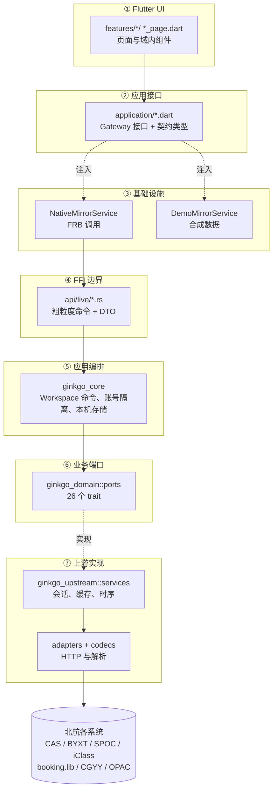

三条硬规则在此图中固化：

1. **页面只碰 ②**：页面拿到的是 `application/` 的接口，不 import 生成绑定。
2. **端口是唯一收口**：`core` 依赖 `traits`，学校实现从外部注入，因此换实现不影响业务规则。
3. **协议只在 ⑦**：URL、Cookie、token、成功码不出 `ginkgo_upstream`。

## 2. 调用拓扑：读操作 vs 写操作

只读与写入走同一条链，差别在**返回值语义**与**是否可能已改学校状态**。

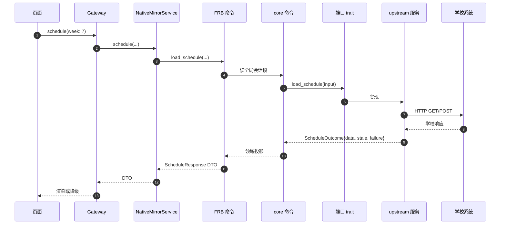

**失败时的数据流**（读）：

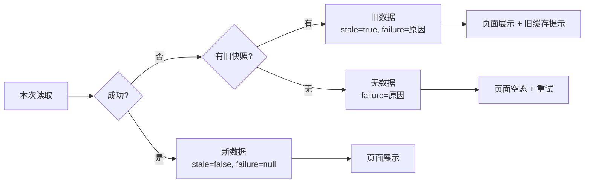

关键：**失败不清空旧数据，也不延长原成功时间**。所以页面的三态（新、旧、无）必须分开呈现。

## 3. 写入的数据流与状态机

写操作多一层本地保护，因为「网络失败」不等于「学校没生效」。

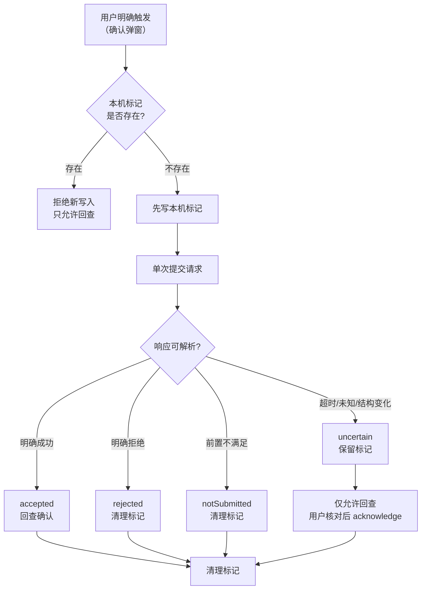

`MutationState` 只有四个终态，由 `ginkgo_domain::features::mutation` 定义：

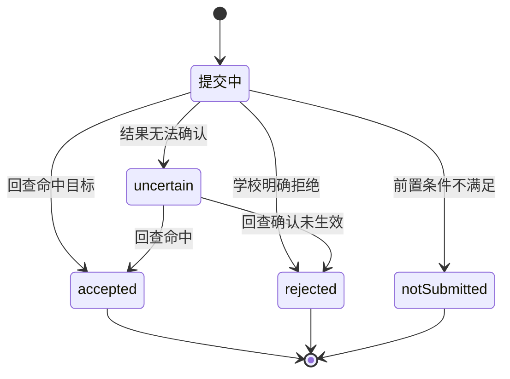

**未在图上画出一条边**：`uncertain → 重新提交`。这条边在生产代码里不存在，也不应该存在。

## 4. 模块依赖图（生成）

完整图与循环检测结果见 [依赖图](interfaces/DEPENDENCY-GRAPH.md)。当前快照：26 个分组节点（其中 25 个有出向依赖）、143 条跨组依赖。

### 4.1 分层依赖方向

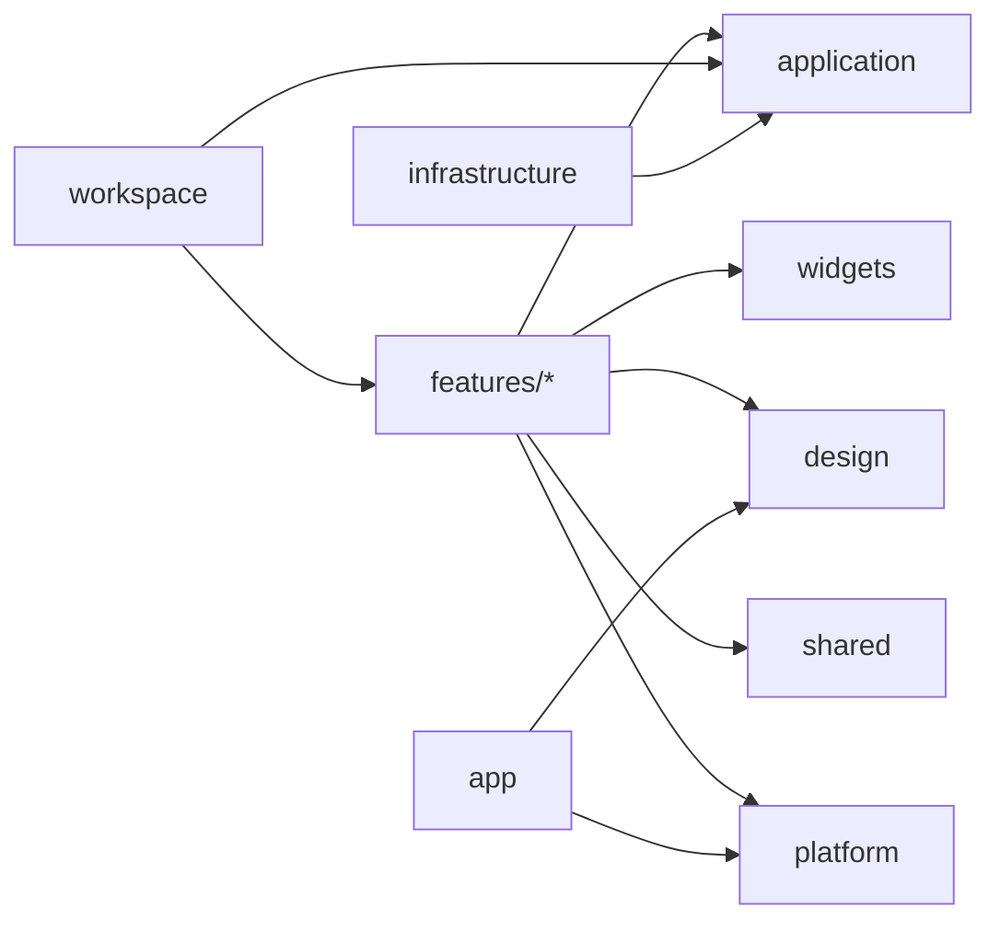

### 4.2 已存在的循环依赖（待收敛）

Dart 侧没有 Rust 那样的依赖方向门禁，因此目录级环不会被自动拦截。当前实测到 **25 个分组同属一个强连通分量**，其中最短的一条真实环是：

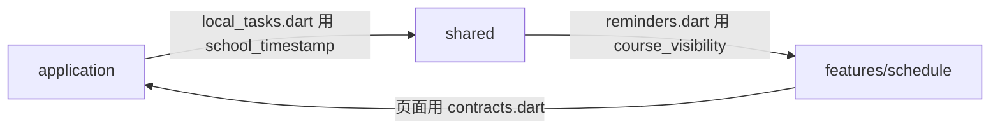

根因很具体：`flutter/lib/features/schedule/course_visibility.dart` 定义的是**跨域共享状态**（课程可见性），却被放在课表域内，于是 `shared/` 反向依赖了 `features/`。

> 这是本次可视化查出的真实问题，尚未修复。修法是把 `course_visibility.dart` 移到 `shared/`，但会牵动 `shared/`、`features/schedule/`、`features/checkin/`、`features/homework/` 的导入与若干测试，属于独立改动。

## 5. 数据 IO 契约图

### 5.1 统一信封

所有读取结果在 Rust 侧都是同一个形状，页面因此只需判断三件事。

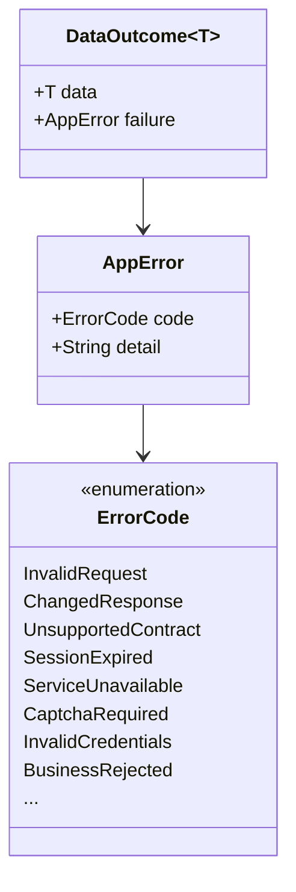

带缓存语义的读取还会带 `fetched_at`、`from_cache`、`stale`，这正是页面区分「新 / 旧 / 无」的依据。

### 5.2 一个功能的数据形状：课表

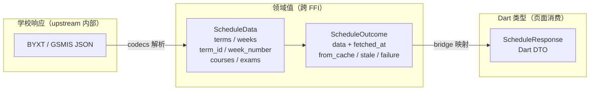

**没有一步把原始 JSON 直接交给 Dart**。这条链上的每个箭头都是一次类型收窄。

### 5.3 各层的数据形态对照

| 层 | 数据形态 | 谁构造 | 谁消费 |
| --- | --- | --- | --- |
| 上游响应 | `serde_json::Value` | HTTP 传输 | codecs |
| 领域值 | `ginkgo_domain::features::*` 结构体 | codecs | core、upstream |
| 结果信封 | `DataOutcome<T>` / `*Outcome` | services | core |
| FFI DTO | `ginkgo_flutter_bridge::api::*` 结构 | bridge 映射 | Dart |
| Dart 契约 | `application/contracts.dart` 导出类型 | 生成绑定 | 页面 |
| 页面投影 | `*_models.dart` 类型值 | 模型函数 | 组件 |

这就是「载荷解码只允许在 `*_models.dart`」那条门禁的由来：前四层都在 Rust，第五层是类型转发，第六层是唯一允许 Dart 自己解码的地方——而它解码的是**已序列化的领域 JSON**，不是学校原始响应。

## 6. 能力地图

24 项能力如何分布到学校系统，见 [§2 能力总表](INTERFACE-INDEX.md#2-能力总表)。下面是同一份数据的关系视图。

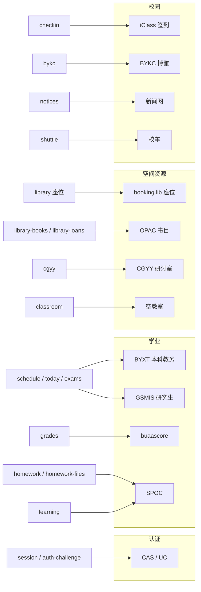

## 7. 会话与缓存的位置

这两者是全局状态，理解它们的归属才能理解「为什么切账号要丢弃旧结果」。

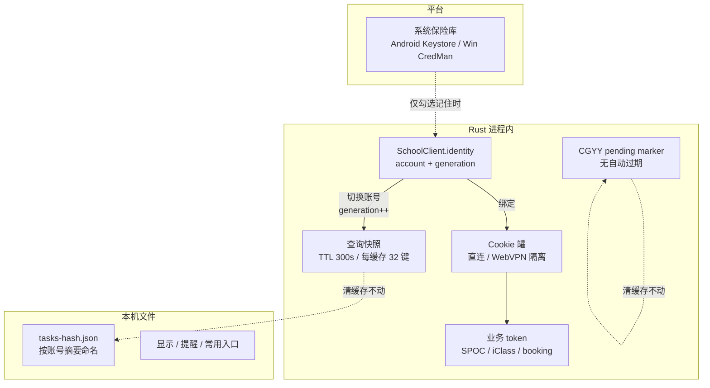

要点：**清查询缓存不删个人待办，也不解锁 CGYY 保护**。这三类数据生命周期不同，不能一起清。

## 8. 如何保持这些图准确

| 图 | 来源 | 是否手绘 |
| --- | --- | --- |
| 分层拓扑、时序、状态机、数据形状 | 架构约定 | 手绘，随架构决策更新 |
| 目录依赖图与循环检测 | `scripts/generate-interface-index.py` 扫描 import | 生成，改代码后重跑 |
| 能力地图 | 与 [能力总表](INTERFACE-INDEX.md#2-能力总表) 同源 | 手绘，新增能力时同步 |

改完代码后：

```sh
python3 scripts/generate-interface-index.py          # 刷新接口清单与依赖图
python3 scripts/generate-interface-index.py --check  # 校验是否过期
```

本文只描述源码结构，不代表功能已发布或已通过真实账号验收。
