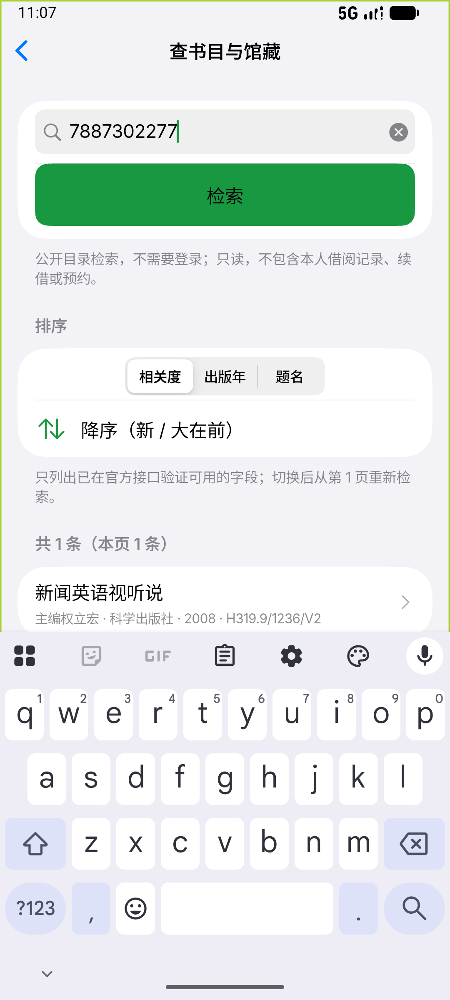
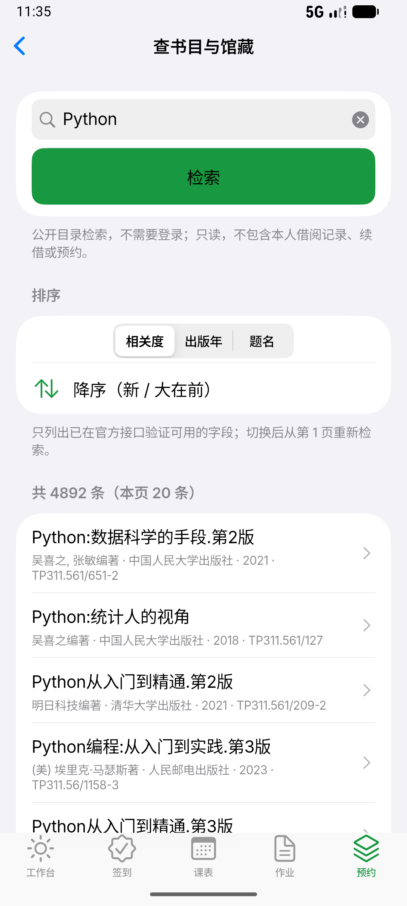
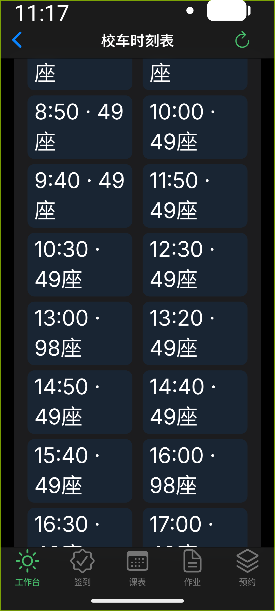
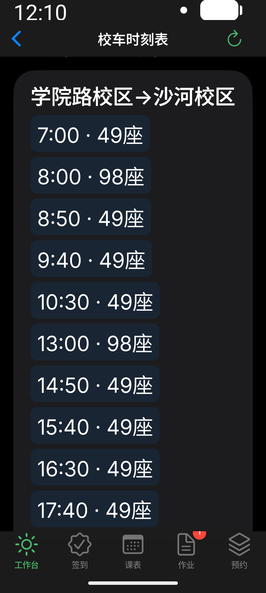

# 图书馆与校车 Android 运行时视觉闭环（2026-10-23～24）

## 验收环境与边界

用户要求对图书馆和校车界面进行真实环境视觉闭环。本轮使用 **Android 模拟器上的当前正常入口 APK + 真实只读数据**，不是 widget 截图替代设备截图，也不是物理真机验收。

- 主机 macOS；设备 `emulator-5554`，AVD `Ginkgo_Alpha7_Release_QA`，SDK 37 / ARM64，`ro.kernel.qemu=1`。本轮启动此前不存在的模拟器进程。
- 原生分辨率 1080×2400 / 420dpi，约 411dp 宽；另临时设为 540dpi（320dp 宽）和系统 `font_scale=2.0`，切换系统明暗模式。
- 应用 `cn.edu.buaa.ginkgo.ginkgo_mirror`，`0.1.0-alpha.7` / build 8；版本号未变，不能靠版本号分辨已发布包与本轮 Debug 包。
- 首轮覆盖安装上一轮正常 `lib/main.dart` ARM64 Debug APK，冷启动后经应用导航操作；修复后再次正常构建、`adb install -r` 覆盖安装与冷启动复验。不是 integration_test APK，未注入假 gateway / fixture / demo service。
- 恢复的是模拟器已有应用会话；未读取、输入或导出凭据，未改认证/TLS/会话策略。图书馆当前预约只观察到空状态，不能据此声称非空个人预约已验收。
- 仅打开页面、只读搜索/排序/馆藏/区域、刷新、滚动和返回；**未执行预约、取消、暂离、入座、离馆、续借、购票或打卡**。
- REA 的 adb 自动发现不在其 PATH，故使用已有绝对路径 `$HOME/Library/Android/sdk/platform-tools/adb`。设备控件通过 ADB 输入，截图通过 `exec-out screencap -p`；未安装工具或改宿主权限。

## 真实操作与观察

| 页面 / 操作 | 设备观察 | 结论范围 |
| --- | --- | --- |
| 正常入口 → 预约 → 图书馆 | 公共入口、当前预约空状态、三馆余量卡片和刷新按钮实际显示 | 未见该范围裁切；余量只是读取时快照，不保证可预约 |
| 在馆与空间 | 两校区分组、在馆人数、座位/研讨间/柜余量和北京时间更新时间实际显示 | 夜间出现 0 人及满余量是上游当次展示，不推导业务规则 |
| 场馆 → 学院路区域列表 | 真实区域名称、余量、长列表滚动；320dp/2x 深色下卡片能重排并继续滚动 | 未点具体座位/预约；不扩大为选座/提交闭环 |
| 查书 → 检索 | 真实查询 `Python` 返回书目，显示本页 20 条及上游总数；切换出版年后书目变化 | 不是验证全部 4892 条、全部排序/分页/限流分支 |
| 书目 → 馆藏 | 实际显示中英文长书名、4 条复本、位置/索书号/原始状态；另一查询显示 5 条复本 | 状态“可借”原样展示，不代表已验证现场借阅 |
| 校车 | 官方公开页读取成功，周一至周五/周六至周日、双向班次与计划容量实际显示 | 不显示实时余票，不保证临时调整已覆盖 |
| 校车外链 | 点击确实转入 Android Chrome 首次设置 Activity，系统返回后仍见时刻表 | 未接受浏览器首启设置；**未验证官网正文在浏览器加载完成** |
| 校车断网刷新与恢复 | 临时关闭模拟器 Wi-Fi/移动数据，刷新出现全局诊断提示，原班次仍可见；恢复网络并再次刷新后正常显示 | 截图未完整证明页面局部错误行；不将其描述为全部错误状态覆盖 |
| 返回与滚动 | 书目↔馆藏、图书馆↔区域/公共人数、校车↔工作台均实际往返；键盘关闭也使用过系统返回 | 不是预测返回动画/物理手势/TalkBack 验收 |

首次覆盖安装后复用旧 Activity 时曾捕获一张黑内容帧，停止进程后正常冷启动成功；不将该瞬间当长期黑屏，也未以热启动结果替代最终冷启动。

## 发现 → 修复 → 复验

### 1. 查书按钮提交后软键盘遮挡结果

原页面点击“检索”后输入框仍聚焦，键盘占下半屏；结果虽然返回，用户需再按返回才能展开阅读。

- 改动：仅在有效非空、非 busy 的 `search` guard 后执行 `FocusScope.of(context).unfocus()`；空白提交仍不发请求、不主动失焦。排序、请求代次、失败保留旧结果语义不变。
- widget 回归先在原页面复现焦点仍为 true；修后文件 13/13 通过，新增 5 项覆盖按钮/Search 提交、失败保旧、空查询和窄屏大字号深浅排序。
- 重建覆盖安装后，ADB 再次点击输入框、输入 `Python`、按检索；真实结果可见且键盘收起。`dumpsys input_method` 同时报告 `mInputShown=false`。

| 修复前 | 修复后（重建安装，真实检索） |
| --- | --- |
|  |  |

### 2. 校车窄屏大字号强制双列难读

原页面在 320dp / 2x 系统字号下仍强制左右各半列，`10:00 · 49座` 拆成两行，方向标题也被反复断开；头部又重复列出两方向，首屏信息冗余。

- 改动：`LayoutBuilder` 根据可用宽度和当前文字缩放选择双列/方向上下排列；不缩小无障碍文字。时段 section header 保留日期/时段标签，不重复双方向，方向仍各自在班次前完整显示。无时段标签时显示“公开时刻表”。
- widget 回归保留普通双列断言，增加 320dp/2x 深浅色上下排列、方向顺序、班次获得可用宽度及滚动断言；19/19 通过。
- 备注：最初用像素高度断言一行时遇到 Ahem 测试字体比设备字体更宽（52px vs 26px），未压缩字号绕过；改为断言结构/宽度，并以下方**真实 Android 字体截图**判断实际换行。
- 重建安装后，同一 320dp/2x 深色环境读取真实数据，方向完整成组，上下排列，班次单行，继续滚动可到反方向；普通 411dp/1x 恢复双列。

| 修复前：固定双列拆行 | 修复后：方向分组、班次单行 |
| --- | --- |
|  |  |

## 最终验证与产物身份

- `flutter test --no-pub test/library_books_test.dart`：13 过 / 0 失败。
- `flutter test --no-pub test/shuttle_page_test.dart`：19 过 / 0 失败。
- `bash scripts/check-mirror.sh`：exit 0；**301 项 Flutter 测试通过**，analyze 无问题，架构、Rust fmt/clippy/测试通过。包括依赖解析，不称纯离线。
- `cd flutter && flutter build apk --debug --target-platform android-arm64 --target lib/main.dart`：exit 0，Gradle 28.6 秒。
- 最终 APK：`flutter/build/app/outputs/flutter-apk/app-debug.apk`，231,174,713 bytes。
- SHA-256：`35aedc3457391ea662edd95cfc86520a9326325550c394e95fc8f87178f09ed3`。已对设备 `pm path` 指向的 base.apk 运行 `sha256sum`，与本机产物一致。
- `git diff --check` 通过。无新版本、提交/推送/发布、桥接生成或 Rust 生产协议修改。
- 临时日志：`/tmp/ginkgo-visual-baseline.log`、`/tmp/ginkgo-visual-build.log`、`/tmp/ginkgo-shuttle-visual-test.log`、`/tmp/library-keyboard-green.log`；日志不是长期交付件。

## 截图证据与未覆盖项

精选 8 张原始 PNG 保存在 [assets/2026-10-24-library-shuttle](assets/2026-10-24-library-shuttle/manifest.json)，manifest 记录原始字节数与 SHA-256；仅公共书目、公开班次和预约空状态，不纳入工作台个人作业截图。其余本机截图在 ignored 的 `artifacts/local/library-shuttle-visual/`；截图命名只是步骤标签，不代替实际图像判断，部分切换主题的瞬间仍显示上一帧，不用这些帧证明目标状态。原始图不做美化、裁切或伪造。

本轮没有给全页面“完全通过”的结论：物理设备、TalkBack/触摸目标完整审查、预测返回、性能、横屏、真实非空预约、下一页/全部排序、限流、官网正文及特殊坏响应仍需后续明确范围。现有 [唯一 TODO](../MIRROR-TODO.md) 中相应人工/业务项继续保留；不得把本记录替代真实写入验收。

结束时已恢复模拟器原始 420dpi、`font_scale=1.0`、系统浅色、Wi-Fi 与移动数据开启；保留安装的最终正常 Debug APK，不删除应用/会话/本机数据。未以清数据解决问题。
