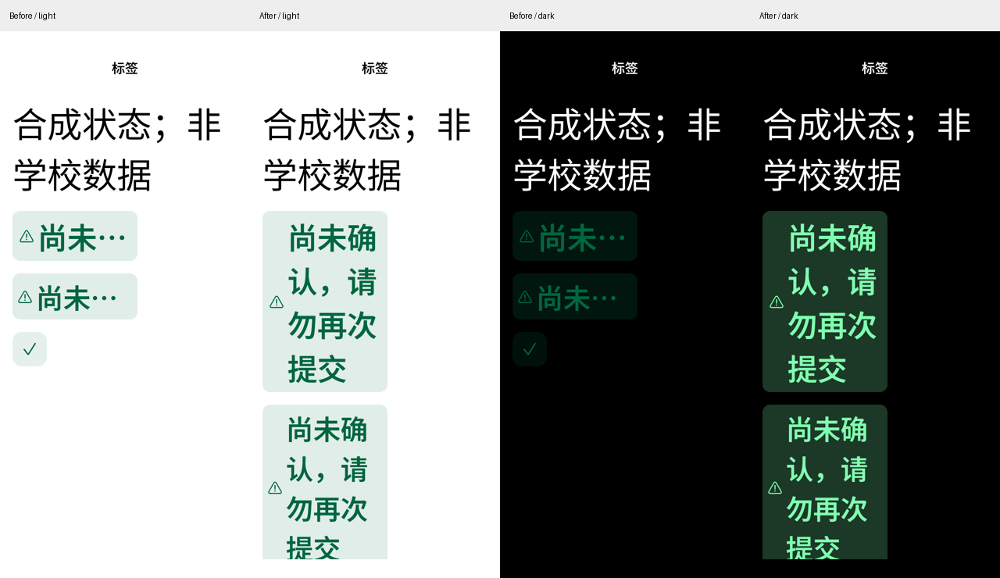

# 原会话全范围接续与视觉闭环（2026-10-26）

## 目标与审计口径

接续用户原会话“作业提交打开、其余建议功能按模块集成并在 App 告警”的完整范围，
以及新增的功能密度、iOS 式视觉、借阅/查书/校车优化要求。
执行目标与**唯一未完成清单**在 [MIRROR-TODO](../MIRROR-TODO.md)；
本文只记录源码和验证事实，不另建 TODO。

当前工作树包含前轮未提交改动，本次未重置、提交或发布它们。公开基线仍为 Android Alpha.8。
不把“已有源码”“合成通过”“设备合成”“真实只读”“真实写入”“签名发布”混成完成。

## 逐项交付证据

| 范围 | 当前工作树及验证 | 边界 |
| --- | --- | --- |
| 学习课程、目录/分页、课程/当前页本地检索、多栏目、测验只读 | 独立 Learning/CourseLearningContext gateway；context/core/upstream/widget 回归；Android 合成截图与点击进入课程 | 仅已加载内容搜索；不开始/作答/提交考试；非空公告/测验与真实第二页仍未验收 |
| 资料及公告附件保存/打开 | guarded 系统选择位置、账号/目录/代次校验、取消和失败独立、主动打开；文件安全与 learning context 测试 | 不自动批量下载；提交到系统保存位置后不能承诺撤销；真实非空附件未全部取到 |
| 普通个人文件作业提交 | 默认不再依赖 experimental feature；私有 journal、上传不等于提交、最终文件确认、单次发送/回查、未知禁止重发；Rust journal/core/Flutter safety 回归；设备 FRB 未绑定账号门禁通过 | 无真实上传/提交；先落保护记录再派发；文件名和大小会进入私有保护记录，不含文件正文/Cookie/票据；清除应用数据会丢保护，不等于学校提交被撤回 |
| 小组/文本/链接作答 | 已有模块能力声明，App 区分未知/未支持/协议变化，不复用个人文件协议 | 只有方式存在的静态线索，无完整字段/身份/回查契约；未编造真实提交能力 |
| 登录验证码 | image/type/id、刷新、过期与账号切换隔离、未知挑战 fail-closed；认证及 widget 回归；已修正根页“图片尚未接入”的过期文案 | 无真实验证码触发或破解；登录成功但密码未保存提示仍有效 |
| 研究生学分地图 | 仅严格执行报告，未知不补零、类别/课组不累加、认证/协议/暂不可用分开；Rust/Flutter 合成回归；Android 深浅色截图 | 本轮主机真实只读执行报告成功一次；未对照所有非空学分分支；不声称毕业资格认定 |
| 课程/待办提醒 | domain 规则、纯 FRB 计划、默认 opt-in、设置与页面更新入口、迟到规划票据防护；extended reminders/domain 测试 | 不承诺后台发现未读学校事项、重启准时投递、强停/厂商省电行为；无 Windows 通知扩展 |
| 安全查询快照 | **已接线为可选的 SPOC 学习元数据快照**：Rust 原成功时间/账号/路线/模式校验、5 分钟期限、Android Keystore AES-GCM/noBackup、显式确认、退出/清缓存清除；Rust/Dart/Android 设备合成往返通过 | 默认关闭，需人工安全审查；不包含课表、成绩、作业、本人借阅、文件字节或认证；不宣称完整离线数据库 |
| 本人借阅 | 独立只读模块，账号及 ABA 防护、错误/确认空/分页；Android 合成记录和后台清除验证 | 主机真实读取遇认证循环跳转，非空实网未接通；不支持续借 |
| 上游能力告警 | 学习分区读取失败立即显示；课程信息按钮可查看本会话被动能力证据，未知不冒充不存在；作业/学分图/借阅各自分类 | 不做 HEAD/写入探活或批量请求；“available”是相应本次业务读取成功，不代表所有写能力实测 |
| 视觉与主题 | 具体改动与截图见下节；正常/320dp 1.6×、绿色/紫色、深浅色合成设备闭环 | 不是物理设备/TalkBack/帧率验收；截图全部为合成数据 |
| 校车与 Release 核对 | 公共入口本次仍提示无认证；已分开实时入口/公开时刻表来源，演示补班次；真实 Alpha.8 安装复现空演示问题 | 实时余票仍未接通；没有把静态计划容量或时刻表成功冒充余票成功，不能据此宣布旧版所有功能均已修好 |

## 安全快照实现细节

- 业务入口：domain `LearningSnapshotSource` → core query_snapshots → upstream learning persistence →
  FRB archive 字节 → `LearningSnapshotCoordinator` → Android 独立 MethodChannel/后台任务队列。
  页面只调用 `LearningSnapshotGateway`。
- 从 upstream 实际成功写入的缓存 `timestamp` 导出，失败不会重写成功时间。
  以原查询成功后 300 秒为期限；未来时钟、过期、未知 schema、重复/非规范成员、账号或路线不符、超限均拒绝。
- 重启后须先已认证为相同账号，导入绑定到本次身份代次；不导入旧请求票据。
  磁盘值**从不作为 fresh hit**：先尝试网络，只对暂不可用保留已标旧值；认证/协议/访问异常不采用磁盘旧值。
- ciphertext 在 noBackupFilesDir 的固定专用目录，随机 IV、AAD、AtomicFile 提交、原子失败不以新值覆盖旧值，
  不回退到明文；关闭/退出/清理先撤销读取并删除专用 blob，不碰待办或账号保险库。
- 首次设备测试发现框架目录别名 `/data/user/0` 与 canonical 路径比较导致拒绝操作。
  修为仅规范化 Android 框架提供的可信私有父目录，仍拒绝本模块目录/文件符号链接；
  修后同设备重跑 Keystore 保存/读取/清除通过。
- 这是需维护者审查的敏感存储 diff；未作为已审查或已发布行为宣传。

## 视觉闭环

首轮设备截图观察到：课程详情空栏目刷新卡和无效官网按钮、学分指标 3+1 孤行、
每类别重复巨大指标网格、作业暴露 textSubmit 等技术能力名并将长说明压在主按钮之前、
借阅页首先展示大段实现说明，校车演示假装结构异常。

本轮修正：

1. 课程隐藏成功的空栏目框、唯一栏目不显示无意义选中按钮，无有效官网 URL 不画灰色大按钮；
   文件夹采用左图标＋右导航箭头，目录/分页对齐；保留独立重试和多栏目显式选择。
2. 学分总览手机 2×2 自适应，类别/课组改紧凑数字行，进度条复用当前强调色，不再固定系统蓝。
3. 作业使用统一 AppleSection/品牌加载反馈，技术能力名中文化，仅展示当前作答相关限制，
   长安全说明分为就地简述与最终提交确认；未移除结果未知保护和二次确认。
4. 借阅采用 grouped 背景与临时隐私摘要，长说明主动展开，单页不画两枚无效翻页按钮。
5. 校车将“实时余票未接通”的入口与“公开计划”分区，官方原文不再被误称余票入口；
   计划时间和容量左对齐；演示明确使用合成班次。
6. 徽标随大字增加内边距与图标大小，不裁切文字。查书保留紧凑检索/排序和连续列表，将重要索书号从低对比 tertiary 色提升为 13pt secondary 色，
   实拍空态与检索结果/深色，未为“改版”无谓重画已经可读的结果卡片。

可复跑：启动独立 QA 模拟器后
`bash scripts/check-android-module-visual.sh emulator-5580`。
脚本仅接受 emulator serial，接收端绑定 loopback，只接收有界 PNG；
用 adb reverse 传合成图，结束恢复 viewport/端口，并重新构建正常 main APK。
普通设备流程为深浅色，窄屏流程为 320dp＋1.6×＋紫色主题。
原始合成截图在 `artifacts/local/module-visual/`（不入库）；
精选对照见本文附图目录。未保存真实账号画面。

### 精选前后对照（全部为合成数据）

- [课程详情](images/2026-10-26/course-comparison.png)：去空栏目卡、无效官网按钮和单一栏目伪操作。
- [学分地图](images/2026-10-26/credit-comparison.png)：总览 2×2，明细压缩为可扫读的指标行。
- [作业文件区](images/2026-10-26/homework-files-comparison.png)：分离说明与主动作，移除技术字段名。
- [校车](images/2026-10-26/shuttle-comparison.png)：修正空演示，静态计划与实时入口分开，**不是已接通余票的证据**。

## 有限真实只读验证

用户追加允许有限、不危险的真实验证。本轮只使用内存输入及临时 MemoryVault：
原会话凭据的标点分隔先导致一次输入解析错误，校正后一次 CAS 成功。
成功登录后读取本人借阅首入口（认证循环跳转未成功）、严格研究生执行报告（成功）、
SPOC 学生课程（10 条）、首课程公告/测验（成功空）、根资料列表（9 条）。
本次未取得可下载文件，因此没有伪称实际文件保存/下载完成。
后续一次登录返回 InvalidCredentials，停止所有真实账号尝试，不据此判断账号封禁。
探针只输出类型、数量与错误码，不输出学号、姓名、课程名、Cookie 或响应正文。

校车：匿名单次官方入口 GET 仍收到“未获取到认证信息”，未构造或重试余票写交易，
未购票。旧文档“确认不可接入”是过强推断，已勘误为当前认证链未确认。

## 公开 Alpha.8 与当前源码分开验证

从官方 Release 下载 Alpha.8 APK/checksums，SHA-256 校验通过，
安装到 read-only QA 模拟器；正常入口登录页可启动，进入离线演示、服务目录和校车页。
校车演示稳定呈现“暂无时刻表／官方结构可能变化”，与实际 demo 返回空数组一致，
不是实网结构证据。本轮已修演示并分开官方静态/实时入口。
未用旧 Release 重新尝试真实登录或任何学校写操作。
此证据只覆盖上述入口，不覆盖用户未提供复现条件的全部旧版问题。

## 最终验证结果

2026-10-26，本机 macOS ARM64，独立 read-only Android ARM64 QA 模拟器：

| 验证 | 结果 |
| --- | --- |
| `bash scripts/check-mirror.sh` | 通过，最终前台执行返回 0；架构规则、fmt、严格 Clippy、Rust 全量、Flutter analyze/unit/widget、FRB 二次生成一致性 |
| `bash scripts/check-android-module-visual.sh emulator-5580` | 通过：Keystore 存储测试＋普通深浅色＋320dp/1.6×/紫色深浅色，36 张合成截图；脚本最后重建正常 main APK |
| homework_files 设备 FRB 未绑定账号门禁 | 通过，不发学校请求 |
| 最终正常入口安装/启动 | 通过，安装上述重建 APK，见登录页后进入离线演示工作台；不是等待测试驱动的启动页 |
| 公开 Alpha.8 下载完整性 | 官方 checksums SHA-256 校验通过；旧包仅做正常入口与演示校车复现 |
| `git diff --check` | 通过 |
| 敏感输入扫描 | 除用户提供的原始会话导出外，未在代码/测试/文档发现该次真实凭据；原导出不得提交 |

没有签名发版、没有修改最低版本门禁、没有自动提交学校写入。
测试期间开启的临时 loopback 截图服务/adb reverse 已由脚本清理，
QA viewport 恢复原 1080×2400/420dpi；留下的是正常应用而非集成测试包。

## 验证入口与边界

- 完整 Rust/Flutter 门禁：`bash scripts/check-mirror.sh`（含严格 Clippy、全部测试、FRB 重生成一致性）。
- 设备：homework_files FRB 未绑定门禁；learning_snapshots Keystore 二进制往返与撤销；
  module_visual 深浅色＋窄屏大字号合成流程。
- 产物：`flutter/build/app/outputs/flutter-apk/app-debug.apk` 是最终重新构建的
  ARM64 **正常 main 入口 Debug 包**，不是公开更新包。
- 尚无物理设备、Windows 主机、完整 TalkBack、真实提交/回查、签名发布证据。

## 接续：共享状态徽标的大字号与动态颜色

认证边界不变：不重试被拒的账号登录，不复制浏览器 Cookie，不执行学校写入。
借阅和实时余票仍受阻；本次转向唯一 TODO 中可独立复现的共享徽标问题。

- 新增回归先红：160dp 约束、3.2× 字号下，`GinkgoBadge` 的 `RenderParagraph.didExceedMaxLines` 为 true，完整状态“尚未确认，请勿再次提交”被显示成“尚未…”。只断言 `takeException() == null` 无法发现这种静默丢信息。
- 取消状态文字的强制省略，允许自然换行及高度增长；普通/紧凑两种均断言完整布局和语义标签，不缩小系统字号。
- 另复现显式 `CupertinoDynamicColor` 的深色取值未解析：徽标和图标底座改为先按 context resolve，再计算背景透明度；回归覆盖背景 RGB、图标及徽标文字。
- 本批次的 `GinkgoIconTile` 保持固定底座/字形尺寸；后续接手批次增加有界字形缩放，见下节，底座尺寸不变。
- 先拍修复前同一合成页面，再拍修复后深浅色与滚动末尾，确认两个徽标完整可读、图标可达。对比见下图；原始合成截图保留于忽略目录 `artifacts/local/module-visual/`。

验证（2026-10-26，macOS 宿主 / ARM64 QA `emulator-5580`）：

| 命令 | 结果 |
| --- | --- |
| `flutter test test/ginkgo_visuals_test.dart test/ginkgo_visual_matrix_test.dart` | 17 项通过；含七种强调色、深浅色/320及430dp矩阵，新增3.2×完整状态与动态色断言 |
| `bash scripts/check-mirror.sh` | 返回 0；架构/fmt/严格Clippy/Rust、Flutter analyze、501项Flutter测试及FRB再生成一致性通过 |
| `bash scripts/check-android-module-visual.sh emulator-5580` | 返回 0；Keystore、原36张模块图、另4张3.2×徽标首屏/末尾深浅色图；最后重建正常main ARM64 Debug APK |

视觉脚本已纳入该大字压力页，复跑不需要学校账号。测试结束清理 loopback 服务/adb reverse、恢复viewport。模拟器与合成语义断言不替代物理设备/TalkBack；没有真实借阅、余票、写入或发布结论。

## 接手：完成 pi 中断的图标缩放改动

已核对仓库根目录 dsh 与 pi 的导出对话、现有工作树和唯一 TODO。pi 最后改动了
`GinkgoIconTile` 的系统字号缩放，但没有补完验证。本批次保留此前所有未提交工作，
仅收口这项改动及关联回归；借阅认证、校车实时余票、缺证据的作答协议仍未解决。

- 默认和自定义图标随系统字号放大，最大为底座边长的 75%，底座及周围布局尺寸不变。
- 新增回归先复现两个边界：自定义字形大于上限时 `clamp` 上下界反转导致 `ArgumentError`；
  父级 `IconTheme.applyTextScaling=true` 时图标被重复放大，徽标的 20dp 上限实际变成 64dp。
- 先规范化基础图标尺寸，再施加有界缩放；已计算字号的底座和徽标图标显式关闭框架二次缩放。
- 回归检查实际渲染尺寸，覆盖 0.8/1/1.3/2/3.2 倍字号、默认/自定义底座及超大自定义图标。

2026-10-26，macOS ARM64 / Android ARM64 QA `emulator-5580`：

| 验证 | 结果 |
| --- | --- |
| 两个 visuals 测试文件 | 20 项通过；新增 3 项测试在修复前失败、修复后通过 |
| `bash scripts/check-mirror.sh` | 返回 0；完整 Rust 检查/测试、Flutter analyze、504 项 Flutter 测试、FRB 再生成一致性通过 |
| `bash scripts/check-android-module-visual.sh emulator-5580` | 返回 0；Keystore 往返、普通/窄屏大字模块与 3.2× 原语截图流程通过，正常 main ARM64 Debug APK 重建成功 |
| 截图复核 | 检查课程深色大字及原语深浅色末尾截图：状态文字完整换行、字形保留底座内边距；原图位于忽略目录 `artifacts/local/module-visual/` |
| 正常入口安装 | 重建后的 APK 已重新安装并启动，不保留测试入口包 |

本批次未尝试真实账号、学校写操作或发布；物理设备、完整 TalkBack 与 Windows 主机未验收。
实现入口已同步，未重复建立 TODO 或将上述真实业务阻碍核销。
