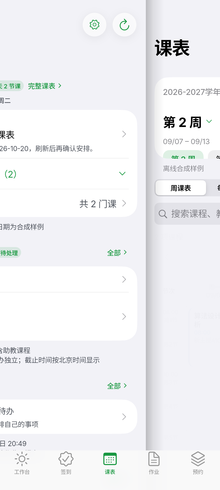
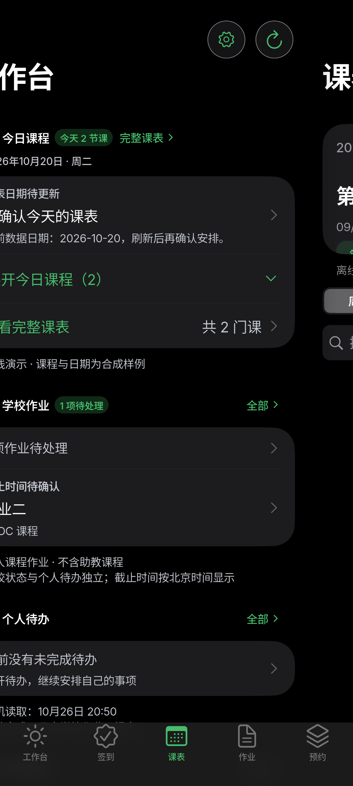

# 左右翻页交互与协议接续（2026-10-26）

本轮接续左右页面动画、智慧校车、SPOC 提交与本人借阅。保留此前所有未提交工作，
未签名发布、未使用真实账号、未执行学校上传/提交/购票/续借等写操作。
未完成事项继续维护在唯一 [MIRROR-TODO](../MIRROR-TODO.md)。

## 连续左右翻页

原切换只绘制新页，旧页立即 Offstage，页面滑入期间露出壳层空白。
现在由 WorkspaceTabScaffold 保留每个已访问页面的唯一子树和导航栈，
在同一动画时钟下绘制新旧两页：旧页退出、新页进入，接缝连续，有轻微页边阴影。
生产动画仍为 230ms，没有复制 Navigator、抓取页面位图或在动画帧重复发起数据读取。

- 点击底部标签按标签顺序决定方向；底栏左右轻扫至少 48dp 切换相邻标签，到两端即止。
- 不给正文增加横向手势识别器，课表横滚继续由课表处理。
- 退场页可以绘制，但停止 ticker、禁用 Hero/点击/焦点，并从语义树中排除；结束后 Offstage。
- 保留每页筛选、详情路由与滚动位置；快速选择只替换本次运动，不排队。
- 系统/应用减少动态效果、后台或关闭 ticker 时直接到位，不恢复旧动画。
- 保留 Cupertino 底栏的键盘避让、底部安全区及不缩放标签的布局行为。
- 宽屏仍使用现有桌面侧栏，不新增 Windows 功能。

新增回归不仅检查动画存在，还检查每帧两页接缝相差一个页面宽度、退场页不可点击且不在语义树、
底栏轻扫和首尾边界。既有回归继续验证导航栈唯一、动画帧不重建页面、课表双向滚动、
快速切换时返回、减少动态效果及跨断点旋转。

## Android 视觉回路

使用独立 QA `emulator-5580`、纯合成 DemoMirrorService，深浅色分别拍初始状态、
正向/反向中间帧和底栏轻扫落定，共 8 张截图。只在截图分支使用 `timeDilation=10`，
使引擎有时间获取中间帧，finally 恢复；生产速度没有改变。

已检查深浅色正向中间帧：两页同时可见、接缝无空白、底栏固定且选中正确；
退场页并未复制。原图位于忽略目录 `artifacts/local/page-turn/`。





复跑（先启动仓库已有的 loopback 截图接收器并设置 adb reverse）：

```sh
cd flutter
flutter test integration_test/module_visual_test.dart \
  --dart-define=GINKGO_VISUAL_CAPTURE=true \
  --dart-define=GINKGO_VISUAL_TABS_ONLY=true -d emulator-5580
```

结束后必须移除 reverse、关闭接收器，并重建正常 main APK；测试包不能作为正常安装产物。

## 协议进展及实际限制

- **提交**：修复去重/合并显式失败被文件 ID 转为成功的缺陷，合成回归先红后绿。
  官方 newup/newup1 共用组件，文本、URL、小组字段及组长 UI 门禁已定位；
  仍缺当前组身份/代表资格、后端内容处理及真实回查，未开放新写方式。
  详见 [提交核对](_audit/2026-10-26-spoc-submission-protocol-followup.md)。
- **借阅**：匿名 rosetta 会跳学校 SSO，入口本身未自循环；普通 CAS 与 UNION token 不能混用。
  无上次真实循环阶段链，后续匿名 SSO 又遇本机 TLS 错误，真实读者认证仍未修复。
  详见 [借阅复核](_audit/2026-10-26-library-loans-auth-followup.md)。
- **校车**：官方办事大厅成功返回智慧校车服务卡片，但仍指旧 HTTP 根址，无授权参数；
  HTTPS indexPage 仍要求认证。仍需本人日常官方宿主的授权跳转和完整余票只读事务。
  详见 [校车入口复核](_audit/2026-10-26-shuttle-auth-followup.md)。

以上公开 GET、静态阅读和合成回归不是私人数据读取或真实写入验收；没有从网络错误推断账号状态。

## 本轮验证

2026-10-26，macOS ARM64 / Android ARM64 QA：

| 验证 | 结果 |
| --- | --- |
| 动画、导航、返回、视觉矩阵 4 个定向测试文件 | 34 项通过 |
| 完整 `bash scripts/check-mirror.sh` | 返回 0：架构规则、fmt、严格 Clippy、Rust 全量、Flutter analyze、507 项 Flutter 测试及 FRB 再生成一致性 |
| Android tabs-only 合成设备流程 | 返回 0，深浅色正反向翻页及底栏轻扫通过 |
| 正常入口 ARM64 Debug 构建 | 通过；已重新安装并启动，UI 层确认正常登录页和离线演示入口，截图接收器与 adb reverse 已清理 |
| `git diff --check` | 通过 |

未覆盖物理设备、完整 TalkBack、帧率测量、Windows 主机、真实账号完整认证和学校写入。
