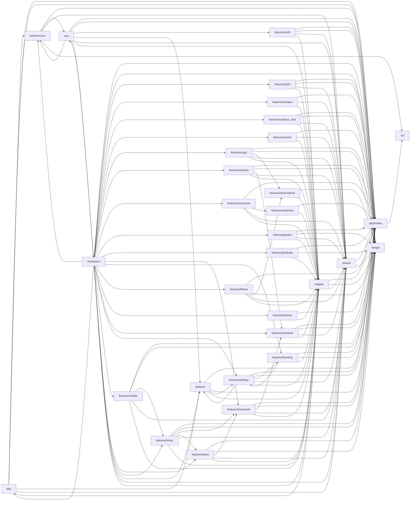
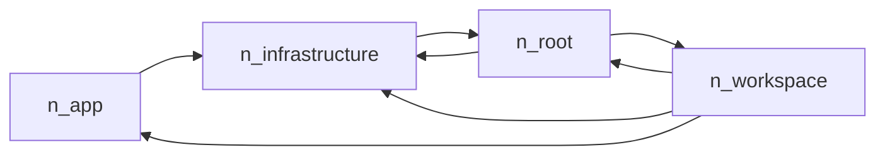
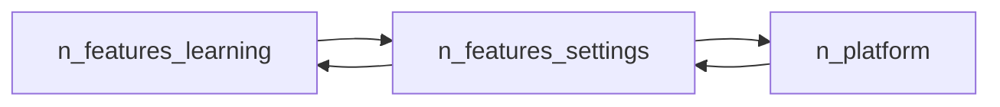

# Flutter 目录依赖图（生成）

> 本文件由 `scripts/generate-interface-index.py` 从源码生成，请勿手工编辑。
> 修改接口后运行 `python3 scripts/generate-interface-index.py` 重新生成；
> 手工总览与分层说明见 [INTERFACE-INDEX.md](../INTERFACE-INDEX.md)。

按目录分组统计：31 个分组节点（其中 29 个有出向依赖）、139 条跨组依赖。箭头方向为「依赖方 → 被依赖方」。

## 依赖图

## 循环依赖

以下分组互相依赖，构成强连通分量。Dart 门禁已约束部分分层方向，但并不禁止所有目录循环；改动前先确认是否真的需要双向引用。

- **4 个分组**：`app`、`infrastructure`、`root`、`workspace`

- **3 个分组**：`features/learning`、`features/settings`、`platform`

## 文件级循环

目录分组环不代表文件环。以下按实际源码文件运行强连通分量检测；生成绑定不作为扫描源。

未发现多文件强连通分量。

## 跨目录依赖证据

覆盖单双引号、相对路径、import/export/part 与条件导入的全部候选；忽略注释和字符串中的伪指令。这是词法依赖扫描，不是 Dart AST/类型分析；条件分支可能产生保守的潜在依赖。

| 来源 | 目标 |
| --- | --- |
| `flutter/lib/app/ginkgo_app.dart:4` | `flutter/lib/application/external_links.dart` |
| `flutter/lib/app/ginkgo_app.dart:10` | `flutter/lib/application/task_storage_scope.dart` |
| `flutter/lib/app/ginkgo_app.dart:8` | `flutter/lib/design/ginkgo_theme.dart` |
| `flutter/lib/app/ginkgo_app.dart:11` | `flutter/lib/infrastructure/task_storage.dart` |
| `flutter/lib/app/ginkgo_app.dart:5` | `flutter/lib/platform/external_links.dart` |
| `flutter/lib/app/ginkgo_app.dart:9` | `flutter/lib/platform/startup_update.dart` |
| `flutter/lib/app/ginkgo_app.dart:7` | `flutter/lib/shared/app_preferences.dart` |
| `flutter/lib/app/ginkgo_app.dart:6` | `flutter/lib/widgets/school_links.dart` |
| `flutter/lib/application/contracts.dart:17` | `flutter/lib/src/rust/api/live.dart` |
| `flutter/lib/application/contracts.dart:28` | `flutter/lib/src/rust/api/mirror.dart` |
| `flutter/lib/application/failures.dart:1` | `flutter/lib/src/rust/api/mirror.dart` |
| `flutter/lib/application/failures.dart:2` | `flutter/lib/src/rust/api/rules.dart` |
| `flutter/lib/features/academic/rules_page.dart:6` | `flutter/lib/application/contracts.dart` |
| `flutter/lib/features/academic/rules_page.dart:5` | `flutter/lib/application/mirror_service.dart` |
| `flutter/lib/features/academic/rules_page.dart:3` | `flutter/lib/widgets/apple_widgets.dart` |
| `flutter/lib/features/academic/rules_page.dart:4` | `flutter/lib/widgets/loading_widgets.dart` |
| `flutter/lib/features/auth/login_feedback.dart:5` | `flutter/lib/design/tokens/layout.dart` |
| `flutter/lib/features/auth/login_feedback.dart:4` | `flutter/lib/design/tokens/spacing.dart` |
| `flutter/lib/features/auth/login_feedback.dart:3` | `flutter/lib/design/tokens/typography.dart` |
| `flutter/lib/features/auth/login_feedback.dart:6` | `flutter/lib/shared/app_preferences.dart` |
| `flutter/lib/features/auth/login_page.dart:17` | `flutter/lib/application/auth_challenge.dart` |
| `flutter/lib/features/auth/login_page.dart:8` | `flutter/lib/application/contracts.dart` |
| `flutter/lib/features/auth/login_page.dart:7` | `flutter/lib/application/mirror_service.dart` |
| `flutter/lib/features/auth/login_page.dart:3` | `flutter/lib/design/apple_design.dart` |
| `flutter/lib/features/auth/login_page.dart:10` | `flutter/lib/shared/app_preferences.dart` |
| `flutter/lib/features/auth/login_page.dart:5` | `flutter/lib/widgets/apple_widgets.dart` |
| `flutter/lib/features/auth/login_page.dart:4` | `flutter/lib/widgets/ginkgo_mark.dart` |
| `flutter/lib/features/auth/login_page.dart:6` | `flutter/lib/widgets/loading_widgets.dart` |
| `flutter/lib/features/auth/login_retry_pause.dart:3` | `flutter/lib/application/contracts.dart` |
| `flutter/lib/features/auth/login_route_selector.dart:3` | `flutter/lib/application/contracts.dart` |
| `flutter/lib/features/auth/login_route_selector.dart:4` | `flutter/lib/design/tokens/spacing.dart` |
| `flutter/lib/features/auth/login_route_selector.dart:5` | `flutter/lib/design/tokens/typography.dart` |
| `flutter/lib/features/auth/session_recovery_page.dart:2` | `flutter/lib/design/tokens/spacing.dart` |
| `flutter/lib/features/bykc/bykc_course_tile.dart:7` | `flutter/lib/application/bykc.dart` |
| `flutter/lib/features/bykc/bykc_course_tile.dart:3` | `flutter/lib/design/apple_design.dart` |
| `flutter/lib/features/bykc/bykc_course_tile.dart:4` | `flutter/lib/shared/school_timestamp.dart` |
| `flutter/lib/features/bykc/bykc_course_tile.dart:5` | `flutter/lib/widgets/apple_widgets.dart` |
| `flutter/lib/features/bykc/bykc_detail_page.dart:5` | `flutter/lib/application/bykc.dart` |
| `flutter/lib/features/bykc/bykc_detail_page.dart:3` | `flutter/lib/design/apple_design.dart` |
| `flutter/lib/features/bykc/bykc_detail_page.dart:6` | `flutter/lib/shared/school_timestamp.dart` |
| `flutter/lib/features/bykc/bykc_detail_page.dart:4` | `flutter/lib/widgets/apple_widgets.dart` |
| `flutter/lib/features/bykc/bykc_page.dart:8` | `flutter/lib/application/bykc.dart` |
| `flutter/lib/features/bykc/bykc_page.dart:13` | `flutter/lib/application/mirror_service.dart` |
| `flutter/lib/features/bykc/bykc_page.dart:3` | `flutter/lib/widgets/apple_widgets.dart` |
| `flutter/lib/features/bykc/bykc_page.dart:4` | `flutter/lib/widgets/loading_widgets.dart` |
| `flutter/lib/features/bykc/bykc_page.dart:5` | `flutter/lib/widgets/long_page_scroll.dart` |
| `flutter/lib/features/bykc/bykc_statistics_view.dart:5` | `flutter/lib/application/bykc.dart` |
| `flutter/lib/features/bykc/bykc_statistics_view.dart:3` | `flutter/lib/widgets/apple_widgets.dart` |
| `flutter/lib/features/bykc/bykc_widgets.dart:5` | `flutter/lib/application/bykc.dart` |
| `flutter/lib/features/bykc/bykc_widgets.dart:3` | `flutter/lib/design/apple_design.dart` |
| `flutter/lib/features/campus/campus_activities_page.dart:3` | `flutter/lib/application/campus_activities.dart` |
| `flutter/lib/features/campus/campus_activities_page.dart:4` | `flutter/lib/application/refresh_section.dart` |
| `flutter/lib/features/campus/campus_activities_page.dart:6` | `flutter/lib/shared/school_timestamp.dart` |
| `flutter/lib/features/campus/campus_activities_page.dart:7` | `flutter/lib/widgets/apple_widgets.dart` |
| `flutter/lib/features/campus/campus_activities_page.dart:8` | `flutter/lib/widgets/public_information_page.dart` |
| `flutter/lib/features/campus/campus_activities_page.dart:5` | `flutter/lib/widgets/school_links.dart` |
| `flutter/lib/features/campus_card/campus_card_page.dart:3` | `flutter/lib/application/contracts.dart` |
| `flutter/lib/features/campus_card/campus_card_page.dart:4` | `flutter/lib/application/mirror_service.dart` |
| `flutter/lib/features/campus_card/campus_card_page.dart:5` | `flutter/lib/design/apple_design.dart` |
| `flutter/lib/features/campus_card/campus_card_page.dart:6` | `flutter/lib/shared/school_timestamp.dart` |
| `flutter/lib/features/campus_card/campus_card_page.dart:7` | `flutter/lib/widgets/apple_widgets.dart` |
| `flutter/lib/features/campus_card/campus_card_page.dart:8` | `flutter/lib/widgets/loading_widgets.dart` |
| `flutter/lib/features/career/career_events_page.dart:5` | `flutter/lib/application/career.dart` |
| `flutter/lib/features/career/career_events_page.dart:6` | `flutter/lib/application/mirror_service.dart` |
| `flutter/lib/features/career/career_events_page.dart:7` | `flutter/lib/application/refresh_section.dart` |
| `flutter/lib/features/career/career_events_page.dart:9` | `flutter/lib/shared/school_timestamp.dart` |
| `flutter/lib/features/career/career_events_page.dart:10` | `flutter/lib/shared/today_time.dart` |
| `flutter/lib/features/career/career_events_page.dart:11` | `flutter/lib/widgets/apple_widgets.dart` |
| `flutter/lib/features/career/career_events_page.dart:2` | `flutter/lib/widgets/date_tile.dart` |
| `flutter/lib/features/career/career_events_page.dart:3` | `flutter/lib/widgets/feature_intro.dart` |
| `flutter/lib/features/career/career_events_page.dart:12` | `flutter/lib/widgets/public_information_page.dart` |
| `flutter/lib/features/career/career_events_page.dart:8` | `flutter/lib/widgets/school_links.dart` |
| `flutter/lib/features/cgyy/cgyy_booking_fields.dart:3` | `flutter/lib/widgets/apple_widgets.dart` |
| `flutter/lib/features/cgyy/cgyy_booking_form.dart:3` | `flutter/lib/widgets/apple_widgets.dart` |
| `flutter/lib/features/cgyy/cgyy_booking_form.dart:4` | `flutter/lib/widgets/loading_widgets.dart` |
| `flutter/lib/features/cgyy/cgyy_booking_page.dart:3` | `flutter/lib/application/cgyy_commands.dart` |
| `flutter/lib/features/cgyy/cgyy_booking_page.dart:4` | `flutter/lib/application/mirror_service.dart` |
| `flutter/lib/features/cgyy/cgyy_booking_page.dart:5` | `flutter/lib/design/tokens/spacing.dart` |
| `flutter/lib/features/cgyy/cgyy_booking_page.dart:6` | `flutter/lib/widgets/apple_widgets.dart` |
| `flutter/lib/features/cgyy/cgyy_booking_slots.dart:3` | `flutter/lib/design/apple_design.dart` |
| `flutter/lib/features/cgyy/cgyy_booking_write.dart:4` | `flutter/lib/application/cgyy_commands.dart` |
| `flutter/lib/features/cgyy/cgyy_captcha_page.dart:9` | `flutter/lib/application/cgyy_commands.dart` |
| `flutter/lib/features/cgyy/cgyy_captcha_page.dart:10` | `flutter/lib/application/mirror_service.dart` |
| `flutter/lib/features/cgyy/cgyy_captcha_page.dart:7` | `flutter/lib/widgets/apple_widgets.dart` |
| `flutter/lib/features/cgyy/cgyy_captcha_page.dart:8` | `flutter/lib/widgets/loading_widgets.dart` |
| `flutter/lib/features/cgyy/cgyy_day_page.dart:3` | `flutter/lib/application/cgyy_commands.dart` |
| `flutter/lib/features/cgyy/cgyy_day_page.dart:4` | `flutter/lib/application/mirror_service.dart` |
| `flutter/lib/features/cgyy/cgyy_day_page.dart:5` | `flutter/lib/shared/school_timestamp.dart` |
| `flutter/lib/features/cgyy/cgyy_day_page.dart:6` | `flutter/lib/shared/today_time.dart` |
| `flutter/lib/features/cgyy/cgyy_day_page.dart:7` | `flutter/lib/widgets/apple_widgets.dart` |
| `flutter/lib/features/cgyy/cgyy_day_page.dart:8` | `flutter/lib/widgets/loading_widgets.dart` |
| `flutter/lib/features/cgyy/cgyy_day_view.dart:4` | `flutter/lib/features/reservations/reservation_widgets.dart` |
| `flutter/lib/features/cgyy/cgyy_day_view.dart:5` | `flutter/lib/shared/school_timestamp.dart` |
| `flutter/lib/features/cgyy/cgyy_day_view.dart:3` | `flutter/lib/widgets/academic_widgets.dart` |
| `flutter/lib/features/cgyy/cgyy_day_view.dart:6` | `flutter/lib/widgets/apple_widgets.dart` |
| `flutter/lib/features/cgyy/cgyy_gateway.dart:1` | `flutter/lib/application/cgyy_commands.dart` |
| `flutter/lib/features/cgyy/cgyy_gateway.dart:2` | `flutter/lib/application/mirror_service.dart` |
| `flutter/lib/features/cgyy/cgyy_lock_code_page.dart:3` | `flutter/lib/application/mirror_service.dart` |
| `flutter/lib/features/cgyy/cgyy_lock_code_page.dart:4` | `flutter/lib/widgets/apple_widgets.dart` |
| `flutter/lib/features/cgyy/cgyy_lock_code_page.dart:5` | `flutter/lib/widgets/loading_widgets.dart` |
| `flutter/lib/features/cgyy/cgyy_models.dart:1` | `flutter/lib/application/cgyy_models.dart` |
| `flutter/lib/features/cgyy/cgyy_models.dart:3` | `flutter/lib/application/cgyy_models.dart` |
| `flutter/lib/features/cgyy/cgyy_order_detail_page.dart:3` | `flutter/lib/application/mirror_service.dart` |
| `flutter/lib/features/cgyy/cgyy_order_detail_page.dart:4` | `flutter/lib/shared/school_timestamp.dart` |
| `flutter/lib/features/cgyy/cgyy_order_detail_page.dart:5` | `flutter/lib/widgets/apple_widgets.dart` |
| `flutter/lib/features/cgyy/cgyy_order_detail_page.dart:6` | `flutter/lib/widgets/loading_widgets.dart` |
| `flutter/lib/features/cgyy/cgyy_page.dart:3` | `flutter/lib/application/mirror_service.dart` |
| `flutter/lib/features/cgyy/cgyy_page.dart:4` | `flutter/lib/application/refresh_section.dart` |
| `flutter/lib/features/cgyy/cgyy_page.dart:5` | `flutter/lib/widgets/apple_widgets.dart` |
| `flutter/lib/features/cgyy/cgyy_page.dart:6` | `flutter/lib/widgets/loading_widgets.dart` |
| `flutter/lib/features/cgyy/cgyy_review_page.dart:5` | `flutter/lib/application/cgyy_commands.dart` |
| `flutter/lib/features/cgyy/cgyy_review_page.dart:6` | `flutter/lib/application/mirror_service.dart` |
| `flutter/lib/features/cgyy/cgyy_review_page.dart:3` | `flutter/lib/widgets/apple_widgets.dart` |
| `flutter/lib/features/cgyy/cgyy_review_page.dart:4` | `flutter/lib/widgets/loading_widgets.dart` |
| `flutter/lib/features/cgyy/cgyy_widgets.dart:4` | `flutter/lib/design/apple_design.dart` |
| `flutter/lib/features/cgyy/cgyy_widgets.dart:3` | `flutter/lib/widgets/academic_widgets.dart` |
| `flutter/lib/features/checkin/checkin_loading.dart:7` | `flutter/lib/application/mirror_service.dart` |
| `flutter/lib/features/checkin/checkin_loading.dart:5` | `flutter/lib/widgets/apple_widgets.dart` |
| `flutter/lib/features/checkin/checkin_loading.dart:6` | `flutter/lib/widgets/loading_widgets.dart` |
| `flutter/lib/features/checkin/checkin_page.dart:18` | `flutter/lib/application/contracts.dart` |
| `flutter/lib/features/checkin/checkin_page.dart:15` | `flutter/lib/application/mirror_service.dart` |
| `flutter/lib/features/checkin/checkin_page.dart:10` | `flutter/lib/design/apple_design.dart` |
| `flutter/lib/features/checkin/checkin_page.dart:20` | `flutter/lib/features/schedule/course_range_page.dart` |
| `flutter/lib/features/checkin/checkin_page.dart:5` | `flutter/lib/shared/checkin_sessions.dart` |
| `flutter/lib/features/checkin/checkin_page.dart:19` | `flutter/lib/shared/course_visibility.dart` |
| `flutter/lib/features/checkin/checkin_page.dart:6` | `flutter/lib/shared/reminder_rules.dart` |
| `flutter/lib/features/checkin/checkin_page.dart:7` | `flutter/lib/shared/reminders.dart` |
| `flutter/lib/features/checkin/checkin_page.dart:16` | `flutter/lib/shared/school_timestamp.dart` |
| `flutter/lib/features/checkin/checkin_page.dart:17` | `flutter/lib/shared/today_time.dart` |
| `flutter/lib/features/checkin/checkin_page.dart:9` | `flutter/lib/widgets/apple_widgets.dart` |
| `flutter/lib/features/checkin/checkin_page.dart:13` | `flutter/lib/widgets/loading_widgets.dart` |
| `flutter/lib/features/checkin/checkin_page.dart:14` | `flutter/lib/widgets/mutation_dialog.dart` |
| `flutter/lib/features/checkin/checkin_widgets.dart:7` | `flutter/lib/application/contracts.dart` |
| `flutter/lib/features/checkin/checkin_widgets.dart:3` | `flutter/lib/design/apple_design.dart` |
| `flutter/lib/features/checkin/checkin_widgets.dart:6` | `flutter/lib/shared/school_timestamp.dart` |
| `flutter/lib/features/checkin/checkin_widgets.dart:4` | `flutter/lib/widgets/apple_widgets.dart` |
| `flutter/lib/features/checkin/checkin_widgets.dart:5` | `flutter/lib/widgets/loading_widgets.dart` |
| `flutter/lib/features/classroom/classroom_detail.dart:3` | `flutter/lib/application/contracts.dart` |
| `flutter/lib/features/classroom/classroom_detail.dart:4` | `flutter/lib/widgets/apple_widgets.dart` |
| `flutter/lib/features/classroom/classroom_detail.dart:6` | `flutter/lib/widgets/feature_intro.dart` |
| `flutter/lib/features/classroom/classroom_models.dart:1` | `flutter/lib/application/contracts.dart` |
| `flutter/lib/features/classroom/classroom_page.dart:5` | `flutter/lib/application/collection_window.dart` |
| `flutter/lib/features/classroom/classroom_page.dart:6` | `flutter/lib/application/contracts.dart` |
| `flutter/lib/features/classroom/classroom_page.dart:8` | `flutter/lib/application/mirror_service.dart` |
| `flutter/lib/features/classroom/classroom_page.dart:7` | `flutter/lib/features/academic/rules_page.dart` |
| `flutter/lib/features/classroom/classroom_page.dart:9` | `flutter/lib/widgets/apple_widgets.dart` |
| `flutter/lib/features/classroom/classroom_page.dart:10` | `flutter/lib/widgets/collection_toolbar.dart` |
| `flutter/lib/features/classroom/classroom_page.dart:12` | `flutter/lib/widgets/loading_widgets.dart` |
| `flutter/lib/features/classroom/classroom_page.dart:11` | `flutter/lib/widgets/long_page_scroll.dart` |
| `flutter/lib/features/classroom/classroom_results.dart:3` | `flutter/lib/application/collection_window.dart` |
| `flutter/lib/features/classroom/classroom_results.dart:4` | `flutter/lib/widgets/apple_widgets.dart` |
| `flutter/lib/features/classroom/classroom_sections.dart:3` | `flutter/lib/application/contracts.dart` |
| `flutter/lib/features/classroom/classroom_sections.dart:4` | `flutter/lib/shared/school_timestamp.dart` |
| `flutter/lib/features/classroom/classroom_sections.dart:5` | `flutter/lib/widgets/apple_widgets.dart` |
| `flutter/lib/features/classroom/classroom_status.dart:3` | `flutter/lib/widgets/apple_widgets.dart` |
| `flutter/lib/features/classroom/classroom_status.dart:4` | `flutter/lib/widgets/loading_widgets.dart` |
| `flutter/lib/features/classroom/classroom_widgets.dart:3` | `flutter/lib/application/collection_window.dart` |
| `flutter/lib/features/classroom/classroom_widgets.dart:4` | `flutter/lib/application/contracts.dart` |
| `flutter/lib/features/classroom/classroom_widgets.dart:5` | `flutter/lib/widgets/apple_widgets.dart` |
| `flutter/lib/features/classroom/classroom_widgets.dart:6` | `flutter/lib/widgets/collection_toolbar.dart` |
| `flutter/lib/features/grades/grades_page.dart:10` | `flutter/lib/application/contracts.dart` |
| `flutter/lib/features/grades/grades_page.dart:9` | `flutter/lib/application/mirror_service.dart` |
| `flutter/lib/features/grades/grades_page.dart:5` | `flutter/lib/design/tokens.dart` |
| `flutter/lib/features/grades/grades_page.dart:11` | `flutter/lib/shared/school_timestamp.dart` |
| `flutter/lib/features/grades/grades_page.dart:3` | `flutter/lib/widgets/academic_overview.dart` |
| `flutter/lib/features/grades/grades_page.dart:7` | `flutter/lib/widgets/academic_widgets.dart` |
| `flutter/lib/features/grades/grades_page.dart:6` | `flutter/lib/widgets/apple_widgets.dart` |
| `flutter/lib/features/grades/grades_page.dart:2` | `flutter/lib/widgets/feature_intro.dart` |
| `flutter/lib/features/grades/grades_page.dart:8` | `flutter/lib/widgets/loading_widgets.dart` |
| `flutter/lib/features/graduate/graduate_course_controls.dart:5` | `flutter/lib/application/graduate.dart` |
| `flutter/lib/features/graduate/graduate_course_controls.dart:3` | `flutter/lib/widgets/apple_widgets.dart` |
| `flutter/lib/features/graduate/graduate_course_widgets.dart:7` | `flutter/lib/application/graduate.dart` |
| `flutter/lib/features/graduate/graduate_course_widgets.dart:4` | `flutter/lib/design/apple_design.dart` |
| `flutter/lib/features/graduate/graduate_course_widgets.dart:3` | `flutter/lib/widgets/academic_widgets.dart` |
| `flutter/lib/features/graduate/graduate_course_widgets.dart:5` | `flutter/lib/widgets/apple_widgets.dart` |
| `flutter/lib/features/graduate/graduate_credit_map_page.dart:5` | `flutter/lib/application/graduate_credit_map.dart` |
| `flutter/lib/features/graduate/graduate_credit_map_page.dart:6` | `flutter/lib/application/refresh_section.dart` |
| `flutter/lib/features/graduate/graduate_credit_map_page.dart:7` | `flutter/lib/widgets/apple_widgets.dart` |
| `flutter/lib/features/graduate/graduate_credit_map_page.dart:8` | `flutter/lib/widgets/loading_widgets.dart` |
| `flutter/lib/features/graduate/graduate_credit_map_widgets.dart:3` | `flutter/lib/application/graduate_credit_map.dart` |
| `flutter/lib/features/graduate/graduate_credit_map_widgets.dart:5` | `flutter/lib/design/apple_design.dart` |
| `flutter/lib/features/graduate/graduate_credit_map_widgets.dart:4` | `flutter/lib/widgets/academic_widgets.dart` |
| `flutter/lib/features/graduate/graduate_credit_map_widgets.dart:6` | `flutter/lib/widgets/apple_widgets.dart` |
| `flutter/lib/features/graduate/graduate_page.dart:14` | `flutter/lib/application/graduate.dart` |
| `flutter/lib/features/graduate/graduate_page.dart:3` | `flutter/lib/application/graduate_credit_map.dart` |
| `flutter/lib/features/graduate/graduate_page.dart:5` | `flutter/lib/application/mirror_service.dart` |
| `flutter/lib/features/graduate/graduate_page.dart:4` | `flutter/lib/application/refresh_section.dart` |
| `flutter/lib/features/graduate/graduate_page.dart:6` | `flutter/lib/widgets/apple_widgets.dart` |
| `flutter/lib/features/graduate/graduate_page.dart:8` | `flutter/lib/widgets/loading_widgets.dart` |
| `flutter/lib/features/graduate/graduate_page.dart:7` | `flutter/lib/widgets/long_page_scroll.dart` |
| `flutter/lib/features/graduate/graduate_sections.dart:8` | `flutter/lib/application/graduate.dart` |
| `flutter/lib/features/graduate/graduate_sections.dart:4` | `flutter/lib/widgets/academic_widgets.dart` |
| `flutter/lib/features/graduate/graduate_sections.dart:5` | `flutter/lib/widgets/apple_widgets.dart` |
| `flutter/lib/features/graduate/graduate_sections.dart:2` | `flutter/lib/widgets/feature_intro.dart` |
| `flutter/lib/features/graduate/graduate_sections.dart:6` | `flutter/lib/widgets/loading_widgets.dart` |
| `flutter/lib/features/graduate/graduate_widgets.dart:7` | `flutter/lib/application/graduate.dart` |
| `flutter/lib/features/graduate/graduate_widgets.dart:4` | `flutter/lib/design/apple_design.dart` |
| `flutter/lib/features/graduate/graduate_widgets.dart:3` | `flutter/lib/widgets/academic_widgets.dart` |
| `flutter/lib/features/graduate/graduate_widgets.dart:5` | `flutter/lib/widgets/apple_widgets.dart` |
| `flutter/lib/features/homework/homework_detail_page.dart:14` | `flutter/lib/application/contracts.dart` |
| `flutter/lib/features/homework/homework_detail_page.dart:18` | `flutter/lib/application/homework_files.dart` |
| `flutter/lib/features/homework/homework_detail_page.dart:11` | `flutter/lib/application/mirror_service.dart` |
| `flutter/lib/features/homework/homework_detail_page.dart:15` | `flutter/lib/application/platform_actions.dart` |
| `flutter/lib/features/homework/homework_detail_page.dart:12` | `flutter/lib/application/refresh_section.dart` |
| `flutter/lib/features/homework/homework_detail_page.dart:4` | `flutter/lib/design/apple_design.dart` |
| `flutter/lib/features/homework/homework_detail_page.dart:13` | `flutter/lib/shared/school_timestamp.dart` |
| `flutter/lib/features/homework/homework_detail_page.dart:17` | `flutter/lib/shared/today_time.dart` |
| `flutter/lib/features/homework/homework_detail_page.dart:9` | `flutter/lib/widgets/apple_widgets.dart` |
| `flutter/lib/features/homework/homework_detail_page.dart:2` | `flutter/lib/widgets/feature_intro.dart` |
| `flutter/lib/features/homework/homework_detail_page.dart:10` | `flutter/lib/widgets/loading_widgets.dart` |
| `flutter/lib/features/homework/homework_detail_page.dart:7` | `flutter/lib/widgets/school_links.dart` |
| `flutter/lib/features/homework/homework_files_panel.dart:4` | `flutter/lib/application/contracts.dart` |
| `flutter/lib/features/homework/homework_files_panel.dart:5` | `flutter/lib/application/file_actions.dart` |
| `flutter/lib/features/homework/homework_files_panel.dart:6` | `flutter/lib/application/homework_files.dart` |
| `flutter/lib/features/homework/homework_files_panel.dart:7` | `flutter/lib/widgets/apple_widgets.dart` |
| `flutter/lib/features/homework/homework_files_panel.dart:8` | `flutter/lib/widgets/loading_widgets.dart` |
| `flutter/lib/features/homework/homework_files_widgets.dart:3` | `flutter/lib/application/homework_files.dart` |
| `flutter/lib/features/homework/homework_page.dart:15` | `flutter/lib/application/contracts.dart` |
| `flutter/lib/features/homework/homework_page.dart:10` | `flutter/lib/application/mirror_service.dart` |
| `flutter/lib/features/homework/homework_page.dart:16` | `flutter/lib/application/platform_actions.dart` |
| `flutter/lib/features/homework/homework_page.dart:11` | `flutter/lib/application/refresh_section.dart` |
| `flutter/lib/features/homework/homework_page.dart:12` | `flutter/lib/application/school_rules.dart` |
| `flutter/lib/features/homework/homework_page.dart:8` | `flutter/lib/design/apple_design.dart` |
| `flutter/lib/features/homework/homework_page.dart:18` | `flutter/lib/features/schedule/course_range_page.dart` |
| `flutter/lib/features/homework/homework_page.dart:17` | `flutter/lib/shared/course_visibility.dart` |
| `flutter/lib/features/homework/homework_page.dart:5` | `flutter/lib/shared/reminders.dart` |
| `flutter/lib/features/homework/homework_page.dart:22` | `flutter/lib/shared/today_time.dart` |
| `flutter/lib/features/homework/homework_page.dart:7` | `flutter/lib/widgets/apple_widgets.dart` |
| `flutter/lib/features/homework/homework_page.dart:9` | `flutter/lib/widgets/loading_widgets.dart` |
| `flutter/lib/features/homework/homework_projection.dart:3` | `flutter/lib/application/school_rules.dart` |
| `flutter/lib/features/homework/homework_projection.dart:5` | `flutter/lib/design/apple_design.dart` |
| `flutter/lib/features/homework/homework_projection.dart:6` | `flutter/lib/shared/homework_visibility.dart` |
| `flutter/lib/features/homework/homework_projection.dart:7` | `flutter/lib/shared/school_timestamp.dart` |
| `flutter/lib/features/homework/homework_projection.dart:8` | `flutter/lib/shared/today_time.dart` |
| `flutter/lib/features/homework/homework_widgets.dart:3` | `flutter/lib/application/contracts.dart` |
| `flutter/lib/features/homework/homework_widgets.dart:4` | `flutter/lib/design/apple_design.dart` |
| `flutter/lib/features/homework/homework_widgets.dart:5` | `flutter/lib/shared/school_timestamp.dart` |
| `flutter/lib/features/homework/homework_widgets.dart:6` | `flutter/lib/widgets/apple_widgets.dart` |
| `flutter/lib/features/learning/learning_announcement_page.dart:3` | `flutter/lib/application/contracts.dart` |
| `flutter/lib/features/learning/learning_announcement_page.dart:4` | `flutter/lib/application/learning_file_actions.dart` |
| `flutter/lib/features/learning/learning_announcement_page.dart:5` | `flutter/lib/application/learning_ports.dart` |
| `flutter/lib/features/learning/learning_announcement_page.dart:6` | `flutter/lib/application/refresh_section.dart` |
| `flutter/lib/features/learning/learning_announcement_page.dart:7` | `flutter/lib/widgets/apple_widgets.dart` |
| `flutter/lib/features/learning/learning_announcement_page.dart:8` | `flutter/lib/widgets/loading_widgets.dart` |
| `flutter/lib/features/learning/learning_course_page.dart:4` | `flutter/lib/application/contracts.dart` |
| `flutter/lib/features/learning/learning_course_page.dart:5` | `flutter/lib/application/learning.dart` |
| `flutter/lib/features/learning/learning_course_page.dart:6` | `flutter/lib/application/learning_context.dart` |
| `flutter/lib/features/learning/learning_course_page.dart:7` | `flutter/lib/application/learning_file_actions.dart` |
| `flutter/lib/features/learning/learning_course_page.dart:8` | `flutter/lib/application/learning_ports.dart` |
| `flutter/lib/features/learning/learning_course_page.dart:9` | `flutter/lib/application/refresh_section.dart` |
| `flutter/lib/features/learning/learning_course_page.dart:10` | `flutter/lib/widgets/apple_widgets.dart` |
| `flutter/lib/features/learning/learning_course_page.dart:2` | `flutter/lib/widgets/school_links.dart` |
| `flutter/lib/features/learning/learning_page.dart:3` | `flutter/lib/application/contracts.dart` |
| `flutter/lib/features/learning/learning_page.dart:4` | `flutter/lib/application/learning.dart` |
| `flutter/lib/features/learning/learning_page.dart:5` | `flutter/lib/application/learning_ports.dart` |
| `flutter/lib/features/learning/learning_page.dart:6` | `flutter/lib/application/platform_actions.dart` |
| `flutter/lib/features/learning/learning_page.dart:7` | `flutter/lib/application/refresh_section.dart` |
| `flutter/lib/features/learning/learning_page.dart:8` | `flutter/lib/widgets/apple_widgets.dart` |
| `flutter/lib/features/learning/learning_page.dart:9` | `flutter/lib/widgets/loading_widgets.dart` |
| `flutter/lib/features/learning/learning_resource_section.dart:3` | `flutter/lib/application/contracts.dart` |
| `flutter/lib/features/learning/learning_resource_section.dart:4` | `flutter/lib/application/learning.dart` |
| `flutter/lib/features/learning/learning_resource_section.dart:5` | `flutter/lib/application/learning_file_actions.dart` |
| `flutter/lib/features/learning/learning_resource_section.dart:6` | `flutter/lib/application/refresh_section.dart` |
| `flutter/lib/features/learning/learning_resource_section.dart:7` | `flutter/lib/widgets/apple_widgets.dart` |
| `flutter/lib/features/learning/learning_snapshots_page.dart:3` | `flutter/lib/application/query_snapshots.dart` |
| `flutter/lib/features/learning/learning_snapshots_page.dart:5` | `flutter/lib/features/settings/maintenance_pages.dart` |
| `flutter/lib/features/learning/learning_snapshots_page.dart:4` | `flutter/lib/widgets/apple_widgets.dart` |
| `flutter/lib/features/learning/learning_widgets.dart:3` | `flutter/lib/application/contracts.dart` |
| `flutter/lib/features/learning/learning_widgets.dart:4` | `flutter/lib/application/failure_message.dart` |
| `flutter/lib/features/learning/learning_widgets.dart:5` | `flutter/lib/application/learning.dart` |
| `flutter/lib/features/learning/learning_widgets.dart:6` | `flutter/lib/application/learning_file_actions.dart` |
| `flutter/lib/features/learning/learning_widgets.dart:7` | `flutter/lib/application/refresh_section.dart` |
| `flutter/lib/features/learning/learning_widgets.dart:8` | `flutter/lib/design/apple_design.dart` |
| `flutter/lib/features/learning/learning_widgets.dart:9` | `flutter/lib/widgets/loading_widgets.dart` |
| `flutter/lib/features/library/library_area_page.dart:7` | `flutter/lib/application/contracts.dart` |
| `flutter/lib/features/library/library_area_page.dart:3` | `flutter/lib/application/mirror_service.dart` |
| `flutter/lib/features/library/library_area_page.dart:4` | `flutter/lib/widgets/apple_widgets.dart` |
| `flutter/lib/features/library/library_area_page.dart:5` | `flutter/lib/widgets/loading_widgets.dart` |
| `flutter/lib/features/library/library_area_page.dart:6` | `flutter/lib/widgets/resource_meter.dart` |
| `flutter/lib/features/library/library_books_page.dart:7` | `flutter/lib/application/library_books.dart` |
| `flutter/lib/features/library/library_books_page.dart:3` | `flutter/lib/application/mirror_service.dart` |
| `flutter/lib/features/library/library_books_page.dart:4` | `flutter/lib/widgets/apple_widgets.dart` |
| `flutter/lib/features/library/library_books_page.dart:5` | `flutter/lib/widgets/loading_widgets.dart` |
| `flutter/lib/features/library/library_cards.dart:3` | `flutter/lib/application/contracts.dart` |
| `flutter/lib/features/library/library_cards.dart:9` | `flutter/lib/application/library_books.dart` |
| `flutter/lib/features/library/library_cards.dart:8` | `flutter/lib/application/library_holdings.dart` |
| `flutter/lib/features/library/library_cards.dart:4` | `flutter/lib/design/apple_design.dart` |
| `flutter/lib/features/library/library_cards.dart:6` | `flutter/lib/features/reservations/reservation_widgets.dart` |
| `flutter/lib/features/library/library_cards.dart:5` | `flutter/lib/widgets/apple_widgets.dart` |
| `flutter/lib/features/library/library_controller.dart:7` | `flutter/lib/application/contracts.dart` |
| `flutter/lib/features/library/library_controller.dart:6` | `flutter/lib/application/mirror_service.dart` |
| `flutter/lib/features/library/library_controller.dart:8` | `flutter/lib/application/read_deadline.dart` |
| `flutter/lib/features/library/library_controller.dart:5` | `flutter/lib/widgets/apple_widgets.dart` |
| `flutter/lib/features/library/library_controls.dart:3` | `flutter/lib/design/apple_design.dart` |
| `flutter/lib/features/library/library_controls.dart:4` | `flutter/lib/widgets/loading_widgets.dart` |
| `flutter/lib/features/library/library_history_page.dart:6` | `flutter/lib/application/contracts.dart` |
| `flutter/lib/features/library/library_history_page.dart:5` | `flutter/lib/application/mirror_service.dart` |
| `flutter/lib/features/library/library_history_page.dart:3` | `flutter/lib/widgets/apple_widgets.dart` |
| `flutter/lib/features/library/library_history_page.dart:4` | `flutter/lib/widgets/loading_widgets.dart` |
| `flutter/lib/features/library/library_holdings_page.dart:7` | `flutter/lib/application/library_holdings.dart` |
| `flutter/lib/features/library/library_holdings_page.dart:3` | `flutter/lib/application/mirror_service.dart` |
| `flutter/lib/features/library/library_holdings_page.dart:4` | `flutter/lib/widgets/apple_widgets.dart` |
| `flutter/lib/features/library/library_holdings_page.dart:5` | `flutter/lib/widgets/loading_widgets.dart` |
| `flutter/lib/features/library/library_loans_page.dart:5` | `flutter/lib/application/contracts.dart` |
| `flutter/lib/features/library/library_loans_page.dart:6` | `flutter/lib/application/library_loans.dart` |
| `flutter/lib/features/library/library_loans_page.dart:7` | `flutter/lib/widgets/apple_widgets.dart` |
| `flutter/lib/features/library/library_loans_page.dart:2` | `flutter/lib/widgets/feature_intro.dart` |
| `flutter/lib/features/library/library_loans_page.dart:8` | `flutter/lib/widgets/loading_widgets.dart` |
| `flutter/lib/features/library/library_loans_page.dart:3` | `flutter/lib/widgets/school_links.dart` |
| `flutter/lib/features/library/library_page.dart:11` | `flutter/lib/application/contracts.dart` |
| `flutter/lib/features/library/library_page.dart:5` | `flutter/lib/application/mirror_service.dart` |
| `flutter/lib/features/library/library_page.dart:6` | `flutter/lib/design/apple_design.dart` |
| `flutter/lib/features/library/library_page.dart:10` | `flutter/lib/features/reservations/reservation_widgets.dart` |
| `flutter/lib/features/library/library_page.dart:7` | `flutter/lib/widgets/apple_widgets.dart` |
| `flutter/lib/features/library/library_page.dart:2` | `flutter/lib/widgets/feature_intro.dart` |
| `flutter/lib/features/library/library_page.dart:3` | `flutter/lib/widgets/ginkgo_visuals.dart` |
| `flutter/lib/features/library/library_page.dart:8` | `flutter/lib/widgets/loading_widgets.dart` |
| `flutter/lib/features/library/library_page.dart:9` | `flutter/lib/widgets/mutation_dialog.dart` |
| `flutter/lib/features/library/library_seat_page.dart:6` | `flutter/lib/application/collection_window.dart` |
| `flutter/lib/features/library/library_seat_page.dart:11` | `flutter/lib/application/contracts.dart` |
| `flutter/lib/features/library/library_seat_page.dart:9` | `flutter/lib/application/mirror_service.dart` |
| `flutter/lib/features/library/library_seat_page.dart:8` | `flutter/lib/design/apple_design.dart` |
| `flutter/lib/features/library/library_seat_page.dart:3` | `flutter/lib/widgets/apple_widgets.dart` |
| `flutter/lib/features/library/library_seat_page.dart:7` | `flutter/lib/widgets/collection_toolbar.dart` |
| `flutter/lib/features/library/library_seat_page.dart:4` | `flutter/lib/widgets/loading_widgets.dart` |
| `flutter/lib/features/library/library_seat_page.dart:5` | `flutter/lib/widgets/long_page_scroll.dart` |
| `flutter/lib/features/library/library_seat_page.dart:10` | `flutter/lib/widgets/mutation_dialog.dart` |
| `flutter/lib/features/library/library_slot_page.dart:6` | `flutter/lib/application/contracts.dart` |
| `flutter/lib/features/library/library_slot_page.dart:3` | `flutter/lib/application/mirror_service.dart` |
| `flutter/lib/features/library/library_slot_page.dart:4` | `flutter/lib/widgets/apple_widgets.dart` |
| `flutter/lib/features/library/library_slot_page.dart:5` | `flutter/lib/widgets/loading_widgets.dart` |
| `flutter/lib/features/library/library_stats_page.dart:9` | `flutter/lib/application/library_stats.dart` |
| `flutter/lib/features/library/library_stats_page.dart:5` | `flutter/lib/application/mirror_service.dart` |
| `flutter/lib/features/library/library_stats_page.dart:6` | `flutter/lib/application/refresh_section.dart` |
| `flutter/lib/features/library/library_stats_page.dart:11` | `flutter/lib/shared/today_time.dart` |
| `flutter/lib/features/library/library_stats_page.dart:3` | `flutter/lib/widgets/apple_widgets.dart` |
| `flutter/lib/features/library/library_stats_page.dart:4` | `flutter/lib/widgets/loading_widgets.dart` |
| `flutter/lib/features/library/library_stats_page.dart:7` | `flutter/lib/widgets/resource_meter.dart` |
| `flutter/lib/features/library/library_venue_selection_page.dart:5` | `flutter/lib/application/contracts.dart` |
| `flutter/lib/features/library/library_venue_selection_page.dart:6` | `flutter/lib/design/tokens/spacing.dart` |
| `flutter/lib/features/library/library_venue_selection_page.dart:7` | `flutter/lib/widgets/apple_widgets.dart` |
| `flutter/lib/features/library/library_widgets.dart:3` | `flutter/lib/design/apple_design.dart` |
| `flutter/lib/features/library/library_widgets.dart:4` | `flutter/lib/widgets/loading_widgets.dart` |
| `flutter/lib/features/notices/notices_page.dart:8` | `flutter/lib/application/mirror_service.dart` |
| `flutter/lib/features/notices/notices_page.dart:10` | `flutter/lib/application/notices.dart` |
| `flutter/lib/features/notices/notices_page.dart:9` | `flutter/lib/application/refresh_section.dart` |
| `flutter/lib/features/notices/notices_page.dart:6` | `flutter/lib/widgets/apple_widgets.dart` |
| `flutter/lib/features/notices/notices_page.dart:2` | `flutter/lib/widgets/date_tile.dart` |
| `flutter/lib/features/notices/notices_page.dart:3` | `flutter/lib/widgets/feature_intro.dart` |
| `flutter/lib/features/notices/notices_page.dart:7` | `flutter/lib/widgets/loading_widgets.dart` |
| `flutter/lib/features/notices/notices_page.dart:4` | `flutter/lib/widgets/school_links.dart` |
| `flutter/lib/features/reservations/reservation_widgets.dart:3` | `flutter/lib/design/apple_design.dart` |
| `flutter/lib/features/reservations/reservation_widgets.dart:4` | `flutter/lib/widgets/loading_widgets.dart` |
| `flutter/lib/features/schedule/course_range_page.dart:4` | `flutter/lib/shared/course_visibility.dart` |
| `flutter/lib/features/schedule/course_range_page.dart:3` | `flutter/lib/widgets/apple_widgets.dart` |
| `flutter/lib/features/schedule/schedule_controls.dart:3` | `flutter/lib/application/contracts.dart` |
| `flutter/lib/features/schedule/schedule_controls.dart:4` | `flutter/lib/design/apple_design.dart` |
| `flutter/lib/features/schedule/schedule_controls.dart:5` | `flutter/lib/widgets/apple_widgets.dart` |
| `flutter/lib/features/schedule/schedule_course_detail.dart:3` | `flutter/lib/application/contracts.dart` |
| `flutter/lib/features/schedule/schedule_course_detail.dart:5` | `flutter/lib/widgets/feature_intro.dart` |
| `flutter/lib/features/schedule/schedule_day_strip.dart:5` | `flutter/lib/design/apple_design.dart` |
| `flutter/lib/features/schedule/schedule_grid.dart:5` | `flutter/lib/application/contracts.dart` |
| `flutter/lib/features/schedule/schedule_grid.dart:6` | `flutter/lib/design/apple_design.dart` |
| `flutter/lib/features/schedule/schedule_grid.dart:7` | `flutter/lib/widgets/apple_widgets.dart` |
| `flutter/lib/features/schedule/schedule_grid.dart:8` | `flutter/lib/widgets/day_scroll_physics.dart` |
| `flutter/lib/features/schedule/schedule_grid_course_block.dart:3` | `flutter/lib/application/contracts.dart` |
| `flutter/lib/features/schedule/schedule_grid_layout.dart:3` | `flutter/lib/application/contracts.dart` |
| `flutter/lib/features/schedule/schedule_page.dart:3` | `flutter/lib/application/contracts.dart` |
| `flutter/lib/features/schedule/schedule_page.dart:4` | `flutter/lib/application/mirror_service.dart` |
| `flutter/lib/features/schedule/schedule_page.dart:5` | `flutter/lib/shared/school_timestamp.dart` |
| `flutter/lib/features/schedule/schedule_page.dart:6` | `flutter/lib/widgets/apple_widgets.dart` |
| `flutter/lib/features/schedule/schedule_page.dart:7` | `flutter/lib/widgets/loading_widgets.dart` |
| `flutter/lib/features/schedule/schedule_page.dart:8` | `flutter/lib/widgets/long_page_scroll.dart` |
| `flutter/lib/features/schedule/schedule_style.dart:3` | `flutter/lib/application/contracts.dart` |
| `flutter/lib/features/schedule/schedule_style.dart:4` | `flutter/lib/shared/school_timestamp.dart` |
| `flutter/lib/features/schedule/schedule_style.dart:5` | `flutter/lib/shared/today_time.dart` |
| `flutter/lib/features/schedule/schedule_views.dart:4` | `flutter/lib/application/contracts.dart` |
| `flutter/lib/features/schedule/schedule_views.dart:3` | `flutter/lib/design/tokens.dart` |
| `flutter/lib/features/schedule/schedule_views.dart:5` | `flutter/lib/widgets/apple_widgets.dart` |
| `flutter/lib/features/schedule/schedule_week_strip.dart:3` | `flutter/lib/application/contracts.dart` |
| `flutter/lib/features/schedule/schedule_week_strip.dart:4` | `flutter/lib/design/apple_design.dart` |
| `flutter/lib/features/schedule/schedule_widgets.dart:4` | `flutter/lib/application/contracts.dart` |
| `flutter/lib/features/schedule/schedule_widgets.dart:1` | `flutter/lib/widgets/academic_widgets.dart` |
| `flutter/lib/features/schedule/schedule_widgets.dart:5` | `flutter/lib/widgets/apple_widgets.dart` |
| `flutter/lib/features/schedule/schedule_widgets.dart:6` | `flutter/lib/widgets/loading_widgets.dart` |
| `flutter/lib/features/settings/accent_theme_preview.dart:3` | `flutter/lib/shared/app_preferences.dart` |
| `flutter/lib/features/settings/gateway_challenge_page.dart:4` | `flutter/lib/application/auth_challenge.dart` |
| `flutter/lib/features/settings/gateway_challenge_page.dart:1` | `flutter/lib/application/gateway_verification_failure.dart` |
| `flutter/lib/features/settings/gateway_challenge_page.dart:5` | `flutter/lib/design/apple_design.dart` |
| `flutter/lib/features/settings/gateway_challenge_page.dart:6` | `flutter/lib/widgets/apple_widgets.dart` |
| `flutter/lib/features/settings/gateway_challenge_page.dart:7` | `flutter/lib/widgets/loading_widgets.dart` |
| `flutter/lib/features/settings/maintenance_pages.dart:7` | `flutter/lib/application/maintenance.dart` |
| `flutter/lib/features/settings/maintenance_pages.dart:8` | `flutter/lib/application/mirror_service.dart` |
| `flutter/lib/features/settings/maintenance_pages.dart:3` | `flutter/lib/design/apple_design.dart` |
| `flutter/lib/features/settings/maintenance_pages.dart:9` | `flutter/lib/platform/android_update_controller.dart` |
| `flutter/lib/features/settings/maintenance_pages.dart:10` | `flutter/lib/platform/update_download_section.dart` |
| `flutter/lib/features/settings/maintenance_pages.dart:4` | `flutter/lib/widgets/apple_widgets.dart` |
| `flutter/lib/features/settings/maintenance_pages.dart:5` | `flutter/lib/widgets/loading_widgets.dart` |
| `flutter/lib/features/settings/maintenance_pages.dart:6` | `flutter/lib/widgets/release_notes_view.dart` |
| `flutter/lib/features/settings/network_diagnostics_page.dart:7` | `flutter/lib/application/contracts.dart` |
| `flutter/lib/features/settings/network_diagnostics_page.dart:8` | `flutter/lib/application/graduate.dart` |
| `flutter/lib/features/settings/network_diagnostics_page.dart:6` | `flutter/lib/application/mirror_service.dart` |
| `flutter/lib/features/settings/network_diagnostics_page.dart:3` | `flutter/lib/widgets/apple_widgets.dart` |
| `flutter/lib/features/settings/network_diagnostics_page.dart:4` | `flutter/lib/widgets/loading_widgets.dart` |
| `flutter/lib/features/settings/preferences_pages.dart:6` | `flutter/lib/design/apple_design.dart` |
| `flutter/lib/features/settings/preferences_pages.dart:10` | `flutter/lib/platform/system_settings_service.dart` |
| `flutter/lib/features/settings/preferences_pages.dart:4` | `flutter/lib/shared/app_preferences.dart` |
| `flutter/lib/features/settings/preferences_pages.dart:11` | `flutter/lib/shared/reminders.dart` |
| `flutter/lib/features/settings/preferences_pages.dart:7` | `flutter/lib/widgets/apple_widgets.dart` |
| `flutter/lib/features/settings/preferences_pages.dart:8` | `flutter/lib/widgets/loading_widgets.dart` |
| `flutter/lib/features/settings/settings_page.dart:19` | `flutter/lib/application/contracts.dart` |
| `flutter/lib/features/settings/settings_page.dart:11` | `flutter/lib/application/maintenance.dart` |
| `flutter/lib/features/settings/settings_page.dart:10` | `flutter/lib/application/mirror_service.dart` |
| `flutter/lib/features/settings/settings_page.dart:15` | `flutter/lib/application/query_snapshots.dart` |
| `flutter/lib/features/settings/settings_page.dart:16` | `flutter/lib/application/service_capabilities.dart` |
| `flutter/lib/features/settings/settings_page.dart:6` | `flutter/lib/design/apple_design.dart` |
| `flutter/lib/features/settings/settings_page.dart:17` | `flutter/lib/features/learning/learning_snapshots_page.dart` |
| `flutter/lib/features/settings/settings_page.dart:8` | `flutter/lib/shared/app_preferences.dart` |
| `flutter/lib/features/settings/settings_page.dart:14` | `flutter/lib/shared/query_cache_scope.dart` |
| `flutter/lib/features/settings/settings_page.dart:7` | `flutter/lib/widgets/apple_widgets.dart` |
| `flutter/lib/features/settings/settings_page.dart:9` | `flutter/lib/widgets/loading_widgets.dart` |
| `flutter/lib/features/shuttle/shuttle_page.dart:12` | `flutter/lib/application/shuttle.dart` |
| `flutter/lib/features/shuttle/shuttle_page.dart:5` | `flutter/lib/design/apple_design.dart` |
| `flutter/lib/features/shuttle/shuttle_page.dart:8` | `flutter/lib/shared/today_time.dart` |
| `flutter/lib/features/shuttle/shuttle_page.dart:9` | `flutter/lib/widgets/apple_widgets.dart` |
| `flutter/lib/features/shuttle/shuttle_page.dart:10` | `flutter/lib/widgets/loading_widgets.dart` |
| `flutter/lib/features/shuttle/shuttle_page.dart:6` | `flutter/lib/widgets/school_links.dart` |
| `flutter/lib/features/shuttle/shuttle_widgets.dart:7` | `flutter/lib/application/shuttle.dart` |
| `flutter/lib/features/shuttle/shuttle_widgets.dart:3` | `flutter/lib/design/apple_design.dart` |
| `flutter/lib/features/shuttle/shuttle_widgets.dart:4` | `flutter/lib/features/today/today_presentation.dart` |
| `flutter/lib/features/shuttle/shuttle_widgets.dart:5` | `flutter/lib/widgets/apple_widgets.dart` |
| `flutter/lib/features/tasks/task_editor.dart:7` | `flutter/lib/application/local_tasks.dart` |
| `flutter/lib/features/tasks/task_editor.dart:4` | `flutter/lib/design/apple_design.dart` |
| `flutter/lib/features/tasks/task_editor.dart:9` | `flutter/lib/shared/school_timestamp.dart` |
| `flutter/lib/features/tasks/task_editor.dart:10` | `flutter/lib/shared/today_time.dart` |
| `flutter/lib/features/tasks/task_editor.dart:8` | `flutter/lib/widgets/apple_widgets.dart` |
| `flutter/lib/features/tasks/task_editor.dart:1` | `flutter/lib/widgets/feature_intro.dart` |
| `flutter/lib/features/tasks/task_editor.dart:5` | `flutter/lib/widgets/loading_widgets.dart` |
| `flutter/lib/features/tasks/tasks_page.dart:6` | `flutter/lib/application/local_tasks.dart` |
| `flutter/lib/features/tasks/tasks_page.dart:11` | `flutter/lib/application/mirror_service.dart` |
| `flutter/lib/features/tasks/tasks_page.dart:7` | `flutter/lib/application/platform_actions.dart` |
| `flutter/lib/features/tasks/tasks_page.dart:8` | `flutter/lib/application/task_storage_scope.dart` |
| `flutter/lib/features/tasks/tasks_page.dart:3` | `flutter/lib/design/apple_design.dart` |
| `flutter/lib/features/tasks/tasks_page.dart:9` | `flutter/lib/features/homework/homework_detail_page.dart` |
| `flutter/lib/features/tasks/tasks_page.dart:14` | `flutter/lib/shared/reminders.dart` |
| `flutter/lib/features/tasks/tasks_page.dart:5` | `flutter/lib/widgets/apple_widgets.dart` |
| `flutter/lib/features/tasks/tasks_page.dart:10` | `flutter/lib/widgets/loading_widgets.dart` |
| `flutter/lib/features/tasks/tasks_widgets.dart:3` | `flutter/lib/application/local_tasks.dart` |
| `flutter/lib/features/tasks/tasks_widgets.dart:4` | `flutter/lib/design/apple_design.dart` |
| `flutter/lib/features/tasks/tasks_widgets.dart:5` | `flutter/lib/widgets/apple_widgets.dart` |
| `flutter/lib/features/today/today_action_row.dart:3` | `flutter/lib/design/apple_design.dart` |
| `flutter/lib/features/today/today_action_row.dart:4` | `flutter/lib/widgets/press_feedback.dart` |
| `flutter/lib/features/today/today_checkin_section.dart:3` | `flutter/lib/application/contracts.dart` |
| `flutter/lib/features/today/today_checkin_section.dart:4` | `flutter/lib/application/refresh_section.dart` |
| `flutter/lib/features/today/today_checkin_section.dart:7` | `flutter/lib/shared/today_time.dart` |
| `flutter/lib/features/today/today_checkin_section.dart:5` | `flutter/lib/widgets/apple_widgets.dart` |
| `flutter/lib/features/today/today_checkin_section.dart:6` | `flutter/lib/widgets/loading_widgets.dart` |
| `flutter/lib/features/today/today_course_focus.dart:3` | `flutter/lib/application/contracts.dart` |
| `flutter/lib/features/today/today_course_focus.dart:4` | `flutter/lib/shared/today_time.dart` |
| `flutter/lib/features/today/today_course_list.dart:4` | `flutter/lib/application/contracts.dart` |
| `flutter/lib/features/today/today_course_list.dart:3` | `flutter/lib/design/apple_design.dart` |
| `flutter/lib/features/today/today_course_section.dart:3` | `flutter/lib/application/contracts.dart` |
| `flutter/lib/features/today/today_course_section.dart:4` | `flutter/lib/design/apple_design.dart` |
| `flutter/lib/features/today/today_course_section.dart:5` | `flutter/lib/shared/school_timestamp.dart` |
| `flutter/lib/features/today/today_course_section.dart:6` | `flutter/lib/shared/today_time.dart` |
| `flutter/lib/features/today/today_course_section.dart:7` | `flutter/lib/widgets/loading_widgets.dart` |
| `flutter/lib/features/today/today_exam_section.dart:2` | `flutter/lib/application/contracts.dart` |
| `flutter/lib/features/today/today_exam_section.dart:3` | `flutter/lib/application/failure_message.dart` |
| `flutter/lib/features/today/today_exam_section.dart:5` | `flutter/lib/application/mirror_service.dart` |
| `flutter/lib/features/today/today_exam_section.dart:4` | `flutter/lib/application/refresh_section.dart` |
| `flutter/lib/features/today/today_exam_section.dart:6` | `flutter/lib/shared/school_timestamp.dart` |
| `flutter/lib/features/today/today_exam_section.dart:7` | `flutter/lib/shared/today_time.dart` |
| `flutter/lib/features/today/today_exam_section.dart:8` | `flutter/lib/widgets/loading_widgets.dart` |
| `flutter/lib/features/today/today_homework_section.dart:3` | `flutter/lib/application/contracts.dart` |
| `flutter/lib/features/today/today_homework_section.dart:4` | `flutter/lib/application/refresh_section.dart` |
| `flutter/lib/features/today/today_homework_section.dart:6` | `flutter/lib/features/homework/homework_projection.dart` |
| `flutter/lib/features/today/today_homework_section.dart:5` | `flutter/lib/shared/course_visibility.dart` |
| `flutter/lib/features/today/today_homework_section.dart:12` | `flutter/lib/shared/school_timestamp.dart` |
| `flutter/lib/features/today/today_homework_section.dart:11` | `flutter/lib/shared/today_time.dart` |
| `flutter/lib/features/today/today_homework_section.dart:7` | `flutter/lib/widgets/loading_widgets.dart` |
| `flutter/lib/features/today/today_notice_section.dart:3` | `flutter/lib/application/notices.dart` |
| `flutter/lib/features/today/today_notice_section.dart:4` | `flutter/lib/application/refresh_section.dart` |
| `flutter/lib/features/today/today_notice_section.dart:5` | `flutter/lib/widgets/loading_widgets.dart` |
| `flutter/lib/features/today/today_page.dart:5` | `flutter/lib/application/contracts.dart` |
| `flutter/lib/features/today/today_page.dart:6` | `flutter/lib/application/local_tasks.dart` |
| `flutter/lib/features/today/today_page.dart:11` | `flutter/lib/application/mirror_service.dart` |
| `flutter/lib/features/today/today_page.dart:7` | `flutter/lib/application/notices.dart` |
| `flutter/lib/features/today/today_page.dart:12` | `flutter/lib/application/platform_actions.dart` |
| `flutter/lib/features/today/today_page.dart:9` | `flutter/lib/application/refresh_section.dart` |
| `flutter/lib/features/today/today_page.dart:8` | `flutter/lib/application/task_storage_scope.dart` |
| `flutter/lib/features/today/today_page.dart:10` | `flutter/lib/shared/course_visibility.dart` |
| `flutter/lib/features/today/today_page.dart:13` | `flutter/lib/shared/reminders.dart` |
| `flutter/lib/features/today/today_page.dart:14` | `flutter/lib/shared/today_time.dart` |
| `flutter/lib/features/today/today_page.dart:15` | `flutter/lib/widgets/apple_widgets.dart` |
| `flutter/lib/features/today/today_page.dart:16` | `flutter/lib/widgets/loading_widgets.dart` |
| `flutter/lib/features/today/today_page_actions.dart:3` | `flutter/lib/application/contracts.dart` |
| `flutter/lib/features/today/today_page_actions.dart:6` | `flutter/lib/application/mirror_service.dart` |
| `flutter/lib/features/today/today_page_actions.dart:7` | `flutter/lib/application/platform_actions.dart` |
| `flutter/lib/features/today/today_page_actions.dart:4` | `flutter/lib/features/homework/homework_detail_page.dart` |
| `flutter/lib/features/today/today_page_actions.dart:5` | `flutter/lib/features/tasks/tasks_page.dart` |
| `flutter/lib/features/today/today_page_header.dart:3` | `flutter/lib/widgets/apple_widgets.dart` |
| `flutter/lib/features/today/today_page_header.dart:4` | `flutter/lib/widgets/loading_widgets.dart` |
| `flutter/lib/features/today/today_presentation.dart:3` | `flutter/lib/design/apple_design.dart` |
| `flutter/lib/features/today/today_presentation.dart:4` | `flutter/lib/widgets/apple_widgets.dart` |
| `flutter/lib/features/today/today_tasks_section.dart:3` | `flutter/lib/application/local_tasks.dart` |
| `flutter/lib/features/today/today_tasks_section.dart:4` | `flutter/lib/application/refresh_section.dart` |
| `flutter/lib/features/today/today_tasks_section.dart:5` | `flutter/lib/features/homework/homework_projection.dart` |
| `flutter/lib/features/today/today_tasks_section.dart:10` | `flutter/lib/shared/today_time.dart` |
| `flutter/lib/features/today/today_tasks_section.dart:6` | `flutter/lib/widgets/loading_widgets.dart` |
| `flutter/lib/infrastructure/background_reminders.dart:3` | `flutter/lib/application/background_reminders.dart` |
| `flutter/lib/infrastructure/background_reminders.dart:4` | `flutter/lib/application/contracts.dart` |
| `flutter/lib/infrastructure/background_reminders.dart:5` | `flutter/lib/shared/app_preferences.dart` |
| `flutter/lib/infrastructure/background_reminders.dart:10` | `flutter/lib/src/rust/api/live.dart` |
| `flutter/lib/infrastructure/bykc_decode.dart:1` | `flutter/lib/application/bykc.dart` |
| `flutter/lib/infrastructure/bykc_decode.dart:2` | `flutter/lib/application/contracts.dart` |
| `flutter/lib/infrastructure/bykc_decode.dart:3` | `flutter/lib/src/rust/api/live.dart` |
| `flutter/lib/infrastructure/cgyy_decode.dart:1` | `flutter/lib/application/cgyy_models.dart` |
| `flutter/lib/infrastructure/cgyy_decode.dart:2` | `flutter/lib/src/rust/api/live.dart` |
| `flutter/lib/infrastructure/course_visibility_file_store.dart:7` | `flutter/lib/shared/course_visibility.dart` |
| `flutter/lib/infrastructure/demo_graduate_credit_map.dart:1` | `flutter/lib/application/graduate_credit_map.dart` |
| `flutter/lib/infrastructure/demo_homework_files.dart:4` | `flutter/lib/application/contracts.dart` |
| `flutter/lib/infrastructure/demo_homework_files.dart:3` | `flutter/lib/application/homework_files.dart` |
| `flutter/lib/infrastructure/demo_learning.dart:4` | `flutter/lib/application/contracts.dart` |
| `flutter/lib/infrastructure/demo_learning.dart:5` | `flutter/lib/application/learning.dart` |
| `flutter/lib/infrastructure/demo_learning.dart:6` | `flutter/lib/application/learning_context.dart` |
| `flutter/lib/infrastructure/demo_library_loans.dart:1` | `flutter/lib/application/library_loans.dart` |
| `flutter/lib/infrastructure/demo_mirror_service.dart:24` | `flutter/lib/application/bykc.dart` |
| `flutter/lib/infrastructure/demo_mirror_service.dart:6` | `flutter/lib/application/campus_activities.dart` |
| `flutter/lib/infrastructure/demo_mirror_service.dart:2` | `flutter/lib/application/career.dart` |
| `flutter/lib/infrastructure/demo_mirror_service.dart:23` | `flutter/lib/application/cgyy_models.dart` |
| `flutter/lib/infrastructure/demo_mirror_service.dart:3` | `flutter/lib/application/checkin_progress.dart` |
| `flutter/lib/infrastructure/demo_mirror_service.dart:1` | `flutter/lib/application/contracts.dart` |
| `flutter/lib/infrastructure/demo_mirror_service.dart:25` | `flutter/lib/application/graduate.dart` |
| `flutter/lib/infrastructure/demo_mirror_service.dart:9` | `flutter/lib/application/homework_files.dart` |
| `flutter/lib/infrastructure/demo_mirror_service.dart:26` | `flutter/lib/application/library_books.dart` |
| `flutter/lib/infrastructure/demo_mirror_service.dart:4` | `flutter/lib/application/library_holdings.dart` |
| `flutter/lib/infrastructure/demo_mirror_service.dart:27` | `flutter/lib/application/library_stats.dart` |
| `flutter/lib/infrastructure/demo_mirror_service.dart:5` | `flutter/lib/application/local_tasks_read.dart` |
| `flutter/lib/infrastructure/demo_mirror_service.dart:31` | `flutter/lib/application/mirror_service.dart` |
| `flutter/lib/infrastructure/demo_mirror_service.dart:7` | `flutter/lib/application/notices.dart` |
| `flutter/lib/infrastructure/demo_mirror_service.dart:8` | `flutter/lib/application/shuttle.dart` |
| `flutter/lib/infrastructure/demo_mirror_service.dart:32` | `flutter/lib/src/rust/api/live.dart` |
| `flutter/lib/infrastructure/demo_mirror_service.dart:33` | `flutter/lib/src/rust/api/mirror.dart` |
| `flutter/lib/infrastructure/graduate_credit_map_payload.dart:1` | `flutter/lib/application/contracts.dart` |
| `flutter/lib/infrastructure/graduate_credit_map_payload.dart:2` | `flutter/lib/application/graduate_credit_map.dart` |
| `flutter/lib/infrastructure/graduate_credit_map_payload.dart:3` | `flutter/lib/src/rust/api/live.dart` |
| `flutter/lib/infrastructure/graduate_decode.dart:1` | `flutter/lib/application/contracts.dart` |
| `flutter/lib/infrastructure/graduate_decode.dart:2` | `flutter/lib/application/graduate.dart` |
| `flutter/lib/infrastructure/graduate_decode.dart:3` | `flutter/lib/src/rust/api/live.dart` |
| `flutter/lib/infrastructure/homework_file_io.dart:6` | `flutter/lib/application/file_actions.dart` |
| `flutter/lib/infrastructure/homework_file_io.dart:7` | `flutter/lib/application/homework_files.dart` |
| `flutter/lib/infrastructure/learning_file_actions.dart:1` | `flutter/lib/application/file_actions.dart` |
| `flutter/lib/infrastructure/learning_file_actions.dart:2` | `flutter/lib/application/homework_files.dart` |
| `flutter/lib/infrastructure/learning_file_actions.dart:3` | `flutter/lib/application/learning_file_actions.dart` |
| `flutter/lib/infrastructure/learning_file_actions.dart:4` | `flutter/lib/application/learning_models.dart` |
| `flutter/lib/infrastructure/learning_snapshot_store.dart:7` | `flutter/lib/application/contracts.dart` |
| `flutter/lib/infrastructure/learning_snapshot_store.dart:8` | `flutter/lib/application/query_snapshots.dart` |
| `flutter/lib/infrastructure/learning_snapshot_store.dart:9` | `flutter/lib/src/rust/api/live.dart` |
| `flutter/lib/infrastructure/library_books_decode.dart:1` | `flutter/lib/application/contracts.dart` |
| `flutter/lib/infrastructure/library_books_decode.dart:2` | `flutter/lib/application/library_books.dart` |
| `flutter/lib/infrastructure/library_books_decode.dart:3` | `flutter/lib/src/rust/api/live.dart` |
| `flutter/lib/infrastructure/library_holdings_decode.dart:1` | `flutter/lib/application/contracts.dart` |
| `flutter/lib/infrastructure/library_holdings_decode.dart:2` | `flutter/lib/application/library_holdings.dart` |
| `flutter/lib/infrastructure/library_holdings_decode.dart:3` | `flutter/lib/src/rust/api/live.dart` |
| `flutter/lib/infrastructure/library_stats_decode.dart:1` | `flutter/lib/application/contracts.dart` |
| `flutter/lib/infrastructure/library_stats_decode.dart:2` | `flutter/lib/application/library_stats.dart` |
| `flutter/lib/infrastructure/library_stats_decode.dart:3` | `flutter/lib/src/rust/api/live.dart` |
| `flutter/lib/infrastructure/local_tasks_decode.dart:1` | `flutter/lib/application/contracts.dart` |
| `flutter/lib/infrastructure/local_tasks_decode.dart:2` | `flutter/lib/application/local_tasks.dart` |
| `flutter/lib/infrastructure/local_tasks_decode.dart:3` | `flutter/lib/src/rust/api/live.dart` |
| `flutter/lib/infrastructure/maintenance_service.dart:9` | `flutter/lib/application/maintenance.dart` |
| `flutter/lib/infrastructure/maintenance_service.dart:7` | `flutter/lib/mirror_service.dart` |
| `flutter/lib/infrastructure/maintenance_service.dart:11` | `flutter/lib/src/rust/api/live.dart` |
| `flutter/lib/infrastructure/maintenance_service.dart:12` | `flutter/lib/src/rust/api/mirror.dart` |
| `flutter/lib/infrastructure/mirror_runtime.dart:1` | `flutter/lib/src/rust/frb_generated.dart` |
| `flutter/lib/infrastructure/native_auth_challenge.dart:5` | `flutter/lib/application/auth_challenge.dart` |
| `flutter/lib/infrastructure/native_auth_challenge.dart:1` | `flutter/lib/application/gateway_verification_failure.dart` |
| `flutter/lib/infrastructure/native_auth_challenge.dart:6` | `flutter/lib/src/rust/api/live/auth_challenge.dart` |
| `flutter/lib/infrastructure/native_campus_activities.dart:1` | `flutter/lib/application/campus_activities.dart` |
| `flutter/lib/infrastructure/native_campus_activities.dart:2` | `flutter/lib/application/contracts.dart` |
| `flutter/lib/infrastructure/native_campus_activities.dart:3` | `flutter/lib/src/rust/api/live.dart` |
| `flutter/lib/infrastructure/native_career.dart:1` | `flutter/lib/application/career.dart` |
| `flutter/lib/infrastructure/native_career.dart:3` | `flutter/lib/application/contracts.dart` |
| `flutter/lib/infrastructure/native_career.dart:2` | `flutter/lib/application/mirror_service.dart` |
| `flutter/lib/infrastructure/native_career.dart:4` | `flutter/lib/src/rust/api/live.dart` |
| `flutter/lib/infrastructure/native_learning.dart:3` | `flutter/lib/application/contracts.dart` |
| `flutter/lib/infrastructure/native_learning.dart:4` | `flutter/lib/application/learning.dart` |
| `flutter/lib/infrastructure/native_learning.dart:5` | `flutter/lib/application/learning_context.dart` |
| `flutter/lib/infrastructure/native_learning.dart:6` | `flutter/lib/src/rust/api/live.dart` |
| `flutter/lib/infrastructure/native_library_loans.dart:1` | `flutter/lib/application/contracts.dart` |
| `flutter/lib/infrastructure/native_library_loans.dart:2` | `flutter/lib/application/library_loans.dart` |
| `flutter/lib/infrastructure/native_library_loans.dart:3` | `flutter/lib/src/rust/api/live.dart` |
| `flutter/lib/infrastructure/native_mirror_service.dart:41` | `flutter/lib/application/bykc.dart` |
| `flutter/lib/infrastructure/native_mirror_service.dart:11` | `flutter/lib/application/campus_activities.dart` |
| `flutter/lib/infrastructure/native_mirror_service.dart:12` | `flutter/lib/application/cgyy_commands.dart` |
| `flutter/lib/infrastructure/native_mirror_service.dart:40` | `flutter/lib/application/cgyy_models.dart` |
| `flutter/lib/infrastructure/native_mirror_service.dart:13` | `flutter/lib/application/checkin_progress.dart` |
| `flutter/lib/infrastructure/native_mirror_service.dart:10` | `flutter/lib/application/contracts.dart` |
| `flutter/lib/infrastructure/native_mirror_service.dart:42` | `flutter/lib/application/graduate.dart` |
| `flutter/lib/infrastructure/native_mirror_service.dart:6` | `flutter/lib/application/homework_files.dart` |
| `flutter/lib/infrastructure/native_mirror_service.dart:43` | `flutter/lib/application/library_books.dart` |
| `flutter/lib/infrastructure/native_mirror_service.dart:14` | `flutter/lib/application/library_holdings.dart` |
| `flutter/lib/infrastructure/native_mirror_service.dart:44` | `flutter/lib/application/library_stats.dart` |
| `flutter/lib/infrastructure/native_mirror_service.dart:15` | `flutter/lib/application/local_tasks_read.dart` |
| `flutter/lib/infrastructure/native_mirror_service.dart:18` | `flutter/lib/application/mirror_service.dart` |
| `flutter/lib/infrastructure/native_mirror_service.dart:16` | `flutter/lib/application/notices.dart` |
| `flutter/lib/infrastructure/native_mirror_service.dart:17` | `flutter/lib/application/shuttle.dart` |
| `flutter/lib/infrastructure/native_mirror_service.dart:19` | `flutter/lib/src/rust/api/live.dart` |
| `flutter/lib/infrastructure/native_mirror_service.dart:20` | `flutter/lib/src/rust/api/mirror.dart` |
| `flutter/lib/infrastructure/native_reminder_planning.dart:1` | `flutter/lib/application/reminder_planning.dart` |
| `flutter/lib/infrastructure/native_reminder_planning.dart:3` | `flutter/lib/src/rust/api/reminder_planning.dart` |
| `flutter/lib/infrastructure/native_reminder_platform.dart:4` | `flutter/lib/application/reminder_platform.dart` |
| `flutter/lib/infrastructure/native_school_rules.dart:1` | `flutter/lib/application/school_rules.dart` |
| `flutter/lib/infrastructure/native_school_rules.dart:3` | `flutter/lib/shared/today_time.dart` |
| `flutter/lib/infrastructure/native_school_rules.dart:4` | `flutter/lib/src/rust/api/rules.dart` |
| `flutter/lib/infrastructure/notices_decode.dart:1` | `flutter/lib/application/contracts.dart` |
| `flutter/lib/infrastructure/notices_decode.dart:2` | `flutter/lib/application/notices.dart` |
| `flutter/lib/infrastructure/notices_decode.dart:3` | `flutter/lib/src/rust/api/live.dart` |
| `flutter/lib/infrastructure/reminder_store.dart:6` | `flutter/lib/application/reminder_store.dart` |
| `flutter/lib/infrastructure/serial_reminder_platform.dart:1` | `flutter/lib/application/reminder_platform.dart` |
| `flutter/lib/infrastructure/shuttle_decode.dart:1` | `flutter/lib/application/contracts.dart` |
| `flutter/lib/infrastructure/shuttle_decode.dart:2` | `flutter/lib/application/shuttle.dart` |
| `flutter/lib/infrastructure/shuttle_decode.dart:3` | `flutter/lib/src/rust/api/live.dart` |
| `flutter/lib/main.dart:13` | `flutter/lib/application/auth_challenge.dart` |
| `flutter/lib/main.dart:6` | `flutter/lib/application/contracts.dart` |
| `flutter/lib/main.dart:17` | `flutter/lib/application/maintenance.dart` |
| `flutter/lib/main.dart:18` | `flutter/lib/application/platform_actions.dart` |
| `flutter/lib/main.dart:19` | `flutter/lib/application/school_rules.dart` |
| `flutter/lib/main.dart:10` | `flutter/lib/features/auth/login_page.dart` |
| `flutter/lib/main.dart:11` | `flutter/lib/features/auth/session_recovery_page.dart` |
| `flutter/lib/main.dart:28` | `flutter/lib/infrastructure/background_reminders.dart` |
| `flutter/lib/main.dart:8` | `flutter/lib/infrastructure/display_preferences_file_store.dart` |
| `flutter/lib/main.dart:21` | `flutter/lib/infrastructure/homework_file_io.dart` |
| `flutter/lib/main.dart:22` | `flutter/lib/infrastructure/learning_file_actions.dart` |
| `flutter/lib/main.dart:23` | `flutter/lib/infrastructure/maintenance_service.dart` |
| `flutter/lib/main.dart:9` | `flutter/lib/infrastructure/mirror_runtime.dart` |
| `flutter/lib/main.dart:12` | `flutter/lib/infrastructure/native_auth_challenge.dart` |
| `flutter/lib/main.dart:20` | `flutter/lib/infrastructure/native_school_rules.dart` |
| `flutter/lib/main.dart:16` | `flutter/lib/platform/startup_update.dart` |
| `flutter/lib/main.dart:24` | `flutter/lib/platform/update_gate.dart` |
| `flutter/lib/main.dart:5` | `flutter/lib/shared/app_preferences.dart` |
| `flutter/lib/main.dart:4` | `flutter/lib/widgets/apple_widgets.dart` |
| `flutter/lib/main.dart:25` | `flutter/lib/workspace/workspace_shell.dart` |
| `flutter/lib/main.dart:32` | `flutter/lib/workspace/workspace_shell.dart` |
| `flutter/lib/mirror_service.dart:9` | `flutter/lib/application/mirror_service.dart` |
| `flutter/lib/mirror_service.dart:11` | `flutter/lib/infrastructure/demo_mirror_service.dart` |
| `flutter/lib/mirror_service.dart:10` | `flutter/lib/infrastructure/native_mirror_service.dart` |
| `flutter/lib/platform/android_update_controller.dart:10` | `flutter/lib/application/maintenance.dart` |
| `flutter/lib/platform/startup_update.dart:5` | `flutter/lib/application/diagnostic_log.dart` |
| `flutter/lib/platform/startup_update.dart:7` | `flutter/lib/application/maintenance.dart` |
| `flutter/lib/platform/startup_update.dart:6` | `flutter/lib/features/settings/maintenance_pages.dart` |
| `flutter/lib/platform/update_download_section.dart:3` | `flutter/lib/application/maintenance.dart` |
| `flutter/lib/platform/update_download_section.dart:5` | `flutter/lib/design/apple_design.dart` |
| `flutter/lib/platform/update_download_section.dart:6` | `flutter/lib/widgets/apple_widgets.dart` |
| `flutter/lib/platform/update_download_section.dart:7` | `flutter/lib/widgets/loading_widgets.dart` |
| `flutter/lib/platform/update_gate.dart:6` | `flutter/lib/design/apple_design.dart` |
| `flutter/lib/shared/app_preferences.dart:3` | `flutter/lib/design/apple_design.dart` |
| `flutter/lib/shared/checkin_sessions.dart:1` | `flutter/lib/application/contracts.dart` |
| `flutter/lib/shared/homework_visibility.dart:1` | `flutter/lib/application/contracts.dart` |
| `flutter/lib/shared/reminder_controller.dart:7` | `flutter/lib/application/busy_gate.dart` |
| `flutter/lib/shared/reminder_controller.dart:8` | `flutter/lib/application/contracts.dart` |
| `flutter/lib/shared/reminder_controller.dart:9` | `flutter/lib/application/failure_message.dart` |
| `flutter/lib/shared/reminder_controller.dart:11` | `flutter/lib/application/local_tasks.dart` |
| `flutter/lib/shared/reminder_controller.dart:10` | `flutter/lib/application/mirror_service.dart` |
| `flutter/lib/shared/reminder_controller.dart:12` | `flutter/lib/application/reminder_planning.dart` |
| `flutter/lib/shared/reminder_controller.dart:15` | `flutter/lib/application/reminder_platform.dart` |
| `flutter/lib/shared/reminder_controller.dart:19` | `flutter/lib/application/reminder_platform.dart` |
| `flutter/lib/shared/reminder_controller.dart:14` | `flutter/lib/application/reminder_store.dart` |
| `flutter/lib/shared/reminder_controller.dart:13` | `flutter/lib/application/service_capabilities.dart` |
| `flutter/lib/shared/reminder_rules.dart:1` | `flutter/lib/application/contracts.dart` |
| `flutter/lib/shared/reminder_rules.dart:2` | `flutter/lib/application/school_rules.dart` |
| `flutter/lib/shared/reminder_scope.dart:5` | `flutter/lib/application/busy_gate.dart` |
| `flutter/lib/shared/reminder_scope.dart:6` | `flutter/lib/application/diagnostic_log.dart` |
| `flutter/lib/shared/reminder_scope.dart:8` | `flutter/lib/application/mirror_service.dart` |
| `flutter/lib/shared/reminders.dart:4` | `flutter/lib/application/reminder_platform.dart` |
| `flutter/lib/shared/school_links.dart:1` | `flutter/lib/application/external_links.dart` |
| `flutter/lib/shared/school_timestamp.dart:1` | `flutter/lib/application/school_timestamp.dart` |
| `flutter/lib/shared/school_timestamp.dart:3` | `flutter/lib/application/school_timestamp.dart` |
| `flutter/lib/startup_page.dart:4` | `flutter/lib/design/tokens/spacing.dart` |
| `flutter/lib/startup_page.dart:5` | `flutter/lib/design/tokens/typography.dart` |
| `flutter/lib/startup_page.dart:3` | `flutter/lib/widgets/ginkgo_mark.dart` |
| `flutter/lib/widgets/academic_overview.dart:2` | `flutter/lib/design/apple_design.dart` |
| `flutter/lib/widgets/academic_widgets.dart:3` | `flutter/lib/design/apple_design.dart` |
| `flutter/lib/widgets/apple_controls.dart:3` | `flutter/lib/design/apple_design.dart` |
| `flutter/lib/widgets/apple_navigation.dart:3` | `flutter/lib/design/apple_design.dart` |
| `flutter/lib/widgets/apple_surfaces.dart:3` | `flutter/lib/design/apple_design.dart` |
| `flutter/lib/widgets/apple_surfaces.dart:4` | `flutter/lib/shared/app_preferences.dart` |
| `flutter/lib/widgets/apple_widgets.dart:10` | `flutter/lib/application/failure_message.dart` |
| `flutter/lib/widgets/collection_toolbar.dart:4` | `flutter/lib/application/collection_window.dart` |
| `flutter/lib/widgets/date_tile.dart:2` | `flutter/lib/design/apple_design.dart` |
| `flutter/lib/widgets/diagnostic_hints.dart:4` | `flutter/lib/application/diagnostic_log.dart` |
| `flutter/lib/widgets/feature_intro.dart:2` | `flutter/lib/design/apple_design.dart` |
| `flutter/lib/widgets/ginkgo_dialog_widgets.dart:3` | `flutter/lib/design/tokens.dart` |
| `flutter/lib/widgets/ginkgo_polished_widgets.dart:3` | `flutter/lib/design/tokens.dart` |
| `flutter/lib/widgets/ginkgo_visuals.dart:3` | `flutter/lib/design/tokens.dart` |
| `flutter/lib/widgets/loading_widgets.dart:6` | `flutter/lib/design/apple_design.dart` |
| `flutter/lib/widgets/long_page_scroll.dart:3` | `flutter/lib/design/apple_design.dart` |
| `flutter/lib/widgets/press_feedback.dart:3` | `flutter/lib/design/tokens.dart` |
| `flutter/lib/widgets/public_information_page.dart:4` | `flutter/lib/application/refresh_section.dart` |
| `flutter/lib/widgets/public_information_page.dart:5` | `flutter/lib/design/apple_design.dart` |
| `flutter/lib/widgets/release_notes_view.dart:12` | `flutter/lib/design/apple_design.dart` |
| `flutter/lib/widgets/resource_meter.dart:3` | `flutter/lib/design/apple_design.dart` |
| `flutter/lib/widgets/school_links.dart:2` | `flutter/lib/application/external_links.dart` |
| `flutter/lib/widgets/school_links.dart:3` | `flutter/lib/shared/school_links.dart` |
| `flutter/lib/widgets/school_links.dart:5` | `flutter/lib/shared/school_links.dart` |
| `flutter/lib/widgets/status_chip.dart:3` | `flutter/lib/design/apple_design.dart` |
| `flutter/lib/widgets/summary_strip.dart:3` | `flutter/lib/design/apple_design.dart` |
| `flutter/lib/workspace/desktop_workspace_shell.dart:5` | `flutter/lib/application/contracts.dart` |
| `flutter/lib/workspace/desktop_workspace_shell.dart:6` | `flutter/lib/application/platform_actions.dart` |
| `flutter/lib/workspace/desktop_workspace_shell.dart:3` | `flutter/lib/design/apple_design.dart` |
| `flutter/lib/workspace/desktop_workspace_shell.dart:7` | `flutter/lib/mirror_service.dart` |
| `flutter/lib/workspace/desktop_workspace_sidebar.dart:3` | `flutter/lib/design/apple_design.dart` |
| `flutter/lib/workspace/desktop_workspace_sidebar.dart:5` | `flutter/lib/shared/reminders.dart` |
| `flutter/lib/workspace/desktop_workspace_sidebar.dart:4` | `flutter/lib/widgets/apple_widgets.dart` |
| `flutter/lib/workspace/mobile_workspace_shell.dart:3` | `flutter/lib/application/contracts.dart` |
| `flutter/lib/workspace/mobile_workspace_shell.dart:4` | `flutter/lib/application/platform_actions.dart` |
| `flutter/lib/workspace/mobile_workspace_shell.dart:5` | `flutter/lib/mirror_service.dart` |
| `flutter/lib/workspace/mobile_workspace_shell.dart:8` | `flutter/lib/shared/reminders.dart` |
| `flutter/lib/workspace/mobile_workspace_shell.dart:7` | `flutter/lib/widgets/reminder_badge.dart` |
| `flutter/lib/workspace/more_page.dart:3` | `flutter/lib/application/contracts.dart` |
| `flutter/lib/workspace/more_page.dart:4` | `flutter/lib/application/mirror_service.dart` |
| `flutter/lib/workspace/more_page.dart:5` | `flutter/lib/application/platform_actions.dart` |
| `flutter/lib/workspace/more_page.dart:6` | `flutter/lib/design/tokens/spacing.dart` |
| `flutter/lib/workspace/more_page.dart:7` | `flutter/lib/widgets/apple_widgets.dart` |
| `flutter/lib/workspace/service_directory.dart:3` | `flutter/lib/application/contracts.dart` |
| `flutter/lib/workspace/service_directory.dart:5` | `flutter/lib/application/mirror_service.dart` |
| `flutter/lib/workspace/service_directory.dart:4` | `flutter/lib/application/platform_actions.dart` |
| `flutter/lib/workspace/service_directory.dart:6` | `flutter/lib/design/apple_design.dart` |
| `flutter/lib/workspace/service_directory.dart:7` | `flutter/lib/shared/reminders.dart` |
| `flutter/lib/workspace/service_directory.dart:8` | `flutter/lib/widgets/apple_widgets.dart` |
| `flutter/lib/workspace/service_directory.dart:9` | `flutter/lib/widgets/ginkgo_visuals.dart` |
| `flutter/lib/workspace/service_search.dart:2` | `flutter/lib/design/apple_design.dart` |
| `flutter/lib/workspace/service_search.dart:3` | `flutter/lib/widgets/apple_widgets.dart` |
| `flutter/lib/workspace/service_search.dart:5` | `flutter/lib/widgets/school_links.dart` |
| `flutter/lib/workspace/workspace_catalog.dart:11` | `flutter/lib/application/graduate.dart` |
| `flutter/lib/workspace/workspace_catalog.dart:3` | `flutter/lib/features/bykc/bykc_page.dart` |
| `flutter/lib/workspace/workspace_catalog.dart:5` | `flutter/lib/features/campus/campus_activities_page.dart` |
| `flutter/lib/workspace/workspace_catalog.dart:4` | `flutter/lib/features/campus_card/campus_card_page.dart` |
| `flutter/lib/workspace/workspace_catalog.dart:8` | `flutter/lib/features/career/career_events_page.dart` |
| `flutter/lib/workspace/workspace_catalog.dart:9` | `flutter/lib/features/cgyy/cgyy_page.dart` |
| `flutter/lib/workspace/workspace_catalog.dart:6` | `flutter/lib/features/checkin/checkin_page.dart` |
| `flutter/lib/workspace/workspace_catalog.dart:7` | `flutter/lib/features/classroom/classroom_page.dart` |
| `flutter/lib/workspace/workspace_catalog.dart:13` | `flutter/lib/features/grades/grades_page.dart` |
| `flutter/lib/workspace/workspace_catalog.dart:10` | `flutter/lib/features/graduate/graduate_page.dart` |
| `flutter/lib/workspace/workspace_catalog.dart:14` | `flutter/lib/features/homework/homework_page.dart` |
| `flutter/lib/workspace/workspace_catalog.dart:16` | `flutter/lib/features/learning/learning_page.dart` |
| `flutter/lib/workspace/workspace_catalog.dart:12` | `flutter/lib/features/library/library_loans_page.dart` |
| `flutter/lib/workspace/workspace_catalog.dart:15` | `flutter/lib/features/library/library_page.dart` |
| `flutter/lib/workspace/workspace_catalog.dart:17` | `flutter/lib/features/notices/notices_page.dart` |
| `flutter/lib/workspace/workspace_catalog.dart:18` | `flutter/lib/features/schedule/schedule_page.dart` |
| `flutter/lib/workspace/workspace_catalog.dart:21` | `flutter/lib/features/settings/settings_page.dart` |
| `flutter/lib/workspace/workspace_catalog.dart:19` | `flutter/lib/features/shuttle/shuttle_page.dart` |
| `flutter/lib/workspace/workspace_catalog.dart:22` | `flutter/lib/features/tasks/tasks_page.dart` |
| `flutter/lib/workspace/workspace_catalog.dart:23` | `flutter/lib/features/today/today_page.dart` |
| `flutter/lib/workspace/workspace_shell.dart:9` | `flutter/lib/app/ginkgo_app.dart` |
| `flutter/lib/workspace/workspace_shell.dart:26` | `flutter/lib/app/ginkgo_app.dart` |
| `flutter/lib/workspace/workspace_shell.dart:3` | `flutter/lib/application/contracts.dart` |
| `flutter/lib/workspace/workspace_shell.dart:4` | `flutter/lib/application/platform_actions.dart` |
| `flutter/lib/workspace/workspace_shell.dart:27` | `flutter/lib/design/ginkgo_theme.dart` |
| `flutter/lib/workspace/workspace_shell.dart:11` | `flutter/lib/infrastructure/course_visibility_file_store.dart` |
| `flutter/lib/workspace/workspace_shell.dart:12` | `flutter/lib/infrastructure/native_reminder_platform.dart` |
| `flutter/lib/workspace/workspace_shell.dart:10` | `flutter/lib/infrastructure/reminder_store.dart` |
| `flutter/lib/workspace/workspace_shell.dart:13` | `flutter/lib/infrastructure/serial_reminder_platform.dart` |
| `flutter/lib/workspace/workspace_shell.dart:14` | `flutter/lib/infrastructure/task_storage.dart` |
| `flutter/lib/workspace/workspace_shell.dart:16` | `flutter/lib/mirror_service.dart` |
| `flutter/lib/workspace/workspace_shell.dart:20` | `flutter/lib/platform/startup_update.dart` |
| `flutter/lib/workspace/workspace_shell.dart:6` | `flutter/lib/shared/app_preferences.dart` |
| `flutter/lib/workspace/workspace_shell.dart:7` | `flutter/lib/shared/course_visibility.dart` |
| `flutter/lib/workspace/workspace_shell.dart:18` | `flutter/lib/shared/query_cache_scope.dart` |
| `flutter/lib/workspace/workspace_shell.dart:19` | `flutter/lib/shared/reminders.dart` |
| `flutter/lib/workspace/workspace_shell.dart:8` | `flutter/lib/widgets/diagnostic_hints.dart` |
| `flutter/lib/workspace/workspace_shell_controller.dart:3` | `flutter/lib/application/contracts.dart` |
| `flutter/lib/workspace/workspace_shell_controller.dart:4` | `flutter/lib/application/mirror_service.dart` |
| `flutter/lib/workspace/workspace_shell_controller.dart:5` | `flutter/lib/application/platform_actions.dart` |
| `flutter/lib/workspace/workspace_shell_controller.dart:6` | `flutter/lib/design/apple_design.dart` |
| `flutter/lib/workspace/workspace_shell_controller.dart:7` | `flutter/lib/shared/reminders.dart` |
| `flutter/lib/workspace/workspace_shortcuts.dart:3` | `flutter/lib/design/apple_design.dart` |
| `flutter/lib/workspace/workspace_shortcuts.dart:5` | `flutter/lib/features/today/today_presentation.dart` |
| `flutter/lib/workspace/workspace_shortcuts.dart:4` | `flutter/lib/widgets/ginkgo_visuals.dart` |
| `flutter/lib/workspace/workspace_types.dart:3` | `flutter/lib/application/contracts.dart` |
| `flutter/lib/workspace/workspace_types.dart:4` | `flutter/lib/application/mirror_service.dart` |
| `flutter/lib/workspace/workspace_types.dart:5` | `flutter/lib/application/platform_actions.dart` |
| `flutter/lib/workspace/workspace_types.dart:6` | `flutter/lib/application/service_capabilities.dart` |

## Rust workspace 依赖（Cargo metadata）

通过 --no-deps --offline --locked 读取声明；包含 normal/dev/build，未展开 feature/target 条件。

| crate | 项目依赖 | 类型 | 条件 |
| --- | --- | --- | --- |
| `ginkgo_core` | `ginkgo_domain` | normal | `all` |
| `ginkgo_flutter_bridge` | `ginkgo_core` | normal | `all` |
| `ginkgo_flutter_bridge` | `ginkgo_runtime` | normal | `all` |
| `ginkgo_runtime` | `ginkgo_core` | normal | `all` |
| `ginkgo_runtime` | `ginkgo_upstream` | normal | `all` |
| `ginkgo_upstream` | `ginkgo_domain` | normal | `all` |

