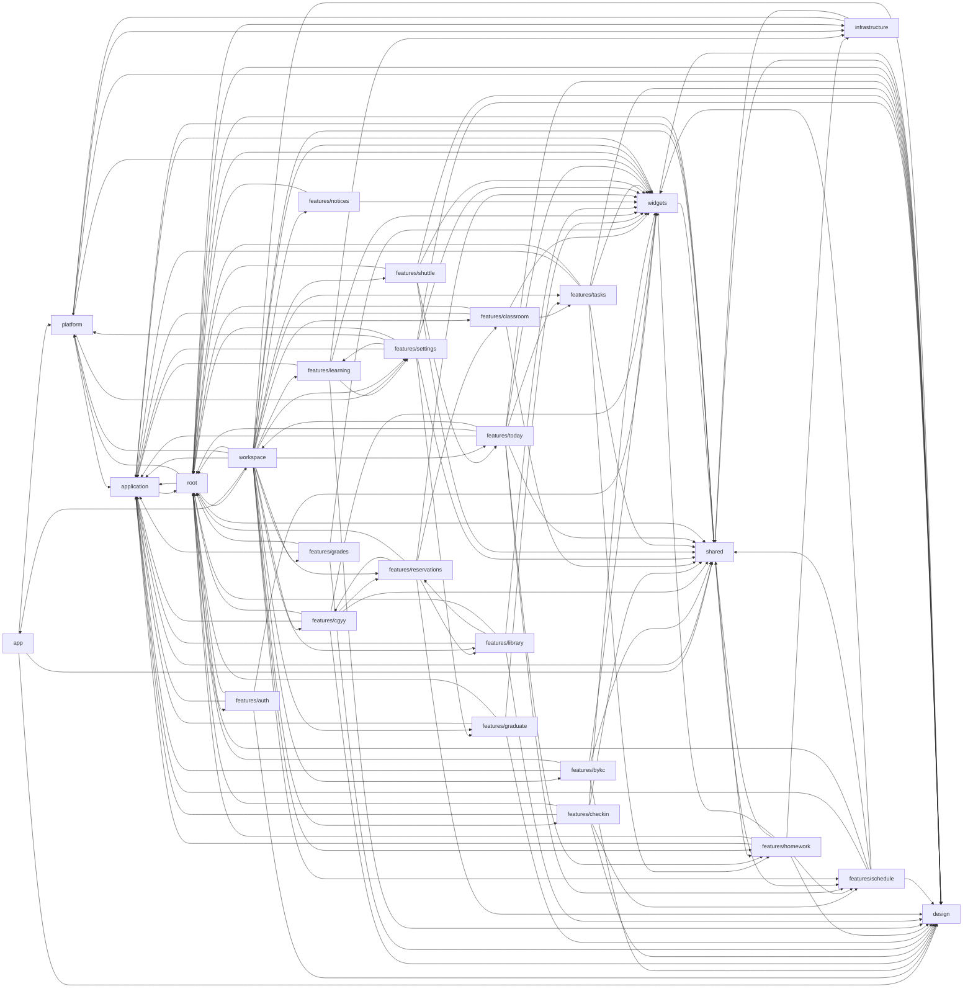
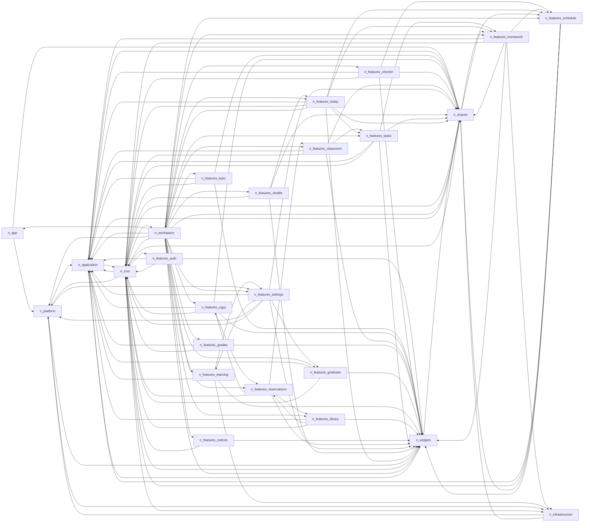

# Flutter 目录依赖图（生成）

> 本文件由 `scripts/generate-interface-index.py` 从源码生成，请勿手工编辑。
> 修改接口后运行 `python3 scripts/generate-interface-index.py` 重新生成；
> 手工总览与分层说明见 [INTERFACE-INDEX.md](../INTERFACE-INDEX.md)。

按目录分组统计：26 个分组节点（其中 25 个有出向依赖）、143 条跨组依赖。箭头方向为「依赖方 → 被依赖方」。

## 依赖图

## 循环依赖

以下分组互相依赖，构成强连通分量。Dart 侧没有像 Rust 那样的依赖方向门禁，因此这些环不会被自动拦截；改动前先确认是否真的需要双向引用。

- **25 个分组**：`app`、`application`、`features/auth`、`features/bykc`、`features/cgyy`、`features/checkin`、`features/classroom`、`features/grades`、`features/graduate`、`features/homework`、`features/learning`、`features/library`、`features/notices`、`features/reservations`、`features/schedule`、`features/settings`、`features/shuttle`、`features/tasks`、`features/today`、`infrastructure`、`platform`、`root`、`shared`、`widgets`、`workspace`

